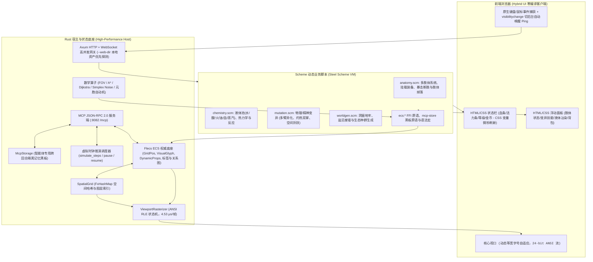

# TextCraft 5.0

TextCraft 5.0 是基于 **Flecs ECS C-Core 状态底座**、**嵌入式 Scheme（Steel）动态脚本层**、**原生高性能 ANSI 光栅化器** 与 **Agent 自动驾驶仿真引擎** 的现代化多人涌现式 Roguelike 游戏引擎。

在 5.0 架构中，系统实现了工业级性能与极客自由度的完美统一：
- **Flecs 权威状态底座（Authoritative Flecs ECS）**：底层采用工业级 Flecs C-Core ECS 管理实体拓扑、标签与关系（如 `PartOf`、`EquippedOn`、`CoveredWith`、`PlayerSession`），结合 `SpatialGrid`（基于 `FxHashMap` 的亚纳秒级坐标哈希）实现超十万实体的微秒级查询与空间检索。
- **原生 ANSI 零拷贝光栅化（Native Sub-5μs Rasterizer）**：将传统脚本层逐格字符串拼接与哈希查找下沉至 Rust 热路径，运用基于颜色状态机的 ANSI RLE 渲染管道，在 10,000+ 实体的大地图中实现 80×24 视口单帧 **4.53 μs** 极速渲染（性能预算 `< 30 μs`）。
- **通用 Roguelike 数学密集算子（Universal Math Operators）**：下沉视野投射（对偶对称阴影投射 Symmetric Recursive Shadowcasting）、A* 网格寻路（防穿墙与步数截断）、全图 BFS Dijkstra 势能场、Simplex 确定性噪声与元胞自动机洞窟扩散算子至 Rust，以 `(ecs:fov ...)` 等优雅原语无缝暴露给 Scheme。
- **类《Caves of Qud》深度涌现机制（Qud Emergence in Pure Scheme）**：100% 纯 Scheme 免编译脚本实现解剖学多肢体树与断肢掉落 (`scripts/anatomy.scm`)、液体热力学相变与酸蚀灭火反应 (`scripts/chemistry.scm`)、多臂/灼热双掌等物理精神变异 (`scripts/mutation.scm`) 以及深度洞窟与盐沼生态生成 (`scripts/worldgen.scm`)。
- **Agent 自动驾驶引擎与无头虚拟推演（Agent Self-Driving & Headless Sim）**：内置无头虚拟时钟步进 (`simulate_steps`)、确定性随机种子 (`seed-prng`)、状态路径掩码投影 (`query_state`)、作用域状态差分 (`state_diff`)、批量自动化断言 (`assert_state`) 与跨回合专用记忆黑板 (`mcp_storage_*`)，全面赋能 AI 智能体自动化回归与时空推演。
- **AI 智能体全透视与在线运维（MCP Tools for AI Agents）**：基于 Model Context Protocol (MCP) JSON-RPC 2.0，提供 `ecs_inspect`、`ecs_query` 与 `ecs_modify` 等权威 ECS 操作工具，并支持通过 `(mcp:def-tool ...)` 在运行期零编译自举扩展全新业务工具。

---

## 1. 架构拓扑 (TextCraft 5.0 Architecture)



---

## 2. 性能实测指标 (v5.0 Benchmarks)

基于真实机器实测数据 (`cargo test --release`)：

| 评测维度 | v5.0 实测成绩 | 目标性能预算 | 达成状态 |
| :--- | :--- | :--- | :--- |
| **80×24 ANSI 视口单帧光栅化** | **4.53 μs** | `< 30.00 μs` | **6.6x 超额达标** |
| **10,000+ 活跃实体生成吞吐量** | **1,667,979 实体/秒** (6.30 ms) | `> 50,000 实体/秒` | **33x 超额达标** |
| **10,000+ 实体主循环 Tick 推进** | **0.49 μs/tick** (60 ticks 29.5 μs) | `< 1,000 μs/tick` | **亚微秒级** |
| **全套自动化测试回归** | **96 / 96 (100% 通过)** | 100% | **全部通过** |
| **静态分析代码质量** | `cargo clippy --all-targets` 0 告警 | 0 告警 | **完美通过** |

---

## 2. 工程模块组织

```text
TextCraft/
  ├── Cargo.toml                    # 极简单一 Crate 配置 (textcraft v5.0.0)
  ├── src/                          # 宿主核心源码 (Tokio + Axum + Steel VM + Flecs)
  │   ├── lib.rs                    # 核心导出、集成测试入口
  │   ├── main.rs                   # 服务端独立入口
  │   ├── ecs/                      # Flecs ECS 底座、物理组件与世界封装
  │   ├── spatial/                  # SpatialGrid 空间哈希与图层索引
  │   ├── render/                   # ViewportRasterizer 原生 ANSI RLE 光栅化
  │   ├── operators/                # Roguelike 数学密集算子 (FOV / A* / Dijkstra / Noise / Cave)
  │   ├── logic/                    # Scheme VM 封装、热重载、看门狗与 ecs_* FFI 原语绑定
  │   ├── runtime.rs                # Axum HTTP + WebSocket 网关、自适应变频主循环、MCP 服务端
  │   └── types.rs                  # 传输层通信协议、MCP 存储黑板数据结构与序列化
  ├── web/
  │   └── index.html                # 极简 Hybrid Web 客户端 (内置 window.TextCraft SDK 与基础 HUD)
  ├── tests/                        # 全量集成测试、无头仿真测试与规模化性能基准 (96 项测试)
  ├── scripts/                      # Steel Scheme 动态脚本层 (自动按序加载)
  │   ├── prelude.scm               # 常量图层、分块兼容、ECS DSL 宏、黑板绑定与 HUD 工具
  │   ├── anatomy.scm               # 解剖学多肢体系统与暴击断肢掉落
  │   ├── chemistry.scm             # 液体池热力学相变与元素化学反应
  │   ├── mutation.scm              # 物理/精神变异与主动能力系统
  │   ├── worldgen.scm              # 程序化洞窟、盐沼与生态种群生成
  │   └── main.scm                  # 回合主循环、网络协议响应与生命周期钩子
  ├── build.sh                      # 本地跨平台打包脚本 (Linux / macOS)
  ├── build.ps1                     # 本地打包脚本 (Windows PowerShell)
  └── docs/
      ├── develop/
      │   ├── scheme_developer_guide.md      # Scheme 游戏逻辑与 Rust-Scheme 交互接口完全开发指南 (v5.0 核心)
      │   ├── agent_developer_guide.md       # 游戏 (Scheme) 与前端 (HUD SDK) Agent 开发者综合指南
      │   ├── mcp_developer_guide.md         # MCP (Model Context Protocol) 开发者与 AI 协同开发指南
      │   ├── steel_scheme_reference.md      # Steel Scheme 0.8.3 内置标准库与核心函数参考手册
      │   └── steel_scheme_best_practices.md # Steel Scheme 代码开发最佳实践
      └── project/                  # 本项目（引擎宿主）开发文档
          ├── v4.0_architecture_and_roadmap.md # v4.0 双引擎架构与演进路线图 (已 100% 达成)
          ├── specification_3.0.0.md           # 引擎 3.0 架构与技术规范 (历史归档)
          ├── agents_3.0.0.md                  # 引擎开发多智能体协作规范 (历史归档)
          └── changelog.md                     # 版本演进与架构变更日志 (v3.0.0 -> v5.0.0)
```

---

## 3. 快速上手

### 3.1 获取源码与环境准备

```bash
# 克隆仓库
git clone https://github.com/ouut/TextCraft.git
cd TextCraft
```

### 3.2 编译与测试

```bash
# 运行全套单元测试、无头仿真与端到端集成测试 (96 项测试 100% 通过)
cargo test

# 代码质量检查 (严格零 Warning)
cargo clippy --all-targets -- -D warnings

# 发布模式编译检查
cargo check --release
```

### 3.3 本地自动化一键打包 (对齐 GitHub Actions)

项目提供了与 GitHub Actions 构建流程完全对齐的本地一键打包脚本，能自动检测本地 OS 与芯片架构，并将单二进制 `server`、`scripts/` 脚本库和文档组装打包至 `dist/` 目录：

```bash
# Linux / macOS (或 Windows Git Bash):
./build.sh

# 运行测试并打包:
./build.sh --test

# Windows PowerShell:
.\build.ps1 -Test
```

打包完成后，产物将生成在 `dist/` 目录：
- Linux: `dist/textcraft-linux-x86_64.tar.gz` (或 arm64)
- macOS: `dist/textcraft-macos-arm64.tar.gz` (或 x86_64)
- Windows: `dist/textcraft-windows-x86_64.zip`
- 同步生成配套的 `.sha256` 完整性校验文件。

### 3.4 启动服务端 (Cargo 启动参数详解)

#### 常用启动场景示例：

```bash
# 1. 默认启动 (全网卡监听 0.0.0.0:8081，默认关闭热重载，日志级别 info)
cargo run

# 2. 开发热重载与调试模式启动 (开启 2s 周期脚本热重载监控 + debug 级别日志)
cargo run -- --watch --log-level debug

# 3. 高性能发布模式启动 (最高性能，适合联机或部署)
cargo run --release

# 4. 指定端口、自定义脚本路径与开启热重载 (-w)
cargo run -- -w --port 8888 --scripts-dir scripts

# 5. 生产高可用启动 (带世界状态持久化与自动定时存档，每 30 秒存档一次)
cargo run --release -- \
  --host 0.0.0.0 \
  --port 8081 \
  --save-file world_save.json \
  --autosave-sec 30

# 6. 自定义管理员 Token 与时钟加速倍率 (双倍速运行)
cargo run -- \
  --admin-token my_super_secret \
  --time-scale 2.0

# 7. 开启 AI 协同开发 MCP HTTP JSON-RPC 2.0 服务端 (监听 8082 端口 + 2s 热重载)
cargo run -- --port 8081 --mcp-port 8082 -w --log-level debug
```

#### CLI 完整参数说明表：

| 参数选项 (CLI Flag) | 对应配置项 | 类型 | 默认值 | 详细说明 |
|---|---|---|---|---|
| `--host <ip>` | `host` | `String` | `0.0.0.0` | 绑定监听地址。`0.0.0.0` 允许本机与局域网设备同时访问 |
| `--port <port>` | `port` | `u16` | `8081` | 监听 HTTP Web 资源与 WebSocket 网关服务端口 |
| `--mcp-port <port>` | `mcp_port` | `Option<u16>` | `None` | 可选的 MCP (Model Context Protocol) HTTP JSON-RPC 2.0 监听端口（如 `8082`，详见 [`docs/develop/mcp_developer_guide.md`](docs/develop/mcp_developer_guide.md)） |
| `--web-dir <path>` | `web_dir` | `Option<PathBuf>` | `None` | 自定义 Web 静态资源目录（覆盖内嵌资源；未指定时自动探测本地 `./web` 或程序同级目录，不存在则兜底使用编译期内嵌资源） |
| `--scripts-dir <path>` | `scripts_dir` | `PathBuf` | `scripts` | Scheme 脚本所在目录（必须包含 `prelude.scm` 与 `main.scm`） |
| `-w, --watch` | `watch` | `bool` | `false` | 开启 Scheme 脚本自动热重载监控（每 2 秒轮询一次，修改保存后无损状态自动重载；默认关闭零开销） |
| `--log-level <level>` | `log_level` | `LogLevel` | `info` | 日志输出级别（枚举：`error`、`warn`、`info`、`debug`、`trace`；若显式设置 `RUST_LOG` 环境变量则优先遵循 `RUST_LOG`） |
| `--time-scale <scale>` | `time_scale` | `f32` | `1.0` | 模拟时钟流逝倍率（例如 `2.0` 表示双倍速流逝，`0.5` 表示半速） |
| `--admin-token <token>` | `admin_token` | `String` | `admin` | 管理员认证 Token。在游戏控制台输入以 `!` 开头的指令进行 REPL 求值 |
| `--save-file <path>` | `save_file` | `PathBuf` | `None` | 世界纯数据状态存档路径（原子保存与断点恢复；未指定则不落盘） |
| `--autosave-sec <sec>` | `autosave_sec` | `u64` | `30` | 自动定时存档周期（单位：秒；设为 `0` 时禁用自动存档） |
| `--heartbeat-timeout-secs <sec>` | `heartbeat_timeout_secs` | `u64` | `30` | 活跃客户端心跳超时时间（单位：秒；超时后进入断线宽限期；默认 30 秒） |
| `--snapshot-heartbeat-ms <ms>` | `snapshot_heartbeat_ms` | `u64` | `1000` | 快照保活心跳周期（毫秒；静止状态去重跳过，达到周期强制推流保活；设为 `0` 禁用去重） |
| `-h, --help` | - | - | - | 打印命令行帮助信息与选项详情 |
| `-V, --version` | - | - | - | 打印当前 TextCraft 版本号 (`5.0.0`) |

---

## 4. 游戏客户端连接与交互指南

服务启动后，使用任意现代桌面或移动浏览器直接访问：  
👉 **`http://127.0.0.1:8081`**（局域网用户访问 **`http://<服务器IP>:8081`**）

页面加载后将自动通过 WebSocket 握手进入游戏。

### 4.0 多用户与管理员 URL 路由 (`#/username/token`)
TextCraft 5.0 前端内置 `resolveClientIdentity()`，支持通过 URL 直接指定用户名与认证 Token，非常适合**单浏览器多标签页联机调试**或快速登录管理员：
- **默认访问**：`http://127.0.0.1:8081` — 自动读取或生成 `localStorage` 中的持久化角色（`textcraft_user`）。
- **指定普通玩家（推荐 Hash 路由）**：
  - `http://127.0.0.1:8081/#/alice` — 以用户名 `alice` 登录（无特权 Token，不覆盖 `localStorage`，可在不同标签页同时打开 `#/alice`、`#/bob` 互不串号，且在地址栏直接修改 Hash 会自动重连切换角色）。
- **指定管理员玩家**：
  - `http://127.0.0.1:8081/#/alice/admin` — 以用户名 `alice` 登录并携带管理员 Token `admin`，可在底部命令框使用 `!` 前缀执行在线 Scheme REPL 求值。
- **其他兼容格式**：同样支持 `http://127.0.0.1:8081/?/alice/admin`、`?user=alice&token=admin` 或旧版 `?token=admin`。

### 4.1 核心视口与自适应字号
- 游戏主界面 `<pre id="screen">` 锁死 `white-space: pre; overflow: hidden;`。
- 前端根据快照中的 `cols`（默认 80）与 `rows`（默认 24）动态计算最佳等宽字体尺寸：
  $$\text{fontSize} = \min\left(\frac{W_{\text{window}}}{\text{cols}} \times 1.6, \frac{H_{\text{window}}}{\text{rows}}\right)$$
- 无论窗口大小或屏幕宽高比如何变动，字符视口均保持 Letterbox 居中铺满、永不换行撕裂。
- **切后台智能保活与唤醒**：客户端监听 `visibilitychange` 与 `window.focus` 事件，当标签页重新激活时自动发送 Ping 探活并请求即时快照，彻底解决移动端/后台标签页被浏览器节流导致的幽灵掉线。

### 4.2 浮动 HUD 与操作按键
- **键盘移动**：`W` / `A` / `S` / `D` 或方向键控制角色移动与探索。
- **UI 动作（物品使用）**：直接点击右侧背包栏中的物品（如生命药水 🧪），触发 `ui_action: use_item`，直接消耗药水恢复 HP 并在日志栏记录战斗事件。所有点击事件自动执行 `blur()`，全局 WASD 控制焦点永不丢失。
- **命令行输入**：点击底部输入框或按 `:` 输入 Scheme 指令，回车发送：
  - `(help)`：查看可用指令列表
  - `(where)`：查询当前所在世界坐标 `(x, y)`
  - `(heal)`：恢复全额生命值与魔法值
  - `(fps 60)` / `(fps 30)` / `(fps 15)`：动态设定游戏目标帧率
  - `(theme "cyberpunk")` / `(theme "retro-terminal")` / `(theme "classic-rpg")` / `(theme "minimal")`：动态切换 HUD 风格
- **管理员实时 REPL**：输入以 `!` 开头的指令（如 `! (+ 100 200)`、`! (set-player 1 ...)`），若连接 Token 与 `--admin-token` 匹配，将直接在虚拟机全局环境执行并返回结果；非管理员将被安全拒绝。

---

## 5. Scheme 引擎核心生命周期契约

Scheme 主脚本需实现以下标准生命周期函数：

| 函数签名 | 触发时机 | 职责说明 |
|---|---|---|
| `(engine:target-fps)` | 每次时钟调度前 | 返回当前目标帧率（1 ~ 60），宿主据此动态调整睡眠节拍（缺省默认 60） |
| `(engine:viewport-size pid)` | 视口渲染前 | 返回 `(list cols rows)`，动态定义该玩家当前屏幕行列大小（缺省默认 80×24） |
| `(engine:hud-config)` | 握手与主题同步 | 返回 HUD 主题配置（如 `"theme": "cyberpunk"`） |
| `(engine:on-init)` | 引擎启动时 | 初始化 `*world-state*` 地图分块、实体与初始数据 |
| `(engine:on-player-join pid token)` | 玩家建立连接 | 解析 `username:token`，清理同身份旧连接，恢复存档或创建角色并置 `"online" #t` |
| `(engine:on-player-disconnect pid)` | 玩家断线进入宽限期 | 将玩家 `"online"` 标记为 `#f`（保留内存态但从他人视口与 AI 索敌中隐藏，不删档） |
| `(engine:on-player-reconnect pid)` | 宽限期内恢复连接 | 将玩家 `"online"` 恢复为 `#t` 并立即重推最新快照（不重复刷欢迎日志） |
| `(engine:on-player-leave pid)` | 宽限期超时彻底离开 | 归档角色数据至 `"saved_players"` 并从活跃表 `"players"` 物理移除 |
| `(engine:on-tick dt tick-id)` | 主时钟心跳 | 更新世界演化、怪物巡逻与战斗 AI、状态结算与无操作降频 |
| `(engine:on-input pid input-map)` | 接收按键/鼠标 | 处理角色位移与交互动作 |
| `(engine:on-ui-action pid action-map)`| 接收 HUD 交互 | 处理点击背包、对话关闭、视口变更等 UI 交互 |
| `(engine:on-command pid datum raw)` | 接收控制台指令 | 安全解析玩家聊天或游戏命令 |
| `(engine:render-snapshot pid)` | 每帧推流前 | 必须返回 `(hash "screen" ansi-str "cols" w "rows" h "hud" hud-map)` |
| `(engine:export-state)` | 存档/热重载前 | 将 `*world-state*` 导出为纯 JSON 兼容纯数据树 |
| `(engine:import-state data)` | 读档/热重载后 | 恢复全局纯数据状态 |

### 宿主注入函数 (Host Functions)

Rust 宿主向 Scheme 运行环境注册了系统级日志、随机数与广播原语，并在 v5.0 中全面注入了 Flecs ECS、Roguelike 数学密集算子与专用 MCP 黑板存储：
- 通用基础：`(engine:send-message pid channel text)`、`(engine:broadcast channel text)`、`(engine:log text)`、`(engine:random-int min max)`、`(engine:strip-ansi text)`
- ECS 状态管理：`(ecs:spawn)`、`(ecs:despawn id)`、`(ecs:set-pos id x y layer)`、`(ecs:get-pos id)`、`(ecs:set-glyph id ch fg bg solid opaque)`、`(ecs:set id key val)`、`(ecs:get id key)`、`(ecs:relate id rel target)`、`(ecs:query query-str)` 等
- 通用数学算子：`(ecs:fov origin-x origin-y radius)`、`(ecs:find-path start-x start-y goal-x goal-y)`、`(ecs:dijkstra-map goals)`、`(ecs:noise-2d x y scale)`、`(ecs:generate-cave w h iterations fill-prob)`
- 仿真与黑板：`(engine:mcp-store-get key [ns])`、`(engine:mcp-store-set key val [ns])`、`(engine:mcp-store-keys [ns])`、`(engine:mcp-store-delete key [ns])`、`(engine:seed-prng seed)`

> [!TIP]
> **完整 Rust-Scheme FFI 与开发指南**：
> 有关 5.0 详细的原语参数签名、类型映射、DSL 宏、Qud 涌现机制与 MCP 在线调试实战，请参阅专门文档：[**《Scheme 游戏逻辑与 Rust-Scheme 交互接口完全开发指南》 (`docs/develop/scheme_developer_guide.md`)**](docs/develop/scheme_developer_guide.md)。

---

## 6. 全平台发布包 (Releases)

GitHub Actions CI 流水线为 Linux、macOS 与 Windows 构建开箱即用的便携发行包：
- Linux: `textcraft-linux-x86_64.tar.gz`
- macOS (Apple Silicon): `textcraft-macos-arm64.tar.gz`
- Windows: `textcraft-windows-x86_64.zip`

解压后包内目录结构如下：
```text
textcraft/
  ├── server (.exe)                  # 单二进制独立运行程序 (内置 Web 终端与 MCP 服务端)
  ├── scripts/                       # Scheme 核心引擎脚本
  │   ├── prelude.scm                # 基础宏与 MCP 注册表
  │   ├── anatomy.scm                # 解剖学多肢体系统
  │   ├── chemistry.scm              # 液体与热力学系统
  │   ├── mutation.scm               # 变异能力系统
  │   ├── worldgen.scm               # 程序化世界生成
  │   └── main.scm                   # 游戏主入口与交互管道
  ├── docs/                          # 开发者完整文档
  │   └── develop/
  │       ├── scheme_developer_guide.md
  │       ├── agent_developer_guide.md
  │       ├── mcp_developer_guide.md
  │       ├── steel_scheme_reference.md
  │       └── steel_scheme_best_practices.md
  └── README.md                      # 使用说明
```

启动命令：
```bash
./server
```
即可在浏览器中开启 TextCraft 5.0 的冒险世界！
