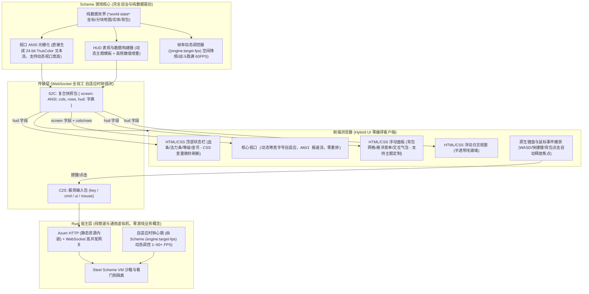

# TextCraft 3.0

TextCraft 3.0 是基于 Rust 宿主网关与嵌入式 Scheme（Steel）的高性能多人混合 UI（Hybrid UI）字符网格游戏引擎。

在 3.0 架构中，系统进行了彻底的范式重构与能力跃升：
- **零 Rust 业务结构体（Zero Rust Game Structs）**：物理移除 Rust 层所有硬编码游戏数据结构（如 `GridCoord`、`ViewportRect`、`RenderLayer`、`TileSemantic`、`LogicalClock` 等），游戏世界坐标、16×16 分块地图、实体属性、碰撞战斗与光栅化算法完全由 Scheme 纯数据与算法驱动。Rust 宿主退居为通用的 Scheme 虚拟机容器、高并发网络网关与自适应调度器。
- **现代化混合 UI 渲染（Hybrid UI）**：核心战场采用 `<pre id="screen">` 承载 24-bit TrueColor ANSI 极速字符流，前端实现等宽字号自适应缩放（Letterbox 自动居中、零重排、零换行撕裂）；环绕式浮动 HUD 采用现代化 HTML/CSS 毛玻璃层呈现血条、法力条、背包网格与日志视窗，支持 CSS 变量微秒级刷新与多套主题定制。
- **自适应动态帧率控制（Adaptive Dynamic FPS）**：Scheme 脚本全权决定目标帧率（1 ~ 60+ FPS）。激烈战斗或移动时跑满 60 FPS，挂机静止或纯剧情交互时自动降频至 15~30 FPS，Rust 宿主按 Scheme 声明动态调节 Tokio 节拍间隔。
- **极致单二进制部署（Zero-Build）**：单一服务端可执行文件集成 Axum HTTP、WebSocket 协议桥接、内嵌单文件 Web 客户端与 Scheme 运行时，零外部编译打包依赖，开箱即用。

---

## 1. 架构拓扑 (Hybrid UI & Pure Scheme Architecture)



---

## 2. 工程模块组织

```text
TextCraft/
  ├── Cargo.toml                    # 极简单一 Crate 配置 (textcraft v3.0.0)
  ├── src/                          # 宿主核心源码 (Tokio + Axum + Steel VM)
  │   ├── lib.rs                    # 核心导出、单元测试与生命周期集成
  │   ├── main.rs                   # 服务端独立入口
  │   ├── logic.rs                  # Scheme VM 封装、热重载、看门狗与宿主函数
  │   ├── runtime.rs                # Axum 静态资源嵌入、WebSocket 网关与自适应调度
  │   └── types.rs                  # 传输层极简协议 (PlayerInput, PlayerSnapshot, Event)
  ├── web/
  │   └── index.html                # 单文件现代化 Hybrid Web Terminal (CSS/JS 内嵌)
  ├── tests/
  │   ├── integration_tests.rs      # 8 个端到端集成测试套件
  │   └── server_gateway_test.rs    # 2 个服务端网关与生命周期测试
  ├── scripts/
  │   ├── prelude.scm               # 16x16 Chunk 分块存储、ANSI 光栅化器与 HUD 构建器
  │   └── main.scm                  # 地图生成、碰撞检测、战斗伤害、AI 与变频控制
  ├── build.sh                      # 本地跨平台打包脚本 (Linux / macOS)
  ├── build.ps1                     # 本地打包脚本 (Windows PowerShell)
  └── docs/                         # 规范文档 (specification_3.0.0.md, agents_3.0.0.md)
```

---

## 3. 快速上手

### 3.1 获取源码与环境准备

```bash
# 克隆仓库
git clone https://github.com/ouut/TextCraft.git
cd TextCraft
```

### 3.2 编译与测试

```bash
# 运行全套单元测试与端到端集成测试 (10 个单元测试 + 10 个端到端集成测试)
cargo test

# 代码质量检查 (严格零 Warning)
cargo clippy --all-targets -- -D warnings

# 发布模式编译检查
cargo check --release
```

### 3.3 本地自动化一键打包 (对齐 GitHub Actions)

项目提供了与 GitHub Actions 构建流程完全对齐的本地一键打包脚本，能自动检测本地 OS 与芯片架构，并将单二进制 `server`、`scripts/` 脚本库和文档组装打包至 `dist/` 目录：

```bash
# Linux / macOS (或 Windows Git Bash):
./build.sh

# 运行测试并打包:
./build.sh --test

# Windows PowerShell:
.\build.ps1 -Test
```

打包完成后，产物将生成在 `dist/` 目录：
- Linux: `dist/textcraft-linux-x86_64.tar.gz` (或 arm64)
- macOS: `dist/textcraft-macos-arm64.tar.gz` (或 x86_64)
- Windows: `dist/textcraft-windows-x86_64.zip`
- 同步生成配套的 `.sha256` 完整性校验文件。

### 3.4 启动服务端 (Cargo 启动参数详解)

#### 常用启动场景示例：

```bash
# 1. 默认启动 (全网卡监听 0.0.0.0:8081，加载 scripts/ 目录并自动启用 Scheme 热重载)
cargo run

# 2. 高性能发布模式启动 (最高性能，适合联机或部署)
cargo run --release

# 3. 开发调试模式 (启用完整 tracing 详细日志输出)
RUST_LOG=info,textcraft=debug cargo run

# 4. 指定端口与自定义脚本路径
cargo run -- --port 8888 --scripts-dir scripts

# 5. 生产高可用启动 (带世界状态持久化与自动定时存档，每 30 秒存档一次)
cargo run --release -- \
  --host 0.0.0.0 \
  --port 8081 \
  --save-file world_save.json \
  --autosave-sec 30

# 6. 自定义管理员 Token 与时钟加速倍率 (双倍速运行)
cargo run -- \
  --admin-token my_super_secret \
  --time-scale 2.0
```

#### CLI 完整参数说明表：

| 参数选项 (CLI Flag) | 对应配置项 | 类型 | 默认值 | 详细说明 |
|---|---|---|---|---|
| `--host <ip>` | `host` | `String` | `0.0.0.0` | 绑定监听地址。`0.0.0.0` 允许本机与局域网设备同时访问 |
| `--port <port>` | `port` | `u16` | `8081` | 监听 HTTP Web 资源与 WebSocket 网关服务端口 |
| `--scripts-dir <path>` | `scripts_dir` | `PathBuf` | `scripts` | Scheme 脚本所在目录（必须包含 `prelude.scm` 与 `main.scm`） |
| `--no-watch-scripts` | `no_watch_scripts` | `bool` | `false` | 关闭脚本文件变动自动热重载（默认开启，脚本修改后即刻生效） |
| `--time-scale <scale>` | `time_scale` | `f32` | `1.0` | 模拟时钟流逝倍率（例如 `2.0` 表示双倍速流逝，`0.5` 表示半速） |
| `--admin-token <token>` | `admin_token` | `String` | `admin` | 管理员认证 Token。在游戏控制台输入以 `!` 开头的指令进行 REPL 求值 |
| `--save-file <path>` | `save_file` | `PathBuf` | `None` | 世界纯数据状态存档路径（原子保存与断点恢复；未指定则不落盘） |
| `--autosave-sec <sec>` | `autosave_sec` | `u64` | `30` | 自动定时存档周期（单位：秒；设为 `0` 时禁用自动存档） |
| `-h, --help` | - | - | - | 打印命令行帮助信息与选项详情 |
| `-V, --version` | - | - | - | 打印当前 TextCraft 版本号 (`3.0.0`) |

---

## 4. 游戏客户端连接与交互指南

服务启动后，使用任意现代桌面或移动浏览器直接访问：  
👉 **`http://127.0.0.1:8081`**（局域网用户访问 **`http://<服务器IP>:8081`**）

页面加载后将自动通过 WebSocket 握手进入游戏。

### 4.1 核心视口与自适应字号
- 游戏主界面 `<pre id="screen">` 锁死 `white-space: pre; overflow: hidden;`。
- 前端根据快照中的 `cols`（默认 80）与 `rows`（默认 24）动态计算最佳等宽字体尺寸：
  $$\text{fontSize} = \min\left(\frac{W_{\text{window}}}{\text{cols}} \times 1.6, \frac{H_{\text{window}}}{\text{rows}}\right)$$
- 无论窗口大小或屏幕宽高比如何变动，字符视口均保持 Letterbox 居中铺满、永不换行撕裂。

### 4.2 浮动 HUD 与操作按键
- **键盘移动**：`W` / `A` / `S` / `D` 或方向键控制角色移动与探索。
- **UI 动作（物品使用）**：直接点击右侧背包栏中的物品（如生命药水 🧪），触发 `ui_action: use_item`，直接消耗药水恢复 HP 并在日志栏记录战斗事件。所有点击事件自动执行 `blur()`，全局 WASD 控制焦点永不丢失。
- **命令行输入**：点击底部输入框或按 `:` 输入 Scheme 指令，回车发送：
  - `(help)`：查看可用指令列表
  - `(where)`：查询当前所在世界坐标 `(x, y)`
  - `(heal)`：恢复全额生命值与魔法值
  - `(fps 60)` / `(fps 30)` / `(fps 15)`：动态设定游戏目标帧率
  - `(theme "cyberpunk")` / `(theme "retro-terminal")` / `(theme "classic-rpg")` / `(theme "minimal")`：动态切换 HUD 风格
- **管理员实时 REPL**：输入以 `!` 开头的指令（如 `! (+ 100 200)`、`! (set-player 1 ...)`），若连接 Token 与 `--admin-token` 匹配，将直接在虚拟机全局环境执行并返回结果；非管理员将被安全拒绝。

---

## 5. Scheme 引擎核心生命周期契约

Scheme 主脚本需实现以下标准生命周期函数：

| 函数签名 | 触发时机 | 职责说明 |
|---|---|---|
| `(engine:target-fps)` | 每次时钟调度前 | 返回当前目标帧率（1 ~ 60），宿主据此动态调整睡眠节拍 |
| `(engine:viewport-size pid)` | 视口渲染前 | 返回 `(list cols rows)`，动态定义该玩家当前屏幕行列大小 |
| `(engine:hud-config)` | 握手与主题同步 | 返回 HUD 主题配置（如 `"theme": "cyberpunk"`） |
| `(engine:on-init)` | 引擎启动时 | 初始化 `*world-state*` 地图分块、实体与初始数据 |
| `(engine:on-player-join pid token)` | 玩家建立连接 | 为玩家分配角色属性、坐标与初始背包 |
| `(engine:on-player-leave pid)` | 玩家断开连接 | 保存角色状态或清理场景实例 |
| `(engine:on-tick dt tick-id)` | 主时钟心跳 | 更新世界演化、怪物巡逻与战斗 AI、状态结算与无操作降频 |
| `(engine:on-input pid input-map)` | 接收按键/鼠标 | 处理角色位移与交互动作 |
| `(engine:on-ui-action pid action-map)`| 接收 HUD 交互 | 处理点击背包、对话关闭、视口变更等 UI 交互 |
| `(engine:on-command pid datum raw)` | 接收控制台指令 | 安全解析玩家聊天或游戏命令 |
| `(engine:render-snapshot pid)` | 每帧推流前 | 必须返回 `(hash "screen" ansi-str "cols" w "rows" h "hud" hud-map)` |
| `(engine:export-state)` | 存档/热重载前 | 将 `*world-state*` 导出为纯 JSON 兼容纯数据树 |
| `(engine:import-state data)` | 读档/热重载后 | 恢复全局纯数据状态 |

### 宿主注入函数 (Host Functions)

Rust 宿主向 Scheme 运行环境注册了以下通用系统功能：
- `(engine:send-message pid channel text)`：向指定玩家发送事件通知
- `(engine:broadcast channel text)`：向全服广播事件通知
- `(engine:log text)`：在服务端输出 tracing 日志
- `(engine:random-int min max)`：生成范围内的安全伪随机整数

---

## 6. 全平台发布包 (Releases)

GitHub Actions CI 流水线为 Linux、macOS 与 Windows 构建开箱即用的便携发行包：
- Linux: `textcraft-linux-x86_64.tar.gz`
- macOS (Apple Silicon): `textcraft-macos-arm64.tar.gz`
- Windows: `textcraft-windows-x86_64.zip`

解压后包内目录结构如下：
```text
textcraft/
  ├── server (.exe)         # 单二进制独立运行程序
  ├── scripts/              # Scheme 核心引擎脚本
  │   ├── prelude.scm
  │   └── main.scm
  └── README.md             # 使用说明
```

启动命令：
```bash
./server
```
即可在浏览器中开启 TextCraft 3.0 的冒险世界！
