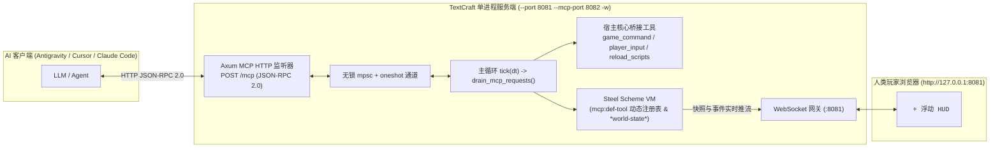

# TextCraft 3.0: MCP (Model Context Protocol) 开发者与 AI 协同开发指南

> [!IMPORTANT]
> **TextCraft MCP 核心设计哲学**：
> TextCraft 采用 **「单进程 `--mcp-port` HTTP JSON-RPC 2.0 管道 + 复用现有游戏命令与输入系统 + Scheme 动态可扩展 MCP 工具注册表」** 架构。
> - **同进程实时同屏**：AI 客户端通过 HTTP 连接正在运行的游戏服务端，AI 的每一次指令、传送、刷怪或代码热改都会在人类玩家的浏览器视口与 HUD 日志中毫秒级同步展现！
> - **零编译动态造工具**：AI 与开发者无需修改或重新编译任何 Rust 代码，只需在 `scripts/*.scm`（或在线 `!` REPL）中调用 `(mcp:def-tool ...)` 即可随时扩展全新的 MCP 工具！

---

## 一、 架构原理与数据流拓扑



### 为什么采用单进程 `--mcp-port` 通道转发？
1. **绝对线程安全与零锁竞争**：`SchemeLogic`（内含 Steel VM 与 `*world-state*`）驻留在主循环线程。Axum MCP HTTP Handler 收到 JSON-RPC 2.0 请求后，通过 `mpsc::unbounded_channel` 将请求投递给主循环，并在 `TextCraftServer::tick()` 的 `drain_mcp_requests()` 阶段顺序执行，彻底消除多线程并发读写虚拟机状态的竞态风险。
2. **与浏览器玩家共享同一世界**：传统 Stdio MCP 会启动一个孤立的子进程，导致 AI 看不到浏览器中正在游玩的玩家。通过 `--mcp-port 8082`，AI 直接接入人类玩家所在的同一个内存世界。
3. **ANSI 自动剥离（Token 极简友好）**：游戏推给浏览器的是带 24-bit TrueColor ANSI 转义序列的字符流，而 MCP 接口通过 `strip_ansi_codes`（及 Scheme 宿主函数 `(engine:strip-ansi str)`）自动剥离颜色控制码，向大模型返回干净紧凑的纯文本 ASCII 2D 网格画面。

---

## 二、 启动与 AI 客户端配置指南

### 2.1 启动带 MCP 端口与热重载的服务端

在开发与 AI 结对编程时，推荐同时开启 `--mcp-port` 与 `-w`（2 秒周期脚本热重载）：

```bash
cargo run -- --port 8081 --mcp-port 8082 -w --log-level debug
```

启动成功后：
- **浏览器游戏入口**：`http://127.0.0.1:8081`（例如访问 `http://127.0.0.1:8081/#/alice/admin`）
- **MCP HTTP JSON-RPC 2.0 端点**：`http://127.0.0.1:8082/mcp`（同时兼容根路径 `http://127.0.0.1:8082/`）

### 2.2 在 AI 客户端中配置 TextCraft MCP Server

#### Antigravity / Cursor / Windsurf (`mcp_config.json` 或 `.cursor/mcp.json`)

```json
{
  "mcpServers": {
    "textcraft": {
      "url": "http://127.0.0.1:8082/mcp"
    }
  }
}
```

#### Claude Code CLI

```bash
claude mcp add --transport http textcraft http://127.0.0.1:8082/mcp
```

#### 使用 `curl` 手动验证 MCP 接口

```bash
# 1. MCP 握手初始化 (initialize)
curl -s -X POST http://127.0.0.1:8082/mcp \
  -H "Content-Type: application/json" \
  -d '{"jsonrpc":"2.0","id":1,"method":"initialize","params":{}}'

# 2. 获取所有可用工具列表 (包含宿主桥接工具 + Scheme 动态工具)
curl -s -X POST http://127.0.0.1:8082/mcp \
  -H "Content-Type: application/json" \
  -d '{"jsonrpc":"2.0","id":2,"method":"tools/list","params":{}}'
```

---

## 三、 宿主核心桥接工具：直接复用游戏命令与输入管线

Rust 宿主层内置了 **15 个永不失效的核心宿主工具**（即使 `.scm` 脚本被改坏，AI 依然可以通过它们修复并重载脚本，或执行单步无头推演与专用 MCP 存储黑板存取）：

### 1. `game_command` —— 复用游戏底部命令输入框与 `!` 管理员 REPL
直接复用游戏内命令输入管线，支持两种模式：
- **普通游戏命令**（不以 `!` 开头）：调用 `logic.on_command(player_id, command)`，执行后自动返回该玩家最新的纯文本 `ascii_screen` 视口与 `hud` 状态。
  ```json
  {
    "name": "game_command",
    "arguments": {
      "player_id": 1,
      "command": "(where)"
    }
  }
  ```
  常用内置命令：`(help)`、`(where)`、`(heal)`、`(say "你好！")`、`(dw)`、`(fps 60)`、`(theme "cyberpunk")`。
- **Scheme 实时 REPL 求值**（以 `!` 开头）：直接调用 `logic.eval_repl(code)` 在虚拟机全局环境中求值任意 Scheme 表达式并返回结果（拥有最高宿主权限，无需玩家在线 Token 鉴权）：
  ```json
  {
    "name": "game_command",
    "arguments": {
      "command": "! (set-player 1 (hash-insert (ensure-player 1) \"gold\" 9999))"
    }
  }
  ```

### 2. `player_input` —— 模拟玩家键盘移动、UI 点击与鼠标交互
直接复用 `process_player_input(player_id, input)`，模拟玩家操作并返回执行后的纯文本 `ascii_screen` 与 `hud`：
- **模拟按键移动/交互 (`type: "key"`)**：
  ```json
  {
    "name": "player_input",
    "arguments": {
      "player_id": 1,
      "type": "key",
      "code": "KeyD"
    }
  }
  ```
- **模拟 HUD 动作 (`type: "ui"`)**：
  ```json
  {
    "name": "player_input",
    "arguments": {
      "player_id": 1,
      "type": "ui",
      "action": "use_item",
      "payload": { "id": "potion" }
    }
  }
  ```

### 3. `reload_scripts` —— 强制无损热重载 `.scm` 脚本
无视 `--watch` 开关或 2 秒轮询间隔，立即扫描并重编译 `scripts/` 下的 `.scm` 文件（自动导出并恢复 `*world-state*`）：
- 编译成功返回 `"Reloaded successfully"`（`isError: false`）；
- 若新脚本存在括号不匹配等语法错误，自动回滚世界状态并返回详细编译错误栈（`isError: true`），方便 AI 改完 `.scm` 文件后立即自检修复。

### 4. `pause_clock` 与 `resume_clock` —— 虚拟模拟时钟暂停与恢复
- `pause_clock`: 将主物理时钟暂停。世界 `tick(dt)` 推进立即停止，但 WebSocket 网络消息收发、心跳与 MCP 请求正常保活，方便 AI 介入冻结现场并执行精确诊断。
- `resume_clock`: 恢复物理时钟定时驱动。

### 5. `step_simulation` —— 虚拟时钟多步推演与操作序列注入
支持以任意步长 `dt` 单步或连续推演指定步数 `steps`，并在特定步数安全注入操作序列：
```json
{
  "name": "step_simulation",
  "arguments": {
    "steps": 1,
    "dt": 0.016,
    "inputs": [
      {
        "step": 0,
        "player_id": 1,
        "type": "key",
        "code": "KeyD"
      }
    ],
    "include_snapshot": true,
    "snapshot_player_id": 1,
    "include_state_diff": true
  }
}
```
返回包含 `steps_executed`、`final_tick`、`duration_ms`，以及可选的 ANSI 视口快照和状态微秒级 Diff。

### 6. `get_state_diff` —— 轻量级微秒级状态差分比较
对比前后两个 JSON 状态树或当前内存世界状态，以扁平化路径输出：
- `changed`: 如 `"players.1.x": { "old": 5, "new": 6 }`
- `added`: 如 `"players.2": { ... }`
- `removed`: 如 `"score": 0`
避免大模型处理全量巨型状态，极度节省 Context Token。

### 7. `eval_assertion` —— 游戏断言执行器 (TDD 单元测试)
在带有看门狗保护的 Scheme 沙箱中求值断言表达式：
- 若表达式求值为非 `#f`，返回 `{"passed": true, "result": ...}`；
- 若表达式求值为 `#f` 或发生 Scheme 异常，返回 `{"passed": false, "error": "..."}`。
使 Agent 具备开箱即用的测试驱动开发（TDD）闭环能力。

### 8. `mcp_store_set` —— 写入专用 MCP 存储 / 智能体黑板
在 Rust 宿主专用内存存储（Blackboard）中存储或更新任意 JSON 数据，完全不污染游戏脚本的业务状态或正常游戏存档：
```json
{
  "name": "mcp_store_set",
  "arguments": {
    "key": "exploration_plan",
    "value": { "phase": 1, "target": "dungeon_north", "rooms_visited": [101, 102] },
    "namespace": "agent_alpha"
  }
}
```
- 参数：`key: string`（必需），`value: any`（必需，任意基本类型/对象/数组），`namespace?: string`（可选命名空间，默认 `"default"`）。

### 9. `mcp_store_get` —— 读取专用 MCP 存储数据项
根据键名和可选命名空间获取数据。若不存在返回 `{"found": false, "value": null}`：
```json
{
  "name": "mcp_store_get",
  "arguments": {
    "key": "exploration_plan",
    "namespace": "agent_alpha"
  }
}
```

### 10. `mcp_store_delete` —— 删除专用 MCP 存储数据项
从专用存储中删除指定数据项：
```json
{
  "name": "mcp_store_delete",
  "arguments": {
    "key": "exploration_plan",
    "namespace": "agent_alpha"
  }
}
```

### 11. `mcp_store_list` —— 列出指定命名空间或匹配前缀的键
列出当前专用存储中的所有键，支持按命名空间过滤或按前缀过滤：
```json
{
  "name": "mcp_store_list",
  "arguments": {
    "namespace": "agent_alpha",
    "prefix": "explor"
  }
}
```

### 12. `mcp_store_clear` —— 清空专用存储
清空专用存储中全部数据，或仅清空指定命名空间下的数据：
```json
{
  "name": "mcp_store_clear",
  "arguments": {
    "namespace": "agent_alpha"
  }
}
```

### 13. `mcp_store_export` —— 导出专用 MCP 存储
将专用存储完整备份至磁盘文件：
```json
{
  "name": "mcp_store_export",
  "arguments": {
    "path": "backups/agent_memory.json"
  }
}
```

### 14. `mcp_store_import` —— 导入专用 MCP 存储
从磁盘文件恢复专用存储（支持 `overwrite` 覆盖或合并）：
```json
{
  "name": "mcp_store_import",
  "arguments": {
    "path": "backups/agent_memory.json",
    "overwrite": true
  }
}
```

---

## 四、 Scheme 动态 MCP 工具系统 (`mcp:def-tool`)

### 4.1 核心范式：时光机快照与回滚的 Scheme 纯脚本自举实现

TextCraft 贯彻**「机制在宿主，策略与功能在脚本」**的极简架构哲学。时光机快照与状态回滚功能完全不需要在 Rust 宿主硬编码死接口，而是由 Scheme 脚本在内存中自管理 `*checkpoints*` 字典，并通过 `(mcp:def-tool ...)` 动态注册给 Agent：

```scheme
;; scripts/prelude.scm 中的内置自举实现：
(define *checkpoints* (hash))

(define (checkpoint:save tag)
  (let* ((str-tag (if (string? tag) tag (to-string tag)))
         (safe-tag (if (string=? str-tag "") "latest" str-tag)))
    (set! *checkpoints* (hash-insert *checkpoints* safe-tag *world-state*))
    safe-tag))

(define (checkpoint:restore tag)
  (let* ((str-tag (if (string? tag) tag (to-string tag)))
         (safe-tag (if (string=? str-tag "") "latest" str-tag))
         (saved (map-get *checkpoints* safe-tag #f)))
    (if saved
        (begin
          (set! *world-state* saved)
          (bump-visual-version!)
          #t)
        #f)))

;; 动态暴露出 create_checkpoint 与 rollback_checkpoint 供 MCP 客户端直接调用
(mcp:def-tool
  "create_checkpoint"
  "Scheme 脚本自驱动时光机：在内存中保存当前游戏世界状态快照 (Checkpoint)"
  (hash "type" "object"
        "properties" (hash "tag" (hash "type" "string" "description" "快照标签名称 (默认 'latest')")))
  (lambda (args)
    (let* ((tag (map-get args "tag" "latest"))
           (saved-tag (checkpoint:save tag)))
      (hash "success" #t
            "tag" saved-tag
            "message" (string-append "Checkpoint '" saved-tag "' saved successfully in Scheme VM")))))

(mcp:def-tool
  "rollback_checkpoint"
  "Scheme 脚本自驱动时光机：瞬间回滚游戏世界状态到指定的历史快照"
  (hash "type" "object"
        "properties" (hash "tag" (hash "type" "string" "description" "要回滚的快照标签名称 (默认 'latest')")))
  (lambda (args)
    (let* ((tag (map-get args "tag" "latest"))
           (ok (checkpoint:restore tag)))
      (if ok
          (hash "success" #t
                "tag" tag
                "message" (string-append "Successfully rolled back to checkpoint '" tag "'"))
          (hash "success" #f
                "error" (string-append "Checkpoint '" tag "' not found in Scheme memory"))))))
```

#### 调用方式：
Agent 通过标准 MCP JSON-RPC 直接调用：
```json
// 1. 创建快照
{
  "name": "create_checkpoint",
  "arguments": { "tag": "before_boss" }
}

// 2. 回滚快照
{
  "name": "rollback_checkpoint",
  "arguments": { "tag": "before_boss" }
}
```

### 4.2 预置的 Scheme 游戏开发与调试工具 (`scripts/main.scm`)

`scripts/main.scm` 默认通过 `(mcp:def-tool ...)` 注册了 4 个高频工具：

| 工具名称 | 参数 (`arguments`) | 功能说明 |
| :--- | :--- | :--- |
| `get_world_summary` | `{}` | 返回 `tick_count`、`target_fps`、所有玩家摘要（坐标、HP、金币、在线状态）与所有存活怪物列表（自动剔除庞大的 `chunks` 原始瓦片数据） |
| `get_viewport` | `{ "player_id"?: 1 }` | 返回指定玩家的坐标 (`x`, `y`)、视口尺寸 (`cols`, `rows`)、去除 ANSI 后的纯文本 `ascii_screen` 画面以及完整 `hud` 数据 |
| `teleport_player` | `{ "player_id"?: 1, "x": 5, "y": -3 }` | 将指定玩家瞬移至 `(x, y)`，向其 HUD 日志推送 `[mcp] AI 将你传送至 (x, y)`，并触发画面刷新 |
| `spawn_monster` | `{ "id": "boss_1", "name": "炎魔", "glyph": "B", "x": 4, "y": 2, "hp"?: 120, "attack"?: 18 }` | 在 `(x, y)` 处动态生成新怪物，写入 `*world-state*["monsters"]` 与 `'actor` 图层，并向全服玩家广播警告日志 |

### 4.3 如何用 `(mcp:def-tool ...)` 动态开发新的 MCP 工具

`scripts/prelude.scm` 提供了极简的声明式注册函数：

```scheme
(mcp:def-tool name description input-schema-hash handler-proc)
```

- `name`：工具英文名称字符串（如 `"build_wall_rect"`）。
- `description`：工具用途说明（展示给 AI 客户端的 `tools/list`）。
- `input-schema-hash`：符合 JSON Schema 规范的 Scheme `hash`（如 `(hash "type" "object" "properties" ...)`）。
- `handler-proc`：接收单参数 `args`（由调用方的 `arguments` JSON 对象自动转换而来的 Scheme `hash`），返回任意可序列化为 JSON 的 Scheme 数据结构（推荐返回 `hash`）。

#### 实战示例：在 `scripts/main.scm` 中新增「矩形造墙工具」

只需在 `scripts/main.scm` 末尾追加以下代码并保存（开启 `-w` 时 2 秒内自动生效，或调用 `reload_scripts` 立即生效）：

```scheme
(mcp:def-tool
  "build_stone_room"
  "在指定矩形区域 (x1, y1) 到 (x2, y2) 建造石墙房间"
  (hash
    "type" "object"
    "properties" (hash
                   "x1" (hash "type" "integer" "description" "左上角 X")
                   "y1" (hash "type" "integer" "description" "左上角 Y")
                   "x2" (hash "type" "integer" "description" "右下角 X")
                   "y2" (hash "type" "integer" "description" "右下角 Y"))
    "required" (list "x1" "y1" "x2" "y2"))
  (lambda (args)
    (let ((x1 (map-get args "x1" -3))
          (y1 (map-get args "y1" -3))
          (x2 (map-get args "x2" 3))
          (y2 (map-get args "y2" 3))
          (count 0))
      (let loop-y ((y y1))
        (if (<= y y2)
            (begin
              (let loop-x ((x x1))
                (if (<= x x2)
                    (begin
                      (if (or (= x x1) (= x x2) (= y y1) (= y y2))
                          (begin
                            (world:set-tile x y 'terrain
                              (hash "glyph" "#" "fg" '(180 180 190) "bg" '(40 40 45) "solid" #t "name" "stone_wall"))
                            (set! count (+ count 1)))
                          #f)
                      (loop-x (+ x 1)))
                    #f))
              (loop-y (+ y 1)))
            #f))
      (engine:broadcast "system" (string-append "[mcp] AI 建造了石墙房间，共放置 " (number->string count) " 块石墙！"))
      (hash "ok" #t "walls_placed" count))))
```

#### 运行期在线自举：通过 `game_command` 零文件修改注册临时 MCP 工具

AI 甚至无需修改磁盘文件，直接通过 `game_command` 发送 `! (mcp:def-tool ...)` 即可在内存中实时注册一个新 MCP 工具并立即调用：

```json
{
  "name": "game_command",
  "arguments": {
    "command": "! (mcp:def-tool \"gift_gold\" \"Give gold to player\" (hash \"type\" \"object\") (lambda (args) (let* ((pid (map-get args \"player_id\" 1)) (amt (map-get args \"amount\" 100)) (p (ensure-player pid)) (new-g (+ (map-get p \"gold\" 0) amt))) (set-player pid (hash-insert p \"gold\" new-g)) (player:add-log pid \"system\" (string-append \"[mcp] AI 赠送了你 \" (number->string amt) \" 金币！\")) (hash \"ok\" #t \"gold\" new-g))))"
  }
}
```
随后调用 `tools/list` 即可发现 `gift_gold`，并通过 `tools/call` 直接使用！
