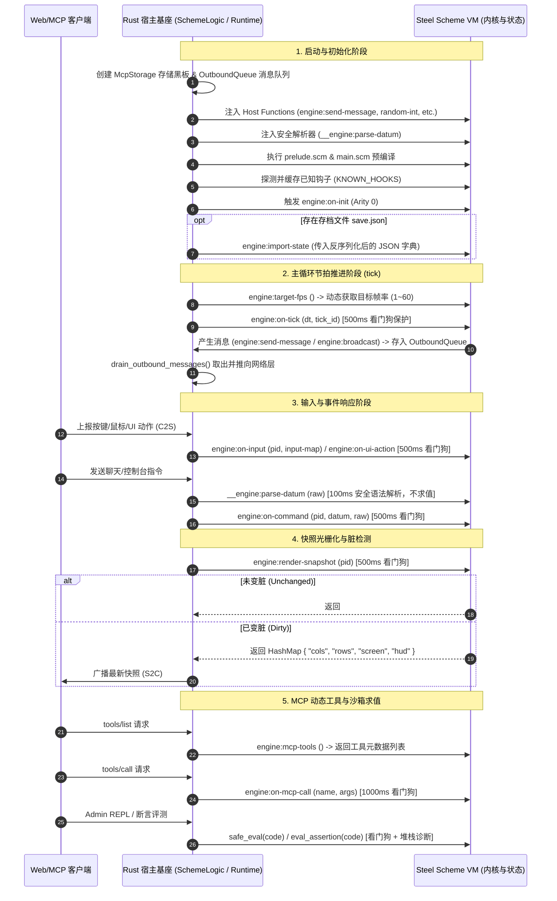
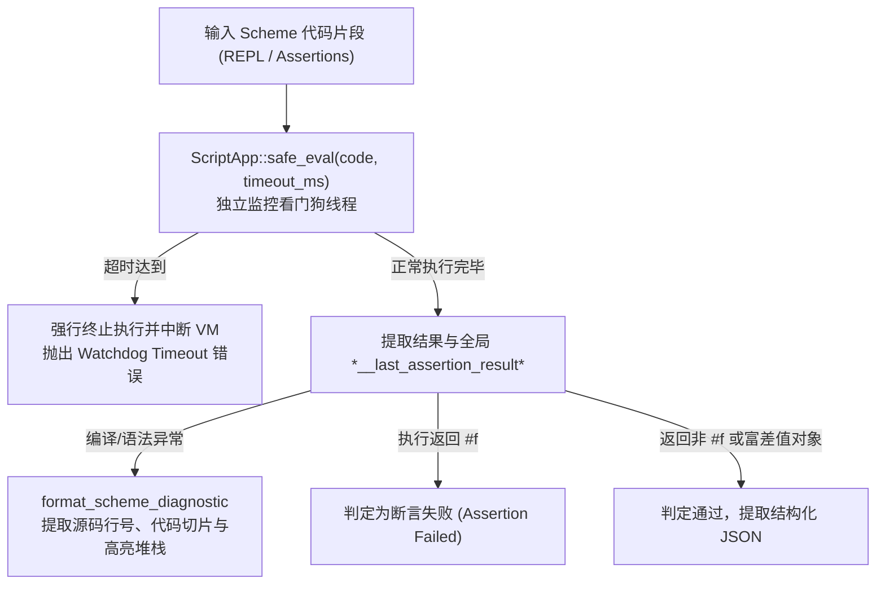

# TextCraft 3.0: Rust 基座与 Scheme 交互通信 API 规范 (Rust-Scheme FFI & Boundary Specification)

> [!IMPORTANT]
> **本文档定位与边界范围说明**：
> - **严格排除**：Scheme 脚本内部的动态函数（即 `scripts/prelude.scm` 和 `scripts/main.scm` 中纯 Scheme 编写的玩法算法与业务辅助函数，如 `coord->chunk-coord`、`build-player-hud`、`player:find-item` 等动态 API）。
> - **仅且全部聚焦**：**底层 Rust 基座（Rust Host Gateway & Engine Runtime）与 Scheme（Steel VM）之间的核心通信边界 API**。包括：
>   1. Rust 宿主注入的原生 FFI 函数 (`RegisterFn`)
>   2. Rust 调用的 Scheme 标准生命周期与事件钩子 (`KNOWN_HOOKS`)
>   3. Rust 看门狗求值与自动化测试断言沙箱 (`eval_repl` / `eval_assertion` / `eval_assertions`)
>   4. 跨语言核心数据结构与协议类型映射 (`PlayerInput`, `PlayerSnapshot`, `*world-state*`, `OutboundMessage`)
>   5. MCP 专用存储黑板与工具自举边界 (`McpStorage` FFI)

---

## 1. 架构交互全景 (Boundary Overview)

TextCraft 3.0 采用宿主与脚本完全解耦的架构设计：Rust 作为通用的高并发网关容器与自适应调度器，Scheme（Steel VM）作为完全自治的图灵完备游戏世界内核。二者通过明确的 FFI 边界进行全双工通信：



---

## 2. Rust 宿主向 Scheme 注入的原生函数 (Host Functions / FFI)

在引擎启动初始化 `SchemeLogic::new(...)` 时，Rust 宿主通过 Steel 的 `RegisterFn` 接口将以下底层系统能力直接注入至 Scheme 的全局符号表中。Scheme 脚本可直接作为一等公民函数无缝调用。

### 2.1 网络通信与日志能力

#### 1. `(engine:send-message pid channel text)`
- **说明**：向指定已连接的玩家发送结构化文本或业务事件消息。
- **参数**：
  - `pid`: `Integer` —— 目标玩家的全局会话 ID（Rust 内部自动转为 `u64`）。
  - `channel`: `String` | `Symbol` —— 消息频道分类标识（例如 `"system"`、`"combat"`、`"chat"`）。
  - `text`: `String` | `Symbol` | 任意值 —— 消息文本正文。
- **返回值**：`void`
- **Rust 底层实现**：
  将消息打包为 `OutboundMessage::SendMessage { player_id, channel, text }` 并原子推入线程安全队列 `outbound_queue: Arc<Mutex<Vec<OutboundMessage>>>`。在每帧 `runtime.tick()` 的第 6 步被批量排出（`drain`）并通过 WebSocket 发往对应客户端。

#### 2. `(engine:broadcast channel text)`
- **说明**：向所有当前在线连接的玩家全服广播消息。
- **参数**：
  - `channel`: `String` | `Symbol` —— 广播频道标识（例如 `"world"`、`"announcement"`）。
  - `text`: `String` | `Symbol` —— 广播内容。
- **返回值**：`void`
- **Rust 底层实现**：
  向 `outbound_queue` 推入 `OutboundMessage::Broadcast { channel, text }`，由网络网关批量全服下发。

#### 3. `(engine:log text)`
- **说明**：调用宿主日志设施输出统一日志，受 Rust 的 `tracing` 过滤器统一管理。
- **参数**：
  - `text`: `String` | `Symbol` | 任意可打印对象。
- **返回值**：`void`
- **Rust 底层实现**：
  调用 `tracing::info!(target: "scheme", "{}", text)`，附带精确时间戳与 `"scheme"` target 标记，支持配置环境变量 `RUST_LOG=scheme=debug` 过滤。

---

### 2.2 确定性随机数与文本工具

#### 4. `(engine:raw-random-int lo hi seed_val)`
- **说明**：底层 PRNG 随机数生成原始接口，支持确定性伪随机数种子与系统真随机熵回退。
- **参数**：
  - `lo`: `Integer` —— 范围下界。
  - `hi`: `Integer` —— 范围上界（若 `lo > hi`，Rust 内部自动归一化为 `[min(lo, hi), max(lo, hi)]`）。
  - `seed_val`: `Integer` | `Float` | `#f` | 任意值 —— 种子控制指示符：
    - **显式种子 (`Integer` / `Float`)**：基于 `seed_val` 使用 `rand::rngs::StdRng::seed_from_u64(...)` 初始化宿主受控 PRNG 并保存，生成在此范围内的确定性整数。
    - **重置种子 (`lo == 0 && hi == 0 && seed_val == #f`)**：彻底重置并释放受控 PRNG，恢复系统随机熵，返回 `0`。
    - **缺省情况 (`#f`)**：若当前已有受控 PRNG，则沿着该 PRNG 生成下一个随机数；若未设定任何种子，则自动回退至系统熵源 `rand::thread_rng()`。
- **返回值**：`Integer` —— 落在闭区间 `[min, max]` 内的随机整数。

#### 5. `(engine:random-int lo hi)`
- **说明**：高频使用的两参数随机整数接口。
- **参数**：
  - `lo`: `Integer` —— 范围下界。
  - `hi`: `Integer` —— 范围上界。
- **返回值**：`Integer` —— 闭区间 `[min, max]` 内的伪随机整数。
- **Rust 底层实现**：
  优先检查受控 PRNG，存在则从中采样；否则使用当前线程系统熵源 `rand::thread_rng().gen_range(min..=max)`。

#### 6. `(engine:strip-ansi text)`
- **说明**：高性能剥离 ANSI Escape 颜色与排版控制字符，计算文本排版净宽度或生成无样式纯文本。
- **参数**：
  - `text`: `String` —— 含有 24-bit TrueColor 或 16 色 ANSI 编码的文本。
- **返回值**：`String` —— 剥离所有控制码后的纯文本字符串。
- **Rust 底层实现**：
  直接调用 Rust 零分配状态机 `crate::runtime::strip_ansi_codes`。

---

### 2.3 专用 MCP 存储黑板原语 (McpStorage Host FFI)

TextCraft 3.0 设立了与游戏世界状态 `*world-state*` 物理隔离的专用内存黑板 `McpStorage`（类型为 `Arc<RwLock<HashMap<String, serde_json::Value>>>`），用于 AI 智能体存放中间计算结果、多轮推理会话、探索标记与调试快照。

#### 7. `(engine:raw-mcp-store-set! key val ns)`
- **说明**：向专用 MCP 存储黑板原子写入键值对。
- **参数**：
  - `key`: `String` —— 键名。
  - `val`: `SteelVal` —— 待存储的任意 Scheme 纯数据，Rust 内部自动调用 `steel_val_to_json` 转为 JSON。
  - `ns`: `String` —— 命名空间（空字符串时按 `key` 内部前缀或缺省命名空间解析）。
- **返回值**：`Boolean` —— `#t` 表示写入成功；`#f` 表示数据无法序列化为 JSON。
- **内部键名规则**：由 `resolve_namespace_and_key` 格式化为 `"<namespace>:<key>"`。

#### 8. `(engine:raw-mcp-store-get key ns)`
- **说明**：从专用 MCP 存储黑板中检索指定条目。
- **参数**：
  - `key`: `String` —— 键名。
  - `ns`: `String` —— 命名空间。
- **返回值**：`SteelVal` —— 若找到则自动转为对应 Scheme 结构（字典/列表/标量）；若不存在则返回 `#f`。

#### 9. `(engine:raw-mcp-store-list ns)`
- **说明**：列出指定命名空间下已存储的所有键名列表。
- **参数**：
  - `ns`: `String` —— 命名空间。若为空串，列举存储中所有完整键名；若指定命名空间，则返回已剥离 `"<ns>:"` 前缀的子键名。
- **返回值**：`List<String>` —— 键名列表。

#### 10. `(engine:raw-mcp-store-delete! key ns)`
- **说明**：从专用 MCP 存储黑板中删除指定键。
- **参数**：
  - `key`: `String`
  - `ns`: `String`
- **返回值**：`Boolean` —— `#t` 表示成功删除；`#f` 表示未找到该条目。

---

### 2.4 受控 S 表达式安全语法解析器

#### 11. `(__engine:parse-datum s)`
- **说明**：受控 Scheme Reader 原语，仅将字符串解析为 S 表达式 AST 数据（Datum），**绝不执行求值**。
- **参数**：
  - `s`: `String` —— 玩家输入的原始文本（如 `"(teleport 10 20)"` 或普通文本 `"hello"`）。
- **返回值**：`Datum` (List/Symbol/Number) | `String` —— 解析出的纯数据结构；若语法有误或达到 EOF，则原样返回原始字符串 `s`。
- **安全保障**：在 Rust 初始化时通过受保护的 `read` + `open-input-string` + `with-handler` 动态注入，杜绝任何利用玩家聊天窗口执行任意代码的注入攻击。

---

## 3. Rust 调用的 Scheme 标准生命周期与事件钩子 (`KNOWN_HOOKS`)

Rust 宿主在 `src/logic.rs` 中定义了 16 个标准钩子符号。脚本加载或热重载时，宿主自动探测脚本是否定义了对应函数（`has_hook`）；未定义的钩子会自动触发优雅降级（Graceful Fallback），保障系统绝不崩溃。

| 序号 | 钩子名称 | Arity | 触发时机 | 看门狗保护 | 缺省降级行为 |
|:---:|:---|:---:|:---|:---:|:---|
| 1 | `engine:on-init` | 0 | 引擎冷启动、干净重载（Clean Reload） | 无限制 (直接调用) | 空操作 |
| 2 | `engine:target-fps` | 0 | 主循环每帧动态获取调度频次 | 无限制 (直接调用) | 缺省固定 60 FPS |
| 3 | `engine:viewport-size` | 1 | 客户端建立连接、视口握手 | 500 ms | 缺省返回 `(80, 24)` |
| 4 | `engine:on-tick` | 2 | 自适应主循环每次心跳推演 | 500 ms | 空操作 |
| 5 | `engine:render-snapshot` | 1 | 每帧推流前为在线玩家光栅化画面 | 500 ms | 返回空画面与空 HUD |
| 6 | `engine:on-player-join` | 2 | 玩家 WebSocket 连接认证成功 | 500 ms | 空操作 |
| 7 | `engine:on-player-disconnect` | 1 | 玩家连接断开，进入宽限期 | 500 ms | 标记下线，保留数据 |
| 8 | `engine:on-player-reconnect` | 1 | 玩家在 60s 宽限期内重新连接 | 500 ms | 标记上线，重推快照 |
| 9 | `engine:on-player-leave` | 1 | 玩家宽限期超时彻底离开 | 500 ms | 从活跃玩家表移除归档 |
| 10 | `engine:on-input` | 2 | 玩家产生键盘按下/释放或鼠标事件 | 500 ms | 忽略输入 |
| 11 | `engine:on-ui-action` | 2 | 玩家触发前端 HUD 组件事件 | 500 ms | 忽略交互 |
| 12 | `engine:on-command` | 3 | 玩家发送控制台指令或聊天发言 | 500 ms | 忽略命令 |
| 13 | `engine:export-state` | 0 | 定时落盘存档、热重载前暂存 | 1000 ms | 导出失败，无法暂存 |
| 14 | `engine:import-state` | 1 | 读档恢复、热重载后恢复世界态 | 1000 ms | 恢复失败 |
| 15 | `engine:mcp-tools` | 0 | MCP 协议客户端获取工具列表 | 500 ms | 返回空列表 `()` |
| 16 | `engine:on-mcp-call` | 2 | MCP 协议客户端调用具体工具 | 1000 ms | 返回工具未定义错误 |

---

### 3.1 详细契约与参数规范

#### 1. `(engine:on-init)`
- **调用方**：`SchemeLogic::init()`, `SchemeLogic::force_reload(clean = true)`
- **契约要求**：负责初始化全局纯数据状态 `*world-state*`（生成或重置大地图分块、实体表、时间戳等）。

#### 2. `(engine:target-fps)`
- **调用方**：`SchemeLogic::query_target_fps()` (在 `runtime.tick_loop()` 中每轮迭代查询)
- **期望返回值**：`Integer` | `Number`
- **Rust 端处理**：自动进行边界夹取 `(fps as u64).clamp(1, 60)`。
- **设计目的**：当玩家处于激烈移动或战斗时，Scheme 返回 60；当所有玩家静止挂机或纯剧情对话时，Scheme 降频返回 15~30，Rust 宿主按此值动态拉伸 Tokio 节拍等待时间，大幅降低 CPU 负载。

#### 3. `(engine:viewport-size pid)`
- **调用方**：`SchemeLogic::query_viewport_size(pid)`
- **参数**：`pid`: `Integer`
- **期望返回值**：包含两个整数的 Scheme 列表 `(list cols rows)`，例如 `'(80 24)`。
- **降级回退**：若返回值非有效列表或长度不足，Rust 宿主默认回退至 `(80, 24)`。

#### 4. `(engine:on-tick dt tick-id)`
- **调用方**：`SchemeLogic::on_tick(dt, tick_id)` (在 `runtime.tick()` 中由时钟驱动)
- **参数**：
  - `dt`: `Float` —— 距离上一帧的实际物理时间差（秒，例如 `0.0166`）。
  - `tick_id`: `Integer` —— Rust 宿主全局原子单调递增的 tick 计数器。
- **契约要求**：Scheme 在此推进世界演化、怪物寻路战斗、持续动作计时器等。

#### 5. `(engine:render-snapshot pid)`
- **调用方**：`SchemeLogic::render_snapshot(pid)` (在 `runtime.tick()` 第 7 步调用)
- **参数**：`pid`: `Integer`
- **期望返回值**：
  - **未发生变脏（Unchanged）**：返回 `#f`。Rust 网关将进行短路去重，跳过光栅化下发（或在达到保活心跳时间窗口时按需重发），极大节省网络带宽与序列化开销。
  - **已变脏（Dirty）**：返回哈希字典：
    ```scheme
    (hash "cols" cols
          "rows" rows
          "screen" ansi-string
          "hud" (hash ...))
    ```
- **Rust 端映射**：解析为 `PlayerSnapshot` 结构体并发往客户端。

#### 6. `(engine:on-player-join pid token)`
- **调用方**：`SchemeLogic::on_player_join(pid, token)`
- **参数**：
  - `pid`: `Integer` —— 分配的玩家 ID。
  - `token`: `String` —— 客户端握手凭证（例如 `"Alice:auth_token"`）。
- **契约要求**：解析玩家身份，清理同名旧连接，恢复该玩家持久化角色或创建初始角色，置 `"online" #t`。

#### 7. `(engine:on-player-disconnect pid)`
- **调用方**：`SchemeLogic::on_player_disconnect(pid)`
- **契约要求**：将玩家标记为离线（`"online" #f`），角色保留在内存中但从其他玩家视口与怪物 AI 仇恨中隐藏，开启 60s 重连宽限期。

#### 8. `(engine:on-player-reconnect pid)`
- **调用方**：`SchemeLogic::on_player_reconnect(pid)`
- **契约要求**：将玩家标记恢复为上线（`"online" #t`），立即标记画面变脏以重推全量快照，不重复发送欢迎日志。

#### 9. `(engine:on-player-leave pid)`
- **调用方**：`SchemeLogic::on_player_leave(pid)`
- **契约要求**：宽限期超时彻底离开。将角色归档至持久化字典 `"saved_players"` 并从活跃字典 `"players"` 中物理移除。

#### 10. `(engine:on-input pid input-map)`
- **调用方**：`SchemeLogic::on_input(pid, &input)`
- **参数**：
  - `pid`: `Integer`
  - `input-map`: 经由 Rust `PlayerInput` 自动转换而来的 Scheme 哈希字典：
    - **键盘事件**：
      ```scheme
      (hash "type" "key"
            "code" "KeyW"          ; 按键标识
            "action" "down"        ; "down" 或 "up" (支持按键释放与持续物理时序)
            "shift" #f             ; 修饰键布尔值
            "ctrl" #f
            "alt" #f)
      ```
    - **鼠标事件**：
      ```scheme
      (hash "type" "mouse"
            "x" 42
            "y" 15
            "button" "left")
      ```

#### 11. `(engine:on-ui-action pid action-map)`
- **调用方**：`SchemeLogic::on_ui_action(pid, action, payload)`
- **参数**：
  - `pid`: `Integer`
  - `action-map`: 包含交互动作名与前端载荷的哈希字典：
    ```scheme
    (hash "type" "ui"
          "action" "use_item"
          "payload" (hash "slot" 2 "item_id" "potion_health"))
    ```

#### 12. `(engine:on-command pid datum raw)`
- **调用方**：`SchemeLogic::on_command(pid, raw)`
- **参数**：
  - `pid`: `Integer`
  - `datum`: 已经由 `__engine:parse-datum` 安全语法解析后的 S 表达式 AST 数据（或字符串）。
  - `raw`: `String` —— 客户端原始输入的纯文本指令。

#### 13. `(engine:export-state)`
- **调用方**：`SchemeLogic::export_state()`
- **期望返回值**：纯数据世界状态（通常是 `*world-state*`）。
- **约束准则**：必须为纯数据树（哈希、列表、数字、字符串、布尔），严禁包含闭包。Rust 将其完整反序列化为 `serde_json::Value`，用于原子双写写入磁盘存档文件（`.tmp` + rename）或在热重载时跨 VM 世代暂存。

#### 14. `(engine:import-state data)`
- **调用方**：`SchemeLogic::import_state(data)`
- **参数**：`data`: 经由 JSON 转换而来的 Scheme 纯数据字典。
- **契约要求**：将传入的数据树完全恢复至全局 `*world-state*`。

#### 15. `(engine:mcp-tools)`
- **调用方**：`SchemeLogic::mcp_list_tools()`
- **期望返回值**：Scheme 工具定义列表。每个工具为包含 `name`, `description`, `inputSchema` 的字典。由 `(mcp:def-tool ...)` 宏自动汇总生成。

#### 16. `(engine:on-mcp-call name args)`
- **调用方**：`SchemeLogic::mcp_call_tool(name, args)`
- **参数**：
  - `name`: `String` —— 调用的工具名称（如 `"game:spawn-mob"`）。
  - `args`: Scheme 哈希字典 —— 客户端传递的入参对象。
- **期望返回值**：任意可序列化为 JSON 的数据对象，作为工具调用的响应内容返回给外部 AI 智能体。

---

## 4. Rust 看门狗求值与自动化测试断言沙箱 (Watchdog Evaluator & Sandbox)

Rust 宿主对外部交互（管理员 REPL 控制台、MCP 代码执行、单元测试断言）提供三层看门狗安全隔离机制：



### 4.1 `SchemeLogic::eval_repl(code)`
- **看门狗超时**：硬限制 `1000 ms`。
- **堆栈诊断**：若代码发生语法错误或运行时异常，调用 `format_scheme_diagnostic(&self.app.engine, &steel_err)` 生成可读的丰富诊断信息（精确定位出错文件路径、行列号及调用栈），而不会导致服务端崩溃。

### 4.2 `SchemeLogic::eval_assertion(code, timeout_ms)`
- **包装机制**：
  ```scheme
  (let ((__res (begin <code>)))
    (set! *__last_assertion_result* __res)
    (if (equal? __res #f)
        "__ASSERTION_FAILED_FALSE__"
        __res))
  ```
- **判定语义**：
  - 表达式结果为 `#f`：立即判定断言失败，返回 `Err("Assertion failed: expression evaluated to #f")`。
  - 表达式抛出未捕获异常或超时：返回 `Err(...)`。
  - 表达式结果为非 `#f`（数字、字符串、布尔 `#t`、列表、字典）：判定断言通过，自动转换为 `serde_json::Value` 返回。

### 4.3 `SchemeLogic::eval_assertions(exprs, timeout_ms)`
- **批量求值接口**：
  接收字符串数组 `&[String]`，逐条评测，自动识别返回对象中是否带有 `{"passed": false}` 的富差值字典，统计汇总生成结构化 JSON 报告：
  ```json
  {
    "total": 3,
    "passed": 2,
    "failed": 1,
    "all_passed": false,
    "results": [
      { "expr": "(> 5 3)", "passed": true, "result": true },
      { "expr": "(= 1 2)", "passed": false, "error": "Assertion failed: expression evaluated to #f" }
    ],
    "failures": [
      { "expr": "(= 1 2)", "passed": false, "error": "Assertion failed: expression evaluated to #f" }
    ]
  }
  ```

---

## 5. 跨语言核心数据结构与协议映射 (Data Marshalling Boundary)

### 5.1 输入事件映射 (`PlayerInput` <-> SteelVal)

| Rust 类型 (`crate::types::PlayerInput`) | Scheme 字典表示 (`SteelVal::HashMapV`) | 字段类型与说明 |
|:---|:---|:---|
| `Key { code, action, shift, ctrl, alt }` | `(hash "type" "key" ...)` | `"code"`: String<br>`"action"`: `"down"` \| `"up"`<br>`"shift"`/`"ctrl"`/`"alt"`: Boolean |
| `Mouse { x, y, button }` | `(hash "type" "mouse" ...)` | `"x"`: Number<br>`"y"`: Number<br>`"button"`: String (`"left"`, `"right"`) |
| `UIAction { action, payload }` | `(hash "type" "ui" ...)` | `"action"`: String<br>`"payload"`: 任意 JSON 映射的 Scheme 字典/列表 |
| `Cmd { input }` | 拆解为 `(engine:on-command pid datum raw)` | 直接展开为参数传给钩子 |

### 5.2 渲染快照映射 (`PlayerSnapshot` <-> SteelVal)

```scheme
;; Scheme 端返回的快照哈希字典规范
(hash
  "cols" 80                          ; 视口实际列数 (Integer)
  "rows" 24                          ; 视口实际行数 (Integer)
  "screen" "\x1b[38;2;...m#..."     ; 视口 24-bit TrueColor ANSI 字符流 (String)
  "hud" (hash                        ; 环绕式 HUD 表现数据字典 (Hash)
          "theme" "cyberpunk"
          "player" (hash "hp" 100 "max_hp" 100 "gold" 50)
          "log" (list "欢迎来到 TextCraft 3.0!")))
```

Rust 宿主在 `render_snapshot` 中对其进行提取并转换为 Rust 结构体：
```rust
pub struct PlayerSnapshot {
    pub cols: u16,
    pub rows: u16,
    pub screen: String,
    pub hud: serde_json::Value,
}
```

### 5.3 出站消息队列 (`OutboundMessage`)

Scheme 代码在任何钩子或事件回调中调用 `(engine:send-message ...)` 或 `(engine:broadcast ...)` 时，Rust 将其实例化为以下枚举并推入缓存队列：

```rust
pub enum OutboundMessage {
    SendMessage {
        player_id: u64,
        channel: String,
        text: String,
    },
    Broadcast {
        channel: String,
        text: String,
    },
}
```
并在每帧时钟心跳结算时，由 `drain_outbound_messages()` 批量清空并通过全双工网络推向客户端。

---

## 6. 开发者快速查询速查表 (Quick Reference Cheatsheet)

### 6.1 宿主函数速查 (Host Injected Functions)
```scheme
;; 消息网络与日志
(engine:send-message pid channel text)     ; 玩家单发消息
(engine:broadcast channel text)            ; 全服广播消息
(engine:log text)                          ; 输出 Rust tracing 日志

;; 随机数与文本
(engine:random-int lo hi)                  ; [lo, hi] 闭区间随机整数
(engine:raw-random-int lo hi seed_val)     ; 确定性种子随机数控制 (seed / reset)
(engine:strip-ansi text)                   ; 剥离 ANSI 控制字符

;; 专用 MCP 存储黑板
(engine:raw-mcp-store-set! key val ns)     ; 写入 MCP 存储
(engine:raw-mcp-store-get key ns)          ; 读取 MCP 存储 (不存在返回 #f)
(engine:raw-mcp-store-list ns)             ; 列出命名空间下所有键名
(engine:raw-mcp-store-delete! key ns)      ; 删除 MCP 存储键值

;; 安全语法解析
(__engine:parse-datum s)                   ; S 表达式 Reader 安全语法解析 (不执行求值)
```

### 6.2 必须/常用生命周期钩子速查 (Engine Hooks)
```scheme
(define (engine:on-init) ...)                      ; 引擎冷启动 / 清理重载
(define (engine:target-fps) 60)                    ; 动态帧率调节 (1~60)
(define (engine:viewport-size pid) '(80 24))       ; 玩家视口大小协商
(define (engine:on-tick dt tick-id) ...)           ; 逻辑推进
(define (engine:render-snapshot pid) ...)          ; 快照光栅化 (未变脏返回 #f)
(define (engine:on-player-join pid token) ...)     ; 玩家上线
(define (engine:on-player-disconnect pid) ...)     ; 玩家掉线 (进入宽限期)
(define (engine:on-player-reconnect pid) ...)      ; 玩家重连
(define (engine:on-player-leave pid) ...)          ; 玩家彻底离线
(define (engine:on-input pid input-map) ...)       ; 键盘/鼠标输入处理
(define (engine:on-ui-action pid action-map) ...)  ; 前端 HUD 交互动作
(define (engine:on-command pid datum raw) ...)     ; 控制台指令与聊天
(define (engine:export-state) *world-state*)       ; 全局状态导出 (存档/重载前)
(define (engine:import-state data) ...)            ; 全局状态恢复 (读档/重载后)
(define (engine:mcp-tools) ...)                    ; MCP 工具清单导出
(define (engine:on-mcp-call name args) ...)        ; MCP 工具执行派发
```
