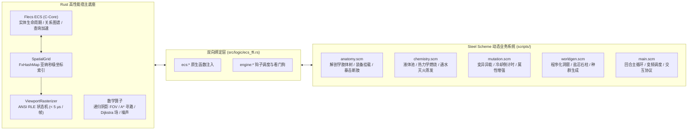

# TextCraft 5.0: Scheme 游戏逻辑与 Rust-Scheme 交互接口完全开发指南

> [!IMPORTANT]
> **致阅读本指南的 AI Agent 与开发者**：
> TextCraft 5.0 采用了 **“Flecs ECS 权威状态底座 (Rust) + 通用密集数学算子 (Rust) + ANSI 零拷贝光栅化 (Rust) + Agent 自动驾驶记忆黑板 (Rust) + 动态涌现规则与玩法系统 (Steel Scheme)”** 的双引擎架构。
> 本文档专门面向编写 Scheme 脚本（`scripts/*.scm`）的 AI 智能体与游戏逻辑开发者，详尽拆解 Rust 宿主与 Scheme 虚拟机之间的**双向通信契约、所有 FFI 原语、DSL 宏封装、数据类型映射、生命周期钩子、Qud 涌现设计模式与 MCP 调试实践**。

---

## 目录 (Table of Contents)
- [1. 双引擎架构与心智模型](#1-双引擎架构与心智模型)
  - [1.1 架构演进：从不可变全局树到权威 ECS 底座](#11-架构演进从不可变全局树到权威-ecs-底座)
  - [1.2 职责边界划分 (Rust vs Scheme)](#12-职责边界划分-rust-vs-scheme)
  - [1.3 脚本加载链与零状态拷贝热重载](#13-脚本加载链与零状态拷贝热重载)
- [2. Rust -> Scheme 注入的原生接口清单 (FFI Reference)](#2-rust---scheme-注入的原生接口清单-ffi-reference)
  - [2.1 ECS 实体生命周期管理](#21-ecs-实体生命周期管理)
  - [2.2 空间网格与四图层坐标系](#22-空间网格与四图层坐标系)
  - [2.3 ANSI 视觉图元与物理属性](#23-ansi-视觉图元与物理属性)
  - [2.4 动态属性读写系统 (Dynamic Props)](#24-动态属性读写系统-dynamic-props)
  - [2.5 实体标签系统 (Tags)](#25-实体标签系统-tags)
  - [2.6 实体拓扑与关系对图谱 (Relationships)](#26-实体拓扑与关系对图谱-relationships)
  - [2.7 原生 Flecs C 查询 DSL (`ecs:query`)](#27-原生-flecs-c-查询-dsl-ecsquery)
  - [2.8 玩家网络会话绑定 (`ecs:set-player-session`)](#28-玩家网络会话绑定-ecsset-player-session)
  - [2.9 Roguelike 五大通用密集数学算子](#29-roguelike-五大通用密集数学算子)
  - [2.10 宿主通信与辅助系统工具](#210-宿主通信与辅助系统工具)
- [3. Scheme -> Rust 导出的标准生命周期钩子 (Lifecycle Hooks)](#3-scheme---rust-导出的标准生命周期钩子-lifecycle-hooks)
  - [3.1 引擎系统与时钟钩子](#31-引擎系统与时钟钩子)
  - [3.2 玩家网络会话生命周期钩子](#32-玩家网络会话生命周期钩子)
  - [3.3 玩家交互与指令管道钩子](#33-玩家交互与指令管道钩子)
  - [3.4 快照渲染与原生光栅化钩子](#34-快照渲染与原生光栅化钩子)
  - [3.5 存档持久化与 MCP 动态工具自举钩子](#35-存档持久化与-mcp-动态工具自举钩子)
- [4. `scripts/prelude.scm` 核心语法糖与宏生态](#4-scriptspreludescm-核心语法糖与宏生态)
  - [4.1 声明式实体构建宏 (`define-entity`, `spawn-entity`)](#41-声明式实体构建宏-define-entity-spawn-entity)
  - [4.2 标签与关系语法糖 (`with-tag`, `relate!`, `part-of`, `equipped-on`)](#42-标签与关系语法糖-with-tag-relate-part-of-equipped-on)
  - [4.3 地图分块兼容层与自动 ECS 同步](#43-地图分块兼容层与自动-ecs-同步)
- [5. 类《Caves of Qud》深度涌现机制开发范式](#5-类caves-of-qud深度涌现机制开发范式)
  - [5.1 解剖学多肢体系统 (`anatomy.scm`)](#51-解剖学多肢体系统-anatomyscm)
  - [5.2 液体池与热力学反应 (`chemistry.scm`)](#52-液体池与热力学反应-chemistryscm)
  - [5.3 物理与精神变异系统 (`mutation.scm`)](#53-物理与精神变异系统-mutationscm)
  - [5.4 程序化洞窟与盐沼生态生成 (`worldgen.scm`)](#54-程序化洞窟与盐沼生态生成-worldgenscm)
- [6. AI Agent 开发工作流与调试最佳实践](#6-ai-agent-开发工作流与调试最佳实践)
  - [6.1 MCP 工具实时透视与修改实体](#61-mcp-工具实时透视与修改实体)
  - [6.2 在线 REPL (`!`) 交互调试技巧](#62-在线-repl--交互调试技巧)
  - [6.3 Steel Scheme 常见陷阱与防御式编程法则](#63-steel-scheme-常见陷阱与防御式编程法则)

---

## 1. 双引擎架构与心智模型

### 1.1 架构演进：从不可变全局树到权威 ECS 底座

在 TextCraft 3.0 中，世界完全由 Scheme 单一不可变哈希表 `*world-state*` 承载，每帧渲染由 Scheme 逐格遍历拼接字符串。面对万级实体大地图与复杂网状关系（如 Caves of Qud 风格的肢体树、液体渗透、视野投射）时，不可变字典深层拷贝与字符串拼接带来了显著开销。

在 **TextCraft 4.0** 中，架构全面演进为双引擎协同：
- **Rust 宿主提供 Flecs ECS 权威底座**：实体（Entity）、组件（Component）、标签（Tag）、关系对（Pair）、空间哈希索引（`SpatialGrid`）以及原生 ANSI RLE 光栅化器（`ViewportRasterizer`）常驻 Rust 内存，天然具备缓存局部性与内存连续性。
- **Steel Scheme 拥有 100% 规则解释权**：所有游戏机制、AI 索敌、变异能力、热力学相变、装备计算全权用 Scheme 动态编写。Scheme 脚本通过细粒度 FFI 函数直接修改 Flecs 状态。



### 1.2 职责边界划分 (Rust vs Scheme)

| 系统领域 | Rust 负责事项 (Host) | Scheme 负责事项 (Logic) |
| :--- | :--- | :--- |
| **实体与状态** | 实体分配/回收、物理组件存储、关系图遍历、动态属性缓存 | 决定创建何种实体、何时赋予变异、何时断肢、动态数值计算 |
| **空间与渲染** | `SpatialGrid` 坐标哈希、4 图层合并、ANSI 转义码 RLE 压缩 (`< 5μs`) | 决定图元字符、颜色、玩家视口居中位置、HUD 字典内容 |
| **算法密集型** | 对称阴影投射 FOV、A* 网格寻路、Dijkstra 势能场、Simplex 噪声、元胞洞窟 | 调用算子获取路径/可见列表、驱动怪物决策、设计地图生成管线 |
| **生命周期** | Tokio 网络 I/O、WebSocket 协议编解码、自适应时钟心跳驱动 | 响应 `engine:on-tick`、`engine:on-player-join` 等生命周期钩子 |
| **工具透视** | Axum HTTP MCP 服务端，提供 `ecs_inspect`、`ecs_query`、`ecs_modify` | 在 `.scm` 中通过 `(mcp:def-tool ...)` 自主扩展新业务工具 |

### 1.3 脚本加载链与零状态拷贝热重载

#### 自动加载序列
当服务端启动或触发热重载时，`src/logic/mod.rs` 会扫描 `scripts/` 目录下所有 `.scm` 文件，并自动执行依赖排序：
1. **`scripts/prelude.scm` 最先加载**：注入图层常量、宏展开规则（`define-entity`、`spawn-entity`）、关系语法糖；
2. **中间模块按字母序加载**：`anatomy.scm` -> `chemistry.scm` -> `mutation.scm` -> `worldgen.scm` ... 确保各涌现子系统定义在主逻辑前就绪；
3. **`scripts/main.scm` 最后加载**：挂载标准生命周期钩子并执行 `(engine:on-init)`。

#### 零状态拷贝热重载 (Zero-State-Copy Hot Reload)
在开发过程中启动服务端添加 `-w` / `--watch` 标志（或通过 MCP 调用 `reload_scripts`）：
```bash
cargo run -- -w --mcp-port 8082
```
修改任意 `.scm` 文件后，Rust 宿主在 2 秒内自动检测并重新编译整个脚本环境。
**核心优势**：实体数据全部保存在 Flecs ECS 权威底座中，热重载只刷新函数的逻辑实现，**不会造成世界实体丢失或状态重置**，真正实现亚秒级免编译热更！

---

## 2. Rust -> Scheme 注入的原生接口清单 (FFI Reference)

在 Scheme 中，Rust 宿主注册了全套带 `ecs:` 前缀的原生函数，任何 `.scm` 脚本无需引入模块即可全局调用。

### 2.1 ECS 实体生命周期管理

| 函数签名 | 说明与用法 | 返回值 |
| :--- | :--- | :--- |
| `(ecs:spawn)` | 在 Flecs 中生成一个匿名新实体 | 整数 `eid` |
| `(ecs:spawn name)` 或 `(ecs:spawn-named name)` | 生成一个具名实体（便于调试与根据名称查找） | 整数 `eid` |
| `(ecs:despawn eid)` | 销毁实体，自动从空间网格和关系树中剥离 | 布尔值 `#t` / `#f` |
| `(ecs:exists? eid)` | 检查实体是否存在且存活（Alive） | 布尔值 `#t` / `#f` |
| `(ecs:count)` | 获取当前在空间网格中登记的总实体数 | 整数数量 |
| `(ecs:clear!)` | 清空整个 Flecs 世界与空间索引（重置世界） | 布尔值 `#t` |
| `(ecs:inspect eid)` | 深度内省实体的所有坐标、图元、标签、属性与关系 | Scheme 哈希表或 `#f` |

```scheme
;; 示例：生成并安全销毁
(let ((e (ecs:spawn-named "CaveSpider")))
  (ecs:set e "hp" 20)
  (if (ecs:exists? e)
      (ecs:despawn e)
      #f))
```

### 2.2 空间网格与四图层坐标系

TextCraft 采用标准的 4 图层空间坐标体系：
- **`LAYER-TERRAIN` (0)**：不可移动底层地形（墙体、泥土、石板、草地）；
- **`LAYER-ITEM-LIQUID` (1)**：地表层（掉落装备、金币、药水、血迹、液体池）；
- **`LAYER-CREATURE` (2)**：生物层（玩家、怪物、NPC、中立生物）；
- **`LAYER-OVERLAY` (3)**：顶层覆盖特效（爆炸火光、法术光环、UI 标记）。

| 函数签名 | 说明与用法 | 返回值 |
| :--- | :--- | :--- |
| `(ecs:set-pos eid x y layer)` | 设置或更新实体的世界网格坐标与图层 | 布尔值 `#t` / `#f` |
| `(ecs:get-pos eid)` | 查询实体坐标 | 返回 `(list x y layer)` 或 `#f` |
| `(ecs:spawn-at x y layer glyph fg bg name)` | 便捷原语：在指定位置生成实体并设置图元 | 整数 `eid` |
| `(ecs:at x y)` | 查询坐标 `(x, y)` 上的所有实体 ID（按图层升序排列） | 实体 ID 列表 |
| `(ecs:at-layer x y layer)` | 查询坐标 `(x, y)` 在特定图层上的实体 ID | 实体 ID 列表 |

```scheme
;; 示例：在生物层查询当前格是否有敌人
(let ((creatures (ecs:at-layer 10 15 LAYER-CREATURE)))
  (for-each
    (lambda (cid)
      (if (ecs:has-tag? cid "Monster")
          (engine:log (string-append "发现怪物: " (number->string cid)))
          #f))
    creatures))
```

### 2.3 ANSI 视觉图元与物理属性

| 函数签名 | 说明与用法 | 返回值 |
| :--- | :--- | :--- |
| `(ecs:set-glyph eid ch fg bg solid opaque)` | 设置实体的显示字符、颜色及阻挡属性 | 布尔值 `#t` / `#f` |
| `(ecs:get-glyph eid)` | 获取实体的图元字典 | 包含 `"ch"`, `"fg"`, `"bg"`, `"solid"`, `"opaque"` 的哈希表 |

**参数说明**：
- `ch`：单字符字符串（如 `"@"`, `"#"`, `","`, `"t"`）或字符字面量；
- `fg`：前景色 24-bit RGB 列表（如 `'(255 100 0)`）或 `#f`（默认白）；
- `bg`：背景色 24-bit RGB 列表（如 `'(40 20 0)`）或 `#f`（透明，自动透出下层颜色）；
- `solid`：布尔值。`#t` 表示该格具备物理碰撞阻挡（A* 寻路与玩家移动均无法直接穿过）；
- `opaque`：布尔值。`#t` 表示阻挡视野（递归阴影投射 FOV 无法穿透，如厚墙、浓烟）。

```scheme
;; 示例：生成一堵阻挡视线与通行的石墙
(let ((w (ecs:spawn-named "GraniteWall")))
  (ecs:set-pos w 5 5 LAYER-TERRAIN)
  (ecs:set-glyph w "#" '(140 140 150) '(40 40 45) #t #t))
```

### 2.4 动态属性读写系统 (Dynamic Props)

实体除核心物理组件外，可通过动态属性挂载任意自定义状态。属性底层以 JSON 兼容格式存放，支持 Scheme 各种原生类型的安全双向映射：

| 函数签名 | 说明与用法 | 返回值 |
| :--- | :--- | :--- |
| `(ecs:set eid key value)` | 设置动态属性（`key` 为字符串，`value` 支持数字、字符串、布尔、哈希表、列表） | 布尔值 `#t` / `#f` |
| `(ecs:get eid key)` | 读取属性，若属性不存在则返回 `#f` | 属性值或 `#f` |
| `(ecs:get eid key default)` | 读取属性，若属性不存在则返回给定的默认值 `default` | 属性值或 `default` |
| `(ecs:has? eid key)` | 检查实体是否存在指定属性 | 布尔值 `#t` / `#f` |

```scheme
;; 示例：设置复杂属性与安全读取
(ecs:set goblin "hp" 45)
(ecs:set goblin "resistances" (hash "fire" 0.5 "acid" -0.2))

(let* ((hp (ecs:get goblin "hp" 0))
       (res (ecs:get goblin "resistances" (hash)))
       (fire-res (map-get res "fire" 0.0)))
  (engine:log (string-append "火抗: " (number->string fire-res))))
```

### 2.5 实体标签系统 (Tags)

标签（Tag）是零内存开销的 Flecs 标识，可快速利用 Flecs 索引机制进行匹配：

| 函数签名 | 说明与用法 | 返回值 |
| :--- | :--- | :--- |
| `(ecs:add-tag eid tag-name)` | 为实体打上标签（如 `"Monster"`, `"Living"`, `"Dead"`） | 布尔值 `#t` / `#f` |
| `(ecs:remove-tag eid tag-name)`| 移除实体上的标签 | 布尔值 `#t` / `#f` |
| `(ecs:has-tag? eid tag-name)` | 检查实体是否具备指定标签 | 布尔值 `#t` / `#f` |

```scheme
;; 示例：击杀怪物并打上死亡标签
(ecs:set m "hp" 0)
(ecs:add-tag m "Dead")
(ecs:remove-tag m "Living")
```

### 2.6 实体拓扑与关系对图谱 (Relationships)

TextCraft 4.0 充分利用了 Flecs 原生的 Entity-Entity 关系对功能（`Relation(Subject, Target)`）。非常适合表达**装备穿戴**、**肢体树归属**、**液体沾染**等复杂网络：

| 函数签名 | 对应 Flecs 语义 | 说明与用法 | 返回值 |
| :--- | :--- | :--- | :--- |
| `(ecs:relate a relation b)` | `a.add((relation, b))` | 建立关系：主体 `a` 以 `relation` 关系指向目标 `b` | 布尔值 `#t` / `#f` |
| `(ecs:unrelate a relation b)` | `a.remove((relation, b))` | 解除主体 `a` 与目标 `b` 的 `relation` 关系 | 布尔值 `#t` / `#f` |
| `(ecs:target a relation)` | `a.target(relation)` | 获取主体 `a` 在 `relation` 关系下指向的目标实体 ID | 整数 `eid` 或 `#f` |
| `(ecs:children b relation)` | 查询所有以 `relation` 指向 `b` 的主体 | 反向查找所有从属实体 ID | 实体 ID 列表 |

```scheme
;; 示例：构建肢体树与装备槽
(define body (ecs:spawn "HumanoidBody"))
(define right-hand (ecs:spawn "RightHand"))
(define iron-sword (ecs:spawn "IronSword"))

;; 肢体属于躯干：RightHand --(PartOf)--> HumanoidBody
(ecs:relate right-hand "PartOf" body)

;; 武器穿戴在手上：IronSword --(EquippedOn)--> RightHand
(ecs:relate iron-sword "EquippedOn" right-hand)

;; 查询手上的武器
(ecs:children right-hand "EquippedOn") ;; => (list iron-sword)

;; 查询武器装在哪个部位
(ecs:target iron-sword "EquippedOn")   ;; => right-hand
```

### 2.7 原生 Flecs C 查询 DSL (`ecs:query`)

`(ecs:query expr-str)` 允许直接使用 Flecs C 查询表达式筛选实体，在 Rust 侧以高度优化的位图/表迭代检索：

| 查询表达式示例 | 含义 |
| :--- | :--- |
| `(ecs:query "Monster")` | 查找所有拥有 `Monster` 标签的实体 |
| `(ecs:query "GridPos, Monster")` | 查找所有具有空间坐标且为怪物的实体 |
| `(ecs:query "Liquid")` | 查找所有液体池实体 |
| `(ecs:query "Item, !Dead")` | 查找所有是 Item 且非 Dead 的实体 |

```scheme
;; 示例：遍历所有活着的地表液体进行蒸发处理
(let ((liquids (ecs:query "Liquid, !Dead")))
  (for-each
    (lambda (lid)
      (let ((dur (ecs:get lid "duration" 0)))
        (if (<= dur 1)
            (ecs:despawn lid)
            (ecs:set lid "duration" (- dur 1)))))
    liquids))
```

### 2.8 玩家网络会话绑定 (`ecs:set-player-session`)

| 函数签名 | 说明与用法 | 返回值 |
| :--- | :--- | :--- |
| `(ecs:set-player-session eid pid [cols rows])` | 将 Flecs 实体与客户端网络会话 `PlayerId` 绑定，赋予 `PlayerSession` 组件与 `Player` 标签，默认视口 `80x24` | 布尔值 `#t` / `#f` |

绑定后，Rust 网关的 `render_snapshot(pid)` 会自动以该实体的 `GridPos` 为视口中心执行原生 ANSI 光栅化渲染。

### 2.9 Roguelike 五大通用密集数学算子

为解放 Scheme 虚拟机的 CPU 算力，计算复杂度高的通用几何与图论算法完全由 Rust 实现：

#### 1. 对称递归阴影投射视野 (`ecs:fov`)
```scheme
;; 从中心 (cx, cy) 投射半径为 radius 的视野，自动判定图层中的 opaque 实体
;; 返回可见的世界坐标对列表: ((x1 y1) (x2 y2) ...)
(ecs:fov cx cy radius)
```

#### 2. A* 网格寻路 (`ecs:find-path`)
```scheme
;; 从起点 (sx, sy) 寻路至终点 (gx, gy)，自动绕开地图中 solid=#t 的实体
;; allow-diag 为可选布尔值（默认 #f，是否允许 8 向对角移动）
;; 成功返回路径坐标列表: ((x1 y1) (x2 y2) ...)，不可达返回 #f
(ecs:find-path sx sy gx gy)
(ecs:find-path sx sy gx gy #t)
```

#### 3. Dijkstra 全图势能场 (`ecs:dijkstra-map`)
```scheme
;; 以目标 (tx, ty) 为中心辐射生成距离势能场（避开 solid 实体）
;; max-dist 为最大扩散步数，allow-diag 决定是否允许对角
;; 返回哈希表: "x,y" -> 步数距离
(ecs:dijkstra-map tx ty max-dist)
(ecs:dijkstra-map tx ty max-dist #t)
```

#### 4. 2D Simplex 确定性噪声 (`ecs:noise-2d`)
```scheme
;; 输入随机种子、坐标与缩放比，返回 [-1.0, 1.0] 的确定性平滑噪声浮点数
(ecs:noise-2d seed x y scale)
```

#### 5. 元胞自动机洞窟生成 (`ecs:generate-cave`)
```scheme
;; 基于 4-5 规则迭代生成自然洞窟网格
;; width, height: 宽高; wall-prob: 初始墙体概率(如 0.45); iterations: 平滑轮数(如 4)
;; 返回布尔二维列表 (每一行是一个列布尔列表，#t 为墙体，#f 为地面)
(ecs:generate-cave 40 30 0.45 4 seed)
```

### 2.10 宿主通信与辅助系统工具

| 函数签名 | 说明 |
| :--- | :--- |
| `(engine:send-message pid channel text)` | 向指定客户端推送一条消息事件帧（通道如 `"system"`, `"combat"`） |
| `(engine:broadcast channel text)` | 向全服在线客户端广播一条文本消息 |
| `(engine:log text)` | 输出一条结构化日志到服务端的 `tracing` 日志流 |
| `(engine:random-int min max)` | 生成 `[min, max]` 闭区间内的高质量伪随机整数 |
| `(engine:seed-prng seed)` | 设置确定性随机数发生器种子（整型数值），用于时空回溯与确定性推演 |
| `(engine:strip-ansi text)` | 剔除字符串中的 ANSI 颜色转义码（保留纯文本网格用于 LLM 读取） |

### 2.11 智能体专用记忆黑板原语 (`mcp-store`)

为了支持 AI Agent 在多回合推演中维护记忆、计划和检查点，Rust 宿主注入了一套**完全不污染游戏物理状态和玩家存档**的专用键值存储黑板：

```scheme
;; 1. 底层宿主原语 (带可选命名空间参数，缺省默认命名空间为 "default")
(engine:mcp-store-set key val [namespace])
(engine:mcp-store-get key [namespace])
(engine:mcp-store-keys [namespace])
(engine:mcp-store-delete key [namespace])

;; 2. prelude.scm 封装的高阶 API
(mcp-store:set! "plan_step" 2 "agent_memory")
(mcp-store:get "plan_step" "agent_memory" 0)    ;; => 2 (未找到返回默认值 0)
(mcp-store:keys "agent_memory")                 ;; => ("plan_step")
(mcp-store:delete! "plan_step" "agent_memory")
```

此外，`prelude.scm` 还提供了持续按键按压与长按时间统计原语（用于平台跳跃与连续移动）：
```scheme
(player:handle-key-action! pid key action)      ;; action 为 "down" 或 "up"
(player:key-pressed? pid key)                  ;; 是否正在按住
(player:key-hold-ticks pid key)                ;; 已持续按住的 tick 数
```

---

## 3. Scheme -> Rust 导出的标准生命周期钩子 (Lifecycle Hooks)

Rust 宿主在主循环中会安全调用 Scheme 预留的标准钩子函数。所有钩子函数均由 Rust 看门狗（Watchdog）保护，超时（默认 500ms）或异常时会自动隔离并打印日志，不会引发宿主崩溃。

### 3.1 引擎系统与时钟钩子

#### `(engine:on-init)`
- **调用时机**：服务端启动、加载完全部 `.scm` 脚本后触发一次。
- **职责**：初始化默认世界、生成初始地图与地牢、注册变异技能与配方。
- **返回值**：`'ok`

#### `(engine:target-fps)`
- **调用时机**：每次主循环开始前由 Rust 动态查询。
- **职责**：决定当前时钟频率（1 ~ 60+ FPS）。例如玩家无交互时返回 15~30 降频节能，激烈战斗时返回 60。
- **返回值**：整数 `1` 到 `60`。

#### `(engine:on-tick dt tick-id)`
- **调用时机**：由自适应时钟定时调用（`dt`: 步长秒数如 `0.016`；`tick-id`: 单调递增的 tick 计数器）。
- **职责**：驱动怪物行为树 AI、执行环境化学液体滴答（`(chemistry:tick-environment)`）、变异能力冷却更新（`(mutation:tick-cooldowns)`）。
- **返回值**：`'ok`

### 3.2 玩家网络会话生命周期钩子

#### `(engine:on-player-join pid token)`
- **参数**：`pid`: 临时整数 ID；`token`: 客户端连接携带的 Token 字符串（支持 `username:auth_token`）。
- **职责**：解析玩家身份、恢复持久化角色数据（或创建默认角色）、在 Flecs 中挂载对应的 `Player` 实体并绑定 `(ecs:set-player-session eid pid 80 24)`。

#### `(engine:on-player-disconnect pid)`
- **参数**：`pid`: 玩家 ID。
- **职责**：玩家断开网络进入 60 秒宽限期（Grace Period）。将玩家标记为离线，并在 Flecs 中暂时隐藏/移除非在线实体（下线幽灵过滤）。

#### `(engine:on-player-reconnect pid)`
- **参数**：`pid`: 玩家 ID。
- **职责**：玩家在宽限期内重新连接。恢复在线状态并在 Flecs 中重新恢复 `Player` 实体。

#### `(engine:on-player-leave pid)`
- **参数**：`pid`: 玩家 ID。
- **职责**：宽限期超时或显式登出。将玩家数据归档至持久化字典并清理会话。

### 3.3 玩家交互与指令管道钩子

#### `(engine:on-input pid input-map)`
- **参数**：`input-map` 包含输入类别的哈希表：
  - 键盘按键：`(hash "type" "key" "code" "KeyW" "shift" #f "ctrl" #f "alt" #f)`
  - 鼠标点击：`(hash "type" "mouse" "x" 12 "y" 8 "button" "left")`
- **职责**：处理角色移动、拾取、普攻、探索等待。

#### `(engine:on-command pid cmd-datum raw-str)`
- **参数**：`cmd-datum`: Scheme Reader 解析后的 S-Expression；`raw-str`: 原始输入字符串。
- **职责**：处理玩家在控制台输入的文本指令，如 `(where)`, `(cast "fire")`, `(say "hello")`。

#### `(engine:on-ui-action pid action-str payload-val)`
- **参数**：`action-str`: 动作字符串（如 `"equip"`, `"use_item"`, `"mutate"`）；`payload-val`: 前端传递的附加参数。
- **职责**：处理前端 Web HUD 触发的各种富交互逻辑。

### 3.4 快照渲染与原生光栅化钩子

#### `(engine:render-snapshot pid)`
- **参数**：`pid`: 当前待推送的玩家 ID。
- **返回值格式**：
```scheme
(hash
  "cols" 80
  "rows" 24
  "screen" "..."   ;; 可留空，Rust 会优先调用 ViewportRasterizer 原生渲染
  "hud" (hash      ;; 前端 HTML/CSS HUD 数据字典
          "name" "Hero"
          "hp" 100
          "max_hp" 100
          "limbs" (list ...)
          "mutations" (list ...)
          "logs" (list ...)))
```
> [!TIP]
> **原生光栅化直通**：只要在 Flecs 中为该玩家设置了 `PlayerSession` 或在 `hud["player"]` 中带有 `x, y` 坐标，Rust 宿主就会**自动调用原生 ANSI 光栅化器更新 `snapshot.screen`**，耗时仅需 ~4.5 μs，彻底免除在 Scheme 拼装 ANSI 字符串的性能损耗！

### 3.5 存档持久化与 MCP 动态工具自举钩子

- `(engine:export-state)`：返回全服待持久化的纯数据字典（供 `--save-file` 自动存档）；
- `(engine:import-state data)`：恢复磁盘存档；
- `(mcp:list-tools)`：返回动态注册的 MCP 工具声明列表；
- `(mcp:call-tool name args)`：执行动态 MCP 工具。

---

## 4. `scripts/prelude.scm` 核心语法糖与宏生态

`scripts/prelude.scm` 提供了大量极具表现力的宏与语法糖，让实体定义与拓扑关系如同声明配置文件一样简洁：

### 4.1 声明式实体构建宏 (`define-entity`, `spawn-entity`)

```scheme
;; 1. 声明并绑定变量: define-entity
(define-entity CaveSpider
  (pos 12 18 LAYER-CREATURE)
  (glyph "s" '(200 50 50) #f #t #f)
  (props
    (hp 35)
    (max_hp 35)
    (poisonous #t)
    (attack 8)))

;; 2. 匿名动态创建: spawn-entity
(let ((drop (spawn-entity
              (pos 10 10 LAYER-ITEM-LIQUID)
              (glyph "$" '(255 215 0) #f #f #f)
              (props (gold_amount 50)))))
  (ecs:add-tag drop "Item"))
```

### 4.2 标签与关系语法糖 (`with-tag`, `relate!`, `part-of`, `equipped-on`)

```scheme
;; 临时为实体附加标签，执行代码块后自动恢复原状态
(with-tag creature "Invulnerable"
  (do-dangerous-ritual creature))

;; 关系对快捷语法糖
(relate! sword "EquippedOn" hand)
(equipped-on sword hand)           ;; 等价于 (ecs:relate sword "EquippedOn" hand)
(equipped-on? sword hand)          ;; => #t
(equipped-items hand)              ;; => 列出 hand 上穿戴的所有物品

(part-of hand body)                ;; 等价于 (ecs:relate hand "PartOf" body)
(part-of? hand body)               ;; => #t
(parts-of body)                    ;; => 列出 body 上的所有肢体
```

### 4.3 地图分块兼容层与自动 ECS 同步

为了向后兼容 3.0 的分块地图代码，`scripts/prelude.scm` 的传统接口已**全面桥接并实时同步至 Flecs ECS**：
- `(world:set-tile x y layer tile-map)`：自动在对应的图层生成/更新 Flecs 实体，并注入 `Solid`、`Terrain`、`Monster` 等标签；
- `(world:remove-tile x y layer)`：自动调用 `(ecs:despawn ...)` 移除该格实体；
- `(world:clear!)`：不仅清空字典，同时执行 `(ecs:clear!)` 彻底重置物理世界。

---

## 5. 类《Caves of Qud》深度涌现机制开发范式

TextCraft 4.0 的 `scripts/` 目录中已经包含了四大类 Qud 深度机制实现，是开发新玩法的最佳范式模板：

### 5.1 解剖学多肢体系统 (`anatomy.scm`)

实现了树状肢体拓扑与断肢机制：
- **肢体结构**：躯干（Torso）包含头部、左右手、左右脚；
- **装备穿戴**：头戴盔、手握剑，装备直接挂载在对应的肢体实体上；
- **核心断肢算法 (`anatomy:sever-limb`)**：
  1. 暴击断肢时，将目标肢体与父躯干断开连接；
  2. 肢体本身及其挂载的装备脱落，**在地面物理坐标处生成掉落物实体**；
  3. **级联断肢**：如果断掉的是手臂，挂在该手臂上的手掌与手指会连带脱落；
  4. 地面喷溅红色血迹液体池。

```scheme
;; 示例：砍下敌人的右手
(let* ((body (ecs:target enemy "BodyTree"))
       (limbs (parts-of body))
       (right-arm (find-limb-by-type limbs "right_arm")))
  (if right-arm
      (anatomy:sever-limb enemy right-arm)
      #f))
```

### 5.2 液体池与热力学反应 (`chemistry.scm`)

实现了真实的环境物理与化学反应：
- **液体池实体**：水（`water`）、酸（`acid`）、火（`fire`）、油（`oil`）、血（`blood`）、蒸汽（`steam`）；
- **相变反应**：
  - **火遇水**：水被消耗，火熄灭，同时蒸发产生一片阻挡视线的白色蒸汽（`steam`, `opaque=#t`）；
  - **火遇油**：产生剧烈爆炸，火势蔓延至周围 8 格；
  - **酸遇肉体/装备**：对生物造成持续酸蚀伤害，降低武器耐久；
- **生物沾染与清洗**：生物踏入液体池会获得 `CoveredInOil`、`CoveredInAcid` 状态；跳入水中可清洗污渍（`cleanse-stains`）。

```scheme
;; 示例：点燃 (x, y) 处的液体池
(chemistry:ignite x y)

;; 倾倒一瓶强酸
(chemistry:pour-acid x y)
```

### 5.3 物理与精神变异系统 (`mutation.scm`)

模拟变异生物与特异功能：
- **异能注册表 (`mutation:register`)**：注册变异 ID、名称、类型、冷却回合与回调；
- **内置经典变异**：
  - `MultipleArms`（多臂异化）：动态为生物额外生长出 2 只手臂和 2 只双手，立即解锁两个全新的主手/副手武器槽；
  - `FlamingHands`（灼热双掌）：朝指定坐标射出锥形烈焰，点燃地面与生物；
  - `Teleportation`（空间折跃）：随机传送到视野内的开阔通行区域；
- **冷却管理**：`(mutation:tick-cooldowns)` 每回合递减 CD。

### 5.4 程序化洞窟与盐沼生态生成 (`worldgen.scm`)

- **元胞洞窟**：调用 `(ecs:generate-cave ...)` 生成深邃蜿蜒的地下天然洞穴，并填充洞窟蝙蝠（`cave_bat`）与食腐兽（`troglodyte`）；
- **盐沼残垣**：调用 `(ecs:noise-2d ...)` 利用 Simplex 噪声生成沼泽水泊、盐芦苇群与石柱群（`salt_pillar`）。

---

## 6. AI Agent 开发工作流与调试最佳实践

### 6.1 MCP 工具实时透视与修改实体

TextCraft 4.0 原生集成了 **Model Context Protocol (MCP)** JSON-RPC 2.0 管道。AI Agent 在进行配对编程时，可以通过 HTTP MCP 服务端（默认端口 `8082`）直接操控游戏世界：

#### 1. `ecs_query`：快速查找实体
```json
{
  "jsonrpc": "2.0",
  "id": 1,
  "method": "tools/call",
  "params": {
    "name": "ecs_query",
    "arguments": {
      "query": "GridPos, Monster",
      "limit": 10
    }
  }
}
```

#### 2. `ecs_inspect`：深度分析实体状态
```json
{
  "jsonrpc": "2.0",
  "id": 2,
  "method": "tools/call",
  "params": {
    "name": "ecs_inspect",
    "arguments": { "eid": 42 }
  }
}
```
*返回内容包含实体坐标、图元、所有打上的 Tag、动态属性字典与上下级关系对。*

#### 3. `ecs_modify`：在线打补丁与调试
```json
{
  "jsonrpc": "2.0",
  "id": 3,
  "method": "tools/call",
  "params": {
    "name": "ecs_modify",
    "arguments": {
      "eid": 42,
      "set_props": { "hp": 999, "god_mode": true },
      "add_tags": ["Burning", "Blessed"],
      "set_pos": { "x": 10, "y": 10 }
    }
  }
}
```

### 6.2 在线 REPL (`!`) 交互调试技巧

通过 `game_command` 工具或游戏内聊天框输入 `!` 开头的表达式，可直接让 Scheme VM 求值并返回结果：
```text
! (ecs:fov 0 0 10)
! (chemistry:ignite 2 0)
! (mutation:grant 1 "MultipleArms")
! (ecs:query "Liquid")
```

### 6.3 Steel Scheme 常见陷阱与防御式编程法则

1. **不可变哈希表必须使用 `map-get`**：
   Steel 的原生 `(hash-ref my-map "missing-key")` 在键不存在时会**直接抛出严重 panic/error**！
   必须使用 `prelude.scm` 提供的安全原语：
   ```scheme
   (map-get my-map "key" default-value)
   ```
2. **实体必须判空与防悬垂指针**：
   在访问实体属性或关系前，检查实体是否依然存活：
   ```scheme
   (if (ecs:exists? eid)
       (ecs:get eid "hp" 0)
       0)
   ```
3. **坐标计算必须保持精确整数**：
   网格计算涉及除法时，务必使用 `quotient` 整数除法，避免产生浮点数导致空间哈希失效：
   ```scheme
   (let ((half-w (quotient cols 2))) ...)
   ```
4. **禁止在全局 `*world-state*` 存储闭包函数**：
   磁盘存档序列化只支持纯数据。逻辑回调请放在注册表中通过字符串 ID 检索。
5. **修改画面后调用 `(bump-visual-version!)`**：
   若通过原生 Scheme 字典修改了影响画面的自定义数据，调用 `(bump-visual-version!)` 通知 Rust 宿主推送最新快照。
