# TextCraft 3.0: 环绕式浮动 HUD 组件规范 (HUD Component Specification)

> [!NOTE]
> TextCraft 3.0 采用 **混合 UI（Hybrid UI）** 架构：
> - **视口区域**：`<pre id="screen">` 承载 24-bit TrueColor ANSI 字符流，锁死纯等宽字号与 Letterbox 自动居中；
> - **HUD 区域**：采用原生 HTML5 + CSS3 + 现代毛玻璃卡片（Glassmorphism），绝对定位浮动在屏幕四周。
> 
> 本文档定义前端所有 HUD 组件的 **布局结构、数据契约、通信协议、主题样式与 Scheme 交互规范**。

---

## 1. 架构原则与交互规范

```mermaid
flowchart LR
    subgraph Scheme["Scheme 服务端"]
        State["*world-state*"]
        Builder["(build-player-hud pid)"]
        Hook["(engine:on-ui-action pid action-map)"]
    end

    subgraph S2C["S2C 下行传输"]
        Snap["每帧快照: { screen, cols, rows, hud: 字典 }"]
    end

    subgraph FrontEnd["前端 DOM (HTML/CSS)"]
        Top["#top-bar (血条/蓝条/等级/金币/连接)"]
        Right["#right-panel (4x4 背包网格)"]
        Left["#bottom-left-panel (彩色多通道日志)"]
        Modal["#dialog-modal (NPC 交互气泡)"]
        Bottom["#bottom-panel (命令/控制台输入)"]
    end

    subgraph C2S["C2S 上行交互"]
        Action["UIAction: { type: 'ui', action, id, slot, payload }"]
    end

    State --> Builder --> Snap --> FrontEnd
    FrontEnd -->|点击物品/选项| Action --> Hook --> State
```



### 1.1 核心交互契约
1. **事件穿透与防抢焦机制（Zero Focus Hijack）**：
   - 整个 HUD 浮动层容器默认 `pointer-events: none;`，仅在具体的交互卡片与按钮上开启 `pointer-events: auto;`。
   - **关键原则**：任何 HUD 按钮或背包槽位被点击后，必须立即触发 `event.currentTarget.blur()`，**绝对禁止抢夺全局 WASD 行走焦点**。
2. **微秒级性能更新（Microsecond DOM Updates）**：
   - 服务端每帧下发轻量 JSON 字典。
   - 数值与状态（如血条、蓝条）通过 CSS 自定义属性（`--hp-percent`）驱动硬件加速过渡（`transition: width 0.15s ease-out`），不引起页面回流与重排。
   - 列表数据（背包、日志）在 JSON 内容未发生实质变更时跳过 DOM 刷新（Dirty Checking）。

---

## 2. 数据协议规范 (S2C HUD Schema)

服务端在快照中的 `hud` 字段下发的数据结构规范如下：

```json
{
  "theme": "cyberpunk",
  "name": "Hero#1",
  "hp": 85,
  "max_hp": 100,
  "mp": 40,
  "max_mp": 50,
  "level": 3,
  "gold": 128,
  "inventory": [
    {
      "id": "sword",
      "name": "铁剑",
      "icon": "⚔️",
      "count": 1,
      "description": "基础近战武器"
    },
    {
      "id": "potion",
      "name": "生命药水",
      "icon": "🧪",
      "count": 3,
      "description": "恢复 25 点生命值"
    }
  ],
  "dialog": {
    "title": "神秘商人",
    "text": "欢迎来到前哨站！需要补给品吗？",
    "options": [
      { "text": "购买生命药水 (25G)", "action": "buy_potion" },
      { "text": "离开", "action": "close_dialog" }
    ]
  },
  "logs": [
    { "channel": "combat", "text": "你击中了半兽人，造成 15 点伤害！" },
    { "channel": "system", "text": "捡起地上的金币 +35！" },
    { "channel": "chat", "text": "说: 出发去探险吧！" }
  ]
}
```

### 字段说明表：

| 字段名 | 类型 | 必需 | 默认值 | 作用说明 |
|---|---|---|---|---|
| `theme` | `String` | 否 | `"cyberpunk"` | 当前激活的视觉主题 (`"cyberpunk"` \| `"retro-terminal"` \| `"classic-rpg"` \| `"minimal"`) |
| `name` / `title` | `String` | 否 | `"Hero#ID"` | 角色名字/称号 |
| `hp` | `Integer` | 是 | `100` | 角色当前生命值 |
| `max_hp` | `Integer` | 是 | `100` | 角色最大生命值（用于计算血条百分比） |
| `mp` | `Integer` | 是 | `50` | 角色当前魔法值 |
| `max_mp` | `Integer` | 是 | `50` | 角色最大魔法值（用于计算蓝条百分比） |
| `level` | `Integer` | 否 | `1` | 角色等级 |
| `gold` | `Integer` | 否 | `0` | 角色金币持有量 |
| `inventory` | `Array<Item>` | 是 | `[]` | 角色背包物品数组（最多 16 项） |
| `dialog` | `Object` \| `null` | 否 | `null` | 当前开启的对话弹窗。为 `null` 或 `#f` 时隐藏弹窗 |
| `logs` | `Array<Log>` | 否 | `[]` | 最近滚动事件日志列表（推荐限制 20~30 条） |

---

## 3. 标准 HUD 组件库定义

### 3.1 顶部状态栏组件 (Top Status Bar - `#top-bar`)

- **DOM 挂载点**：`<div id="top-bar">`
- **定位**：`position: absolute; top: 16px; left: 16px; right: 16px;`
- **内部子组件**：
  1. **玩家身份卡片 (`.status-card`)**：
     - 头像/徽章 (`.player-avatar`)：默认字符或 Emoji（如 `👤` 或 `@`）。
     - 角色名称 (`.player-title`)：展示 `hud.name`。
     - 等级徽章 (`.badge`)：展示 `Lv.${hud.level}`。
     - 金币徽章 (`.badge-gold`)：展示 `🪙 ${hud.gold}`。
  2. **双状态条容器 (`.bars-container`)**：
     - **生命条 (HP Bar)**：
       - CSS 变量：`--hp-percent`
       - 渐变色：`linear-gradient(90deg, #ff4d4f, #ff7875)`
       - 文本：`${hp}/${max_hp}`
     - **法力条 (MP Bar)**：
       - CSS 变量：`--mp-percent`
       - 渐变色：`linear-gradient(90deg, #1890ff, #69c0ff)`
       - 文本：`${mp}/${max_mp}`
  3. **系统元信息卡片 (`.meta-card`)**：
     - 连接状态指示灯 (`.conn-dot`)：绿（已连接）、黄（连接中）、红（已断开）。
     - 延迟与帧率监测 (`#fps-text`, `#ping-text`)。
     - 主题切换按钮 (`#theme-btn`)。
     - 帮助提示按钮 (`#help-btn`)。

---

### 3.2 4×4 交互背包面板 (Inventory Grid - `#right-panel`)

- **DOM 挂载点**：`<div id="right-panel">`
- **定位**：`position: absolute; top: 76px; right: 16px; width: 210px;`
- **特性**：
  - 支持折叠与展开（点击面板顶部 `_` / `□` 切换）。
  - **网格规范**：标准 4×4 共 16 个网格槽位（`.inv-slot`）。
- **槽位渲染与交互规则**：
  - 非空槽位展示道具 Emoji 图标 (`.slot-icon`)，右下角展示堆叠数量 (`.slot-count`)，左上角显示快捷键数字编号 1~9。
  - 空槽位显示虚线边框与半透明状态。
  - **点击上行数据包 (C2S)**：
    ```json
    {
      "type": "ui",
      "action": "use_item",
      "slot": 0,
      "id": "potion",
      "payload": { "slot": 0, "id": "potion" }
    }
    ```

---

### 3.3 左下事件日志视窗 (Combat & Chat Log - `#bottom-left-panel`)

- **DOM 挂载点**：`<div id="bottom-left-panel">`
- **定位**：`position: absolute; left: 16px; bottom: 68px; width: 380px; max-height: 190px;`
- **日志通道 (Channels) 规范**：

| Channel 标识 | 显示标签 | 标签样式类 | 颜色规范 | 用途场景 |
|---|---|---|---|---|
| `"system"` | `[系统]` | `log-tag-system` | 霓虹蓝 `#69c0ff` | 连接提示、位置查询、视口缩放、开箱通知 |
| `"combat"` | `[战斗]` | `log-tag-combat` | 亮红 `#ff7875` | 受到攻击、造成伤害、斩杀怪物、生命恢复 |
| `"chat"` | `[对话]` | `log-tag-chat` | 亮绿 `#95de64` | 玩家发言、NPC 回复 |
| `"error"` | `[错误]` | `log-tag-error` | 暖橙 `#ffc069` | 指令错误、权限拒绝、背包已满 |

- **行为特性**：每次有新日志行推入时，DOM 自动执行 `scrollTop = scrollHeight` 平滑滚动到底部。

---

### 3.4 交互对话模态框 (Dialog Modal - `#dialog-modal`)

- **DOM 挂载点**：`<div id="dialog-modal">`
- **定位**：`position: absolute; top: 15%; left: 50%; transform: translateX(-50%); width: min(480px, 90vw);`
- **触发场景**：与 NPC 交谈、接取任务、商店购物、重大剧情事件。
- **数据结构**：
  ```json
  {
    "title": "对话标题",
    "text": "对话主文本内容...",
    "options": [
      { "text": "按钮显示文字", "action": "自定义UI动作名" }
    ]
  }
  ```
- **交互流程**：
  1. 当 `hud.dialog` 为非空对象时，前端移除 `.hidden` 类，浮现对话气泡；
  2. 玩家点击选项按钮时，自动上行：
     ```json
     {
       "type": "ui",
       "action": "buy_potion",
       "payload": { "text": "购买生命药水 (25G)", "action": "buy_potion" }
     }
     ```
  3. 点击关闭按钮或选项后，前端立即 `hideDialog()` 并 `blur()` 释放焦点，向后端发送 `action: "dialog_close"`。

---

### 3.5 底部控制台指令输入框 (Command Bar - `#bottom-panel`)

- **DOM 挂载点**：`<div id="bottom-panel">`
- **定位**：`position: absolute; left: 16px; right: 16px; bottom: 14px;`
- **交互规范**：
  - 点击输入框或在游戏中按下 `:` 键可立即唤醒输入框并获得聚焦。
  - 支持直接输入 Scheme 指令（例如 `(help)`、`(heal)`、`(dw)`、`(theme "retro-terminal")`）。
  - 支持管理员实时 REPL 指令（以 `!` 开头）。
  - **回车发送**后，自动调用 `input.blur()`，将键盘控制焦点还给主游戏视口。

---

## 4. 主题样式规范 (Theme Tokens)

前端支持 4 套预设沉浸式主题，通过切换 `document.body.className = "theme-<theme-id>"` 实现全量 CSS 变量热替换：

```css
/* 1. 赛博朋克 (Cyberpunk) - 默认 */
body.theme-cyberpunk {
  --theme-accent: #00f0ff;
  --theme-accent-glow: rgba(0, 240, 255, 0.35);
  --theme-accent-secondary: #ff007f;
  --theme-border: rgba(0, 240, 255, 0.25);
  --theme-card-bg: rgba(20, 25, 35, 0.75);
  --theme-bg-gradient: radial-gradient(circle at 50% 50%, #0d111a 0%, #07090e 100%);
}

/* 2. 复古终端 (Retro Terminal) */
body.theme-retro-terminal {
  --theme-accent: #00ff66;
  --theme-accent-glow: rgba(0, 255, 102, 0.4);
  --theme-accent-secondary: #ffb800;
  --theme-border: rgba(0, 255, 102, 0.3);
  --theme-card-bg: rgba(8, 24, 14, 0.82);
  --theme-bg-gradient: radial-gradient(circle at 50% 50%, #06180b 0%, #020804 100%);
}

/* 3. 奇幻角色扮演 (Classic RPG) */
body.theme-classic-rpg {
  --theme-accent: #f5a623;
  --theme-accent-glow: rgba(245, 166, 35, 0.4);
  --theme-accent-secondary: #d93d3d;
  --theme-border: rgba(245, 166, 35, 0.35);
  --theme-card-bg: rgba(30, 24, 22, 0.85);
  --theme-bg-gradient: radial-gradient(circle at 50% 50%, #1a1418 0%, #0a080c 100%);
}

/* 4. 现代极简 (Minimal) */
body.theme-minimal {
  --theme-accent: #cbd5e1;
  --theme-accent-glow: rgba(255, 255, 255, 0.15);
  --theme-accent-secondary: #94a3b8;
  --theme-border: rgba(255, 255, 255, 0.18);
  --theme-card-bg: rgba(15, 20, 28, 0.85);
  --theme-bg-gradient: radial-gradient(circle at 50% 50%, #0f172a 0%, #020617 100%);
}
```

---

## 5. Scheme 侧 HUD 构造与响应开发指南

在 Scheme 脚本中，只需要操作以下两处即可实现对前端 HUD 的完全控制：

### 5.1 构建 HUD 数据 (`scripts/prelude.scm: build-player-hud`)

```scheme
(define (build-player-hud player-id)
  (let ((p (ensure-player player-id)))
    (hash
      "theme" (map-get p "theme" "cyberpunk")
      "hp" (map-get p "hp" 100)
      "max_hp" (map-get p "max_hp" 100)
      "mp" (map-get p "mp" 50)
      "max_mp" (map-get p "max_mp" 50)
      "level" (map-get p "level" 1)
      "gold" (map-get p "gold" 0)
      "inventory" (map-get p "inventory" '())
      "dialog" (map-get p "dialog" #f)
      "logs" (map-get p "logs" '()))))
```

### 5.2 处理 HUD 交互动作 (`scripts/main.scm: engine:on-ui-action`)

```scheme
(define (engine:on-ui-action pid action-map)
  (touch-activity!)
  (let* ((p (ensure-player pid))
         (action (map-get action-map "action" ""))
         (item-id (map-get action-map "id" "")))
    (cond
      ;; 1. 处理点击背包使用道具
      ((equal? action "use_item")
       (cond
         ((equal? item-id "potion")
          (if (player:consume-item pid "potion" 1)
              (let* ((cur-hp (map-get p "hp" 100))
                     (next-hp (min 100 (+ cur-hp 25))))
                (set-player pid (hash-insert p "hp" next-hp))
                (player:add-log pid "combat" "使用了生命药水，恢复 25 HP！"))
              (player:add-log pid "system" "药水不足！")))
         (else #f)))

      ;; 2. 处理对话框选项点击
      ((equal? action "dialog_confirm")
       (set-player pid (hash-insert p "dialog" #f)))

      ;; 3. 处理对话框关闭
      ((equal? action "dialog_close")
       (set-player pid (hash-insert p "dialog" #f)))

      (else #f)))
  'ok)
```

---

## 6. 总结

TextCraft 3.0 的 HUD 组件规范做到了：
- **纯数据解耦**：Scheme 只关心业务数据（HP/背包/日志/对话），无需编写任何 HTML/CSS 字符串；
- **前端极速呈现**：HTML/CSS 原生浮动在四周，利用 CSS 变量实现 60 FPS 零开销渲染；
- **永不抢焦**：`pointer-events` 分流与主动 `blur()` 保证键盘控制（WASD）始终流畅。
