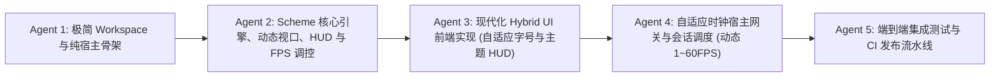

# TextCraft 3.0 多 Agent 协同推倒重构路线图 (Agents Consensus 3.0)

> [!NOTE]
> **历史基线协作规范归档**：
> 本文档记录 TextCraft 3.0 时期多 Agent 协同重构的历史任务编排。
> 最新 TextCraft 5.0 架构与多 Agent 协同工作流，请参阅：
> - 核心架构与使用指南：[**《README.md》**](../../README.md)
> - 版本演进日志：[**《版本演进与架构变更日志》**](changelog.md)
> - 双引擎演进路线图：[**《v4.0/5.0 架构与路线图》**](v4.0_architecture_and_roadmap.md)
> - MCP AI 协同指南：[**《MCP 开发者与 AI 协同指南》**](../develop/mcp_developer_guide.md)
>
> ⚠️ **历史文档标注（2026-11-10）**：本文档对应 **TextCraft 3.0 时期**，正文内容为历史记录、未按后续版本改写。当前分支 `feat/simulator-upgrade`（模拟器基座改造后）的状态以 [`state_inventory.md`](state_inventory.md)（状态全集）、[`known_limitations.md`](known_limitations.md)（现行限制）与 `docs/develop/` 下的三份开发指南为准；版本演进见 [`changelog.md`](changelog.md) 的 feat/simulator-upgrade 条目。

本文档制定了全面推倒重来、彻底剥离 Rust 游戏结构体、构建 **Hybrid UI（`<pre>` 字符流 + HTML 浮动 HUD）**，并支持 **Scheme 动态视口、自定义 HUD 主题与动态 FPS 变频控制** 的工作流与 Agent 任务编排。

---

## 1. 阶段目标与流水线总览

---

## 2. Agent 职责矩阵与任务清单

### Agent 1：极简 Workspace 与纯宿主核心骨架
- **目标**：建立单一核心 Crate 或极简双 Crate，无任何硬编码游戏数据结构。
- **任务清单**：
  1. 重写根目录 `Cargo.toml`：剥离旧 crate，收拢为单工程结构 `crates/server`。
  2. 宿主仅定义通用传输协议结构：
     - `PlayerInput`: `Key { code, shift, ctrl }` / `Cmd { input }` / `UIAction { action, payload }`。
     - `PlayerSnapshot`: `Snapshot { screen: String, cols: u16, rows: u16, hud: serde_json::Value }`。

---

### Agent 2：Scheme 核心引擎、动态视口、HUD 与 FPS 调控 (`scripts/`)
- **目标**：游戏所有状态、地图、移动判定、动态视口、ANSI 光栅化、HUD 表现与目标 FPS 均由 Scheme 全权控制。
- **任务清单**：
  1. 编写增强型 `scripts/prelude.scm`：
     - 纯 Scheme 分块地图存储 `(world:set-tile x y layer tile)` / `(world:get-tile x y layer)`。
     - 支持动态视口行列的 ANSI 极速光栅化器 `(render-viewport-ansi player-id cols rows)`。
     - HUD 构建器 `(build-player-hud player-id)`：输出包含血条、魔法、金币、背包和近期战斗日志的纯 Hash 树。
  2. 编写 `scripts/main.scm`：
     - 实现 `(engine:target-fps)`：根据状态返回目标帧率（10 ~ 60 FPS 动态变频）。
     - 实现 `(engine:viewport-size pid)`：返回 `(list cols rows)`，默认 80×24。
     - 实现 `(engine:hud-config)`：返回主题配置（如 `"theme": "cyberpunk"`）。
     - 实现 `(engine:on-init)`、`(engine:on-tick dt tick-id)`、`(engine:on-input pid input)`、`(engine:on-ui-action pid action)`。
     - 导出 `(engine:render-snapshot pid)`，整合输出 `screen`、`cols`、`rows` 与 `hud`。

---

### Agent 3：现代化 Hybrid UI 前端 (`web/index.html`)
- **目标**：打造高颜值、零外部打包依赖、视口自适应缩放与主题化 HUD 的单文件 Web 客户端。
- **任务清单**：
  1. **核心视口与动态等宽字号自适应**：
     - 居中 `<pre id="screen">`，等宽字体，样式锁死 `white-space: pre; overflow: hidden;`。
     - 前端根据快照中的 `cols` 和 `rows` 实时计算最适合的 `font-size`，确保任何视口尺寸下都居中铺满、永不换行撕裂。
  2. **浮动 HUD 层 (CSS 磨砂玻璃质感与多套主题支持)**：
     - 支持 Cyberpunk、Retro Terminal、Classic RPG 等 CSS 表现主题。
     - 顶部：玩家名、职业、动态平滑过渡血条（HP）、魔法条（MP）通过 CSS 变量微秒级刷新。
     - 右侧：可折叠/常驻的背包物品栏（CSS Grid 渲染，点击可触发 `ui_action` 上报）。
     - 左下角：半透明聊天与战斗日志视窗。
     - 底部：命令行与交互提示输入框。
  3. **焦点防丢机制**：
     - 任何 HUD 点击后自动执行 `blur()`，全局事件监听永不丢失 WASD 控制焦点。

---

### Agent 4：自适应时钟宿主网关与会话调度 (`server`)
- **目标**：高性能 WebSocket 网关与按 Scheme 意图自适应控频的宿主。
- **任务清单**：
  1. 集成 `game_server` 与 `game_script`：
     - 嵌入 `web/index.html`，提供静态 HTTP 托管。
     - 维护玩家 WebSocket 连接，管理认证 Token。
  2. 自适应时钟驱动循环：
     - 动态读取 Scheme 的 `(engine:target-fps)`（支持 1 ~ 60+ FPS），动态调节睡眠间隔，平滑变频。
     - 消费按键/UI 动作，推进世界主时钟 `(engine:on-tick dt tick-id)`。
     - 为在线玩家调用 `(engine:render-snapshot pid)` 并通过 WebSocket 异步推流。
  3. 保留看门狗超时中断与管理员实时 REPL (`!`) 求值。

---

### Agent 5：端到端集成测试与 CI 发布流水线
- **目标**：保障全新架构 100% 稳定运行，实现全平台一键发布。
- **任务清单**：
  1. 编写集成测试套件：覆盖服务启动、WebSocket 握手、ANSI 动态视口推流、HUD 数据更新、FPS 动态调整生效、状态热重载与自动存档。
  2. 验证全平台编译（Linux, Windows, macOS）。
  3. 更新 CI/CD 工作流，打包单二进制文件与 Scheme 脚本库发布 Release。
