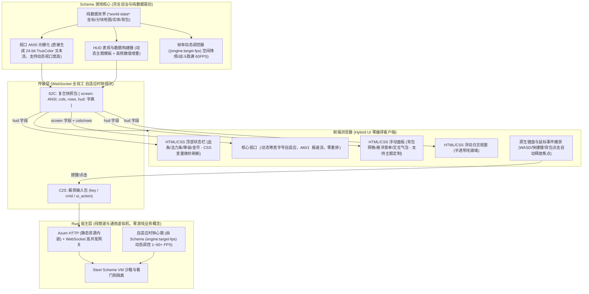

# TextCraft 3.0 混合架构与纯 Scheme 游戏引擎规范 (Specification 3.0)

> [!NOTE]
> **历史基线规范文档归档**：
> 本文档记录 TextCraft 3.0 混合 UI 架构的历史技术规范。
> 最新 TextCraft 5.0 架构（Flecs ECS 权威状态底座、原生 sub-5μs 光栅化、Roguelike 算子库与 Agent 自动驾驶引擎），请参阅：
> - 核心架构与使用指南：[**《README.md》**](../../README.md)
> - 版本演进日志：[**《版本演进与架构变更日志》**](changelog.md)
> - 双引擎演进路线图：[**《v4.0/5.0 架构与路线图》**](v4.0_architecture_and_roadmap.md)
> - Scheme FFI 开发指南：[**《Scheme 开发者指南》**](../develop/scheme_developer_guide.md)
> - MCP AI 协同指南：[**《MCP 开发者与 AI 协同指南》**](../develop/mcp_developer_guide.md)
>
> ⚠️ **历史文档标注（2026-11-10）**：本文档对应 **TextCraft 3.0 时期**的规范，正文（包括以 Scheme `*world-state*` 为世界状态核心的架构描述）为历史记录、未按后续版本改写。当前分支 `feat/simulator-upgrade`（模拟器基座改造后）的状态以 [`state_inventory.md`](state_inventory.md)（状态全集）、[`known_limitations.md`](known_limitations.md)（现行限制）与 `docs/develop/` 下的三份开发指南为准；版本演进见 [`changelog.md`](changelog.md) 的 feat/simulator-upgrade 条目。

> **核心哲学**：  
> **1. 游戏语义完全归属 Scheme，Rust 零硬编码结构体（Zero Rust Game Structs）**。  
> **2. 混合 UI 表现层（Hybrid UI）：死守 `<pre>` 极速字符流 + 现代 HTML/CSS 浮动 HUD**。  
> **3. 视口大小、HUD 表现风格与 60 FPS 帧率全面支持 Scheme 动态自主控制**。  
> **4. 架构极简极致：单二进制服务，内嵌零编译 Web 客户端**。

---

## 1. 架构拓扑：Hybrid UI 与通用宿主运行时



---

## 2. 核心架构设计

### 2.1 彻底抛弃 Rust 游戏结构体 (Zero Rust Game Structs)
在 1.0 与 2.0 中，Rust 定义了 `GridCoord`、`ViewportRect`、`RenderLayer`、`TileSemantic`、`LogicalClock` 等硬编码结构体。
在 3.0 中：
- **物理删除这些业务结构体**：Rust 不再约束地图维度、坐标格式、瓦片元数据以及图层枚举。
- **业务完全由 Scheme 决定**：
  - 坐标系统：Scheme 自行决定是 `(x, y)` 二维平面、网格六边形、还是三维空间。
  - 图层系统：Scheme 自行组织 `'terrain`、`'surface`、`'actor`、`'overlay` 或更多自定义层级。
  - 瓦片与实体：Scheme 原生 Hash 存储，支持无限动态扩展字段。
  - 时钟契约：Rust 仅向 Scheme 传递标量 `(engine:on-tick dt tick-id)`。
- **Rust 的纯粹定位**：Rust 蜕变为通用的“Scheme 游戏虚拟机网关”，只负责网络 I/O、自适应时间调度、看门狗中断与进程生命周期。

### 2.2 混合 UI 渲染管线 (Hybrid UI) 与动态视口自适应
1. **核心战场/视口：`<pre id="screen">`**
   - **特点**：死守终端等宽字符流与 ANSI 24-bit TrueColor（`\x1b[38;2;R;G;Bm`）。
   - **自由视口大小与前端自适应（Letterbox 居中）**：
     - Scheme 可在脚本中自由返回视口行列尺寸，例如 `(define (engine:viewport-size pid) (list 80 24))`。
     - 服务端下发快照时附带 `cols` 与 `rows`。
     - 前端 `<pre>` 样式设置 `white-space: pre; overflow: hidden;`，并基于当前窗口大小动态计算最佳等宽字体尺寸：
       `fontSize = Math.min(window.innerWidth / cols * 1.6, window.innerHeight / rows)`。
     - **效果**：无论视口是 `40×20` 还是 `120×40`，画面始终等比居中自适应，永不撕裂，零 DOM 增删重排（Reflow 耗时 `< 0.2ms`）。
2. **环绕浮动 HUD（动静分离与主题自定义）**：
   - **动静分离原则**：
     - **静态风格（低频定义）**：Scheme 可在 `(engine:hud-config)` 中选择主题（如 `"cyberpunk"` 霓虹毛玻璃、`"retro-terminal"` 经典绿黑终端、`"classic-rpg"` 奇幻石质、`"minimal"` 极简无框），前端按需挂载 CSS 类。
     - **动态数值（高频 60 FPS 刷新）**：每帧推送的只有纯数据字典，前端通过 CSS 变量和属性直接赋值（如 `hpBar.style.width = hp%`），耗时 `< 0.05ms`。
   - **焦点防抢占机制**：
     - HUD 容器设置 `pointer-events: none`，子交互元素设置 `pointer-events: auto`。
     - 任何 HUD 点击后自动执行 `event.target.blur()`，确保 WASD 行走焦点永不丢失。

### 2.3 Scheme 动态调控帧率 (Adaptive Dynamic FPS Control)
- **极致稳定 60 FPS + 按需动态变频**：
  - 游戏并非所有时刻都需要跑满 60 FPS（例如回合制等待、背包挂机、对话剧情时跑 60 FPS 会空耗 CPU 与带宽）。
  - Scheme 提供 `(engine:target-fps)` 入口（或 `(engine:set-fps! n)` 宿主函数）：
    - 激烈战斗 / 移动走位：返回 `60`（16.6ms 每 tick，极致丝滑）；
    - 普通探索 / 对话剧情：返回 `30`（33.3ms 每 tick）；
    - 挂机静止 / 纯回合制操作：降频至 `10~15` 甚至无变动不推流。
  - Rust 宿主调度器根据 Scheme 声明的 `target_fps` 动态调整 Tokio 调度间隔，精准控频，毫秒级无缝切换。

---

## 3. 通信与消息协议

### 3.1 客户端上行 (C2S)
客户端通过 WebSocket 发送轻量 JSON：
```json
// 键盘/方向移动输入
{"type": "key", "code": "KeyW", "shift": false, "ctrl": false}

// 控制台/聊天指令输入
{"type": "cmd", "input": "(say \"Hello, World!\")"}

// UI 直接交互输入 (如点击背包第 2 格)
{"type": "ui", "action": "use_item", "slot": 2}
```

### 3.2 服务端下行 (S2C 复合快照)
服务端每帧向客户端推送复合帧：
```json
{
  "cols": 80,
  "rows": 24,
  "screen": "\u001b[2J\u001b[H\u001b[38;2;100;200;100m# # # # # # # #\u001b[0m\n...",
  "hud": {
    "theme": "cyberpunk",
    "hp": 85,
    "max_hp": 100,
    "mp": 40,
    "max_mp": 50,
    "level": 3,
    "gold": 128,
    "inventory": [
      {"id": "sword_iron", "name": "铁剑", "icon": "⚔️", "count": 1},
      {"id": "potion_hp", "name": "生命药水", "icon": "🧪", "count": 3}
    ],
    "dialog": null,
    "logs": [
      {"channel": "combat", "text": "你击中了哥布林，造成 12 点伤害！"},
      {"channel": "system", "text": "获得金币 +15"}
    ]
  }
}
```

---

## 4. Scheme 核心契约规范

Scheme 主逻辑需实现以下标准生命周期契约：

| 函数签名 | 触发时机 | 职责 |
|---|---|---|
| `(engine:target-fps)` | 每次时钟调度 | 返回当前目标帧率（如 10 ~ 60），动态调控宿主调度节拍 |
| `(engine:viewport-size pid)` | 视口光栅化前 | 返回 `(list cols rows)`，动态定义该玩家当前屏幕大小 |
| `(engine:hud-config)` | 客户端握手/主题变更 | 返回 HUD 表现风格（如 `"theme": "cyberpunk"`, `"layout": "surround"`） |
| `(engine:on-init)` | 引擎启动时 | 初始化 `*world-state*` 地图、生成实体与初始数据 |
| `(engine:on-player-join pid token)` | 玩家建立连接 | 为玩家分配角色、坐标、初始背包与属性 |
| `(engine:on-player-leave pid)` | 玩家断开连接 | 保存角色状态或清理场景实例 |
| `(engine:on-tick dt tick-id)` | 主时钟心跳 | 更新世界演化、怪物 AI、计时器与状态结算 |
| `(engine:on-input pid input-map)` | 接收按键/鼠标 | 处理角色位移与交互动作 |
| `(engine:on-command pid datum raw)` | 接收控制台指令 | 安全解析玩家聊天或管理 REPL 指令 |
| `(engine:on-ui-action pid action-map)`| 接收 HUD 交互 | 处理点击背包、选定菜单等 UI 交互 |
| `(engine:render-snapshot pid)` | 每帧推流前 | 必须返回 `(hash "screen" ansi-str "cols" w "rows" h "hud" hud-map)` |
| `(engine:export-state)` | 存档/热重载前 | 将 `*world-state*` 导出为纯 JSON 兼容数据树 |
| `(engine:import-state data)` | 读档/热重载后 | 恢复全局纯数据状态 |

---

## 5. 性能与工程质量指标

1. **帧率自适应与稳定性**：支持最高 60 FPS 稳定运行，Scheme 动态降频至 10~30 FPS 时毫秒级过渡无跳帧。
2. **视口自适应**：前端 `<pre>` 无论在手机屏幕还是超宽带鱼屏上，基于等宽字号缩放永远完美居中，零布局撕裂。
3. **单二进制零依赖发布**：单一可执行程序集成 Axum HTTP 服务器、WebSocket 协议桥接、内嵌 Hybrid UI 前端（HTML/CSS/JS）及 Scheme 标准库，无需外部依赖开箱即用。
