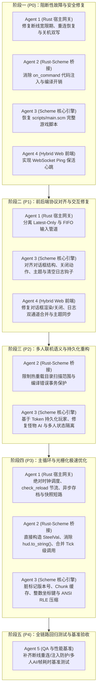
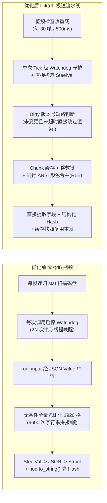

# TextCraft 3.0 全量问题修复与主循环深度优化任务清单 (Master TODO & Agent Execution Plan)

> [!IMPORTANT]
> 本文档汇总了对 TextCraft 3.0 整个代码库（Rust 宿主层 `src/`、Scheme 脚本层 `scripts/`、前端 `web/index.html` 以及底层依赖 `game_server` / `game_script`）进行全量代码审计后发现的 **22 项核心问题**。
> 任务按严重程度与依赖关系划分为 **5 个演进阶段（Phases / P0~P4）**，并拆解为 **5 个专职 Agent** 的可落地分步执行指南。

---

## 1. 全量问题分级总览 (Problem Matrix)

| 优先级 | 编号 | 所属模块 | 问题简述 | 涉及文件与位置 |
| :---: | :---: | :--- | :--- | :--- |
| **P0**<br>阻断故障 | **P0-1** | 脚本工作区 | `scripts/main.scm` 仅剩 26 行半成品代码，缺失 `engine:on-init` 等全部核心钩子，服务启动与测试直接崩溃 | `scripts/main.scm`<br>`scripts/default/main.scm` |
| **P0**<br>阻断故障 | **P0-2** | 会话与心跳 | 前端未实现定时 `Ping` 心跳，而服务端 `heartbeat_timeout_secs` 默认 10 秒，玩家静止 10 秒即被踢下线 | `web/index.html`<br>`src/runtime.rs` |
| **P0**<br>阻断故障 | **P0-3** | 断线重连 | `tick()` 将 `PlayerDisconnected`（进入 60s 宽限期）与 `PlayerTerminated` 混为一谈，断线瞬间调用 `on_player_leave` 删光玩家数据 | `src/runtime.rs:187-194`<br>`scripts/prelude.scm:172` |
| **P0**<br>阻断故障 | **P0-4** | 断线重连 | `PlayerReconnected` 仅打印日志，未恢复 `player_tokens`（导致管理员重连后丢失权限）且未重置快照缓存 | `src/runtime.rs:195-198` |
| **P0**<br>阻断故障 | **P0-5** | 安全与注入 | `on_command` 使用 `engine.run(format!("'{}", raw))` 无看门狗编译求值，输入 `1) (let loop () (loop)` 可直接注入死循环卡死主线程 | `src/logic.rs:229-236` |
| **P1**<br>功能坏死 | **P1-1** | 前后端协议 | NPC 对话框数据格式错位：Scheme 写入纯字符串，前端 `renderDialog` 按 `{ title, text, options }` 对象读取，导致弹窗正文为空 | `scripts/default/main.scm:396`<br>`web/index.html:1294` |
| **P1**<br>功能坏死 | **P1-2** | 前后端协议 | 对话框关闭事件名错位：前端发送 `dialog_close` / `dialog_confirm`，后端只认 `close_dialog`；且按 `Esc` 不发包，导致弹窗永远关不掉 | `scripts/default/main.scm:493`<br>`web/index.html:1299,1328,1427` |
| **P1**<br>功能坏死 | **P1-3** | 前后端协议 | Scheme 中 `dialog: #f` 序列化为 JSON `false`，而前端仅判断 `else if (hud.dialog === null)`，导致服务端无法关闭前端弹窗 | `web/index.html:1207` |
| **P1**<br>功能坏死 | **P1-4** | 日志系统 | 双通道冲突：`TextCraftEvent`（Welcome/REPL结果/Error）直接追加 DOM，而 `hud.logs` 每次执行 `innerHTML = ''` 全量覆盖，导致 REPL 结果与系统事件被瞬间抹除 | `web/index.html:1261-1267,1559` |
| **P1**<br>功能坏死 | **P1-5** | UI 状态同步 | 前端点击“主题切换”与“清空日志”仅修改本地 DOM，未通知服务端，下一帧快照到达时被服务端旧状态强行覆盖还原 | `web/index.html:1351,1378` |
| **P1**<br>功能坏死 | **P1-6** | 输入管道 | `PlayerInput`（含 `Key`/`Cmd`/`UIAction`）走 `drain_inputs()` 的 Latest-Only Latch，同帧内多次按键或指令会被静默覆盖吞掉 | `src/runtime.rs:202,282`<br>`web/index.html:1492` |
| **P2**<br>联机与存档 | **P2-1** | 存档与身份 | `*world-state*["players"]` 以自增临时 `player_id` 为 Key 且下线即删，导致下线后存档丢失玩家数据、重启服务器后新玩家按 ID 串号继承他人存档 | `scripts/prelude.scm:152-177`<br>`src/runtime.rs:171-194` |
| **P2**<br>联机与存档 | **P2-2** | 怪物 AI | 怪物 Y 轴移动 Bug：计算了 `dy` 但 `(target-y my)` 未加上 `dy`，且更新时只更新 `"x"`，导致怪物永远只能水平移动 | `scripts/default/main.scm:284-295` |
| **P2**<br>联机与存档 | **P2-3** | 怪物 AI | 怪物 AI 永远只取 `(car p-keys)`（哈希表第一个玩家）作为追击与攻击目标，无视其他在线玩家 | `scripts/default/main.scm:256-261` |
| **P2**<br>联机与存档 | **P2-4** | 多人状态隔离 | `double_width`（双宽模式）存在全局 `*world-state*` 而非玩家私有属性中，一人切换 `(dw)` 导致全服所有玩家画面变形；`(say ...)` 仅写自身日志未广播 | `scripts/prelude.scm:44`<br>`scripts/default/main.scm:515,541` |
| **P2**<br>联机与存档 | **P2-5** | 热重载与存档 | `check_reload` 递归扫描并加载 `scripts/default/` 子目录造成覆盖冲突；关机时 `run_loop` 与 `SchemeLogic::drop` 重复写盘两次 | `src/logic.rs:342-393`<br>`src/runtime.rs:410` |
| **P3**<br>主循环优化 | **P3-1** | 快照去重与渲染 | 阶段 7 每帧对所有玩家无条件执行全量 `render_snapshot` 光栅化（1920 格）并转 JSON，最后才算 Hash 丢弃未变化帧，静止帧 CPU 浪费 95%+ | `src/runtime.rs:247-277`<br>`src/logic.rs:250-261` |
| **P3**<br>主循环优化 | **P3-2** | 序列化开销 | `snapshot.hud.to_string().hash(...)` 每帧将 `hud` 序列化为完整 JSON 字符串仅用于算 Hash；`render_snapshot` 经历 `SteelVal -> Value -> Struct -> String` 三重转换 | `src/runtime.rs:255`<br>`src/logic.rs:256-259` |
| **P3**<br>主循环优化 | **P3-3** | ANSI 光栅化 | `render-viewport-ansi` 每帧每玩家执行 9600 次 `tile-key`/`chunk-key` 字符串拼接，每格线性遍历其他玩家，且每格重复输出完整 RGB 与 Reset 转义码 | `scripts/prelude.scm:212-305` |
| **P3**<br>主循环优化 | **P3-4** | 文件扫描与归档 | `check_reload()` 每秒 60 次全目录递归 `stat` 系统调用；`save_state_to_file()` 在主线程同步 JSON 序列化与写盘阻塞帧率；`run_loop` 存在累积 `sleep` 时钟漂移 | `src/logic.rs:289,342`<br>`src/runtime.rs:370-406` |
| **P3**<br>主循环优化 | **P3-5** | 跨界与看门狗 | 每帧多次细粒度 `safe_call_function` 触发 $2 \times N$ 次 `PersistentWatchdog` 的 `Mutex` 加锁与 `Condvar` 跨线程唤醒/阻塞等待；`query_target_fps` 每帧额外多 1 次 VM 调用；`on_input` 经由 `serde_json::Value` 中转 | `src/runtime.rs:164-280,377`<br>`src/logic.rs:157-226` |

---

## 2. 分阶段与多 Agent 协同执行路线图



### Agent 角色分工定义

- **Agent 1 — Rust 宿主与网络调度专家 (`src/runtime.rs`, `src/types.rs`)**
  负责 `TextCraftServer` 主循环调度、会话生命周期状态机对接、输入/命令管道分流、快照去重缓存与异步任务编排。
- **Agent 2 — Rust-Scheme 虚拟机桥接专家 (`src/logic.rs`)**
  负责 `SchemeLogic` 与 `steel-core` VM 的交互边界、看门狗粒度控制、零拷贝类型转换、热重载安全策略与非阻塞状态导出。
- **Agent 3 — Scheme 游戏核心与光栅化专家 (`scripts/prelude.scm`, `scripts/main.scm`)**
  负责 `*world-state*` 数据结构、玩家持久化模型、怪物 AI 寻路索敌、多人状态隔离、脏标记（Dirty Flags）以及 `render-viewport-ansi` 光栅化器优化。
- **Agent 4 — Hybrid UI 前端专家 (`web/index.html`)**
  负责 WebSocket 保活心跳、输入事件分流封装、对话框组件协议对齐、日志增量渲染以及 HUD 交互同步。
- **Agent 5 — 集成测试与性能基准专家 (`tests/`)**
  负责编写针对断线重连、安全防注入、前后端契约、多人联机以及 `tick(dt)` 微秒级性能基准的自动化测试套件。

---

## 3. 分阶段详细执行指南 (Step-by-Step Guide)

---

### 阶段一（Phase 1 - P0）：阻断性故障与安全漏洞清零

> **阶段目标**：让项目恢复 100% 可编译、可运行、可通过现有全部测试的状态，解决“挂机 10 秒掉线删档”和“控制台命令代码注入死循环”两个致命隐患。

#### 🔹 Agent 3（Scheme 核心引擎）任务：
- [x] **Task 1.1（修复 P0-1）：恢复 `scripts/main.scm` 完整实现**
  - **问题**：当前 `scripts/main.scm` 仅有 26 行未完成的卡牌测试代码，缺少 `engine:on-init` 等标准契约。
  - **操作**：
    1. 若需保留卡牌草稿，将其移至 `scripts/drafts/stacklands.scm`（注意不要放在会被自动混载的路径下，配合 Agent 2 的 Task 3.1）。
    2. 将 `scripts/default/main.scm` 的完整内容同步恢复至 `scripts/main.scm`，确保 `prelude.scm` 与 `main.scm` 契约完整。

#### 🔹 Agent 4（Hybrid Web 前端）任务：
- [x] **Task 1.2（修复 P0-2）：在 `web/index.html` 中增加 WebSocket `Ping` 心跳定时器**
  - **问题**：服务端 `heartbeat_timeout_secs` 为 10 秒，前端不发 `Ping` 导致静止 10 秒必被 Kick。
  - **操作**：
    1. 在 `web/index.html` 中声明全局变量 `let pingInterval = null;`。
    2. 在 `ws.onopen` 中启动每 3000ms 一次的心跳发送：
       ```javascript
       if (pingInterval) clearInterval(pingInterval);
       pingInterval = setInterval(() => {
         sendWs({ Ping: { client_time_ms: Date.now() } });
       }, 3000);
       ```
    3. 在 `ws.onclose` 中清理 `if (pingInterval) { clearInterval(pingInterval); pingInterval = null; }`。
    4. 在 `ws.onmessage` 中忽略 `raw.Pong` 帧（或用 `Date.now() - raw.Pong.client_time_ms` 更新顶部状态栏 RTT 延迟显示）。

#### 🔹 Agent 1（Rust 宿主网关）任务：
- [x] **Task 1.3（修复 P0-3 & P0-4）：正确区分 `PlayerDisconnected`、`PlayerReconnected` 与 `PlayerTerminated`**
  - **问题**：`src/runtime.rs:187-198` 在 `PlayerDisconnected` 时立刻删掉 `player_tokens` 并调用 `on_player_leave`，使 60 秒宽限期失效，且重连后丢失管理员权限与画面。
  - **操作**：修改 `TextCraftServer::tick` 中的阶段 2 会话事件处理：
    1. `SessionEvent::PlayerDisconnected { player_id, grace_period_secs }`：
       - **不要**移除 `self.player_tokens`，**不要**调用 `self.logic.on_player_leave(player_id)`！
       - 仅移除 `self.last_snapshots.remove(&player_id)`（确保重连后第一帧必定全量推送快照），并记录 `tracing::info!(player_id, grace_period_secs, "Player disconnected, entering grace period")`。
    2. `SessionEvent::PlayerReconnected { player_id }`：
       - 移除 `self.last_snapshots.remove(&player_id)` 以强制立即下发最新快照。
       - 如果 `self.handle.session_manager().get_session_by_player(player_id)` 存在，确保 `self.player_tokens.insert(player_id, session.token)` 保持同步。
       - 向该玩家重新发送 `TextCraftEvent::Welcome`（提示“已成功重连恢复会话”）。
    3. `SessionEvent::PlayerTerminated { player_id }`：
       - 此时宽限期已过，正式执行清理：`self.player_tokens.remove(&player_id)`、`self.last_snapshots.remove(&player_id)`，并调用 `self.logic.on_player_leave(player_id)`。

#### 🔹 Agent 2（Rust-Scheme 桥接）任务：
- [x] **Task 1.4（修复 P0-5）：消除 `SchemeLogic::on_command` 的代码注入漏洞与编译开销**
  - **问题**：`src/logic.rs:230-236` 执行 `self.app.engine.run(format!("'{}", raw))`，既无看门狗保护，又允许通过闭合括号注入任意死循环代码（如 `1) (let loop () (loop)`）。
  - **操作**：
    1. 在 `scripts/prelude.scm` 中新增一个安全解析辅助函数 `(engine:safe-parse-datum raw)`（使用 `(open-input-string raw)` 和 `(read port)` 读取首个 S-表达式，并检查是否还有多余未闭合或尾随表达式，捕获异常回退为原始字符串）。
    2. 在 `src/logic.rs` 的 `on_command` 中删除 `self.app.engine.run(format!("'{}", raw))`，改为在受 `safe_call_function` 看门狗保护的 Scheme 调用内部完成 `datum` 解析（或由 `engine:on-command` 内部调用 `engine:safe-parse-datum`）。

---

### 阶段二（Phase 2 - P1）：前后端协议对齐、输入分流与交互修复

> **阶段目标**：彻底修复 NPC 对话框死锁、REPL 与系统日志被抹除、主题切换被回滚、连续按键被吞等影响核心玩法的交互 Bug。

#### 🔹 Agent 3（Scheme 核心引擎）与 Agent 4（Hybrid Web 前端）联合任务：
- [x] **Task 2.1（修复 P1-1, P1-2, P1-3）：统一 NPC 对话框数据契约与关闭协议**
  - **Scheme 侧（Agent 3，`scripts/main.scm`）**：
    1. 将与 `merchant` 交互时写入的 `"dialog"` 从纯字符串改为结构化哈希表：
       ```scheme
       (hash "title" "神秘商人"
             "text" dialog-text
             "options" (list (hash "text" "购买生命药水 (25G)" "action" "buy_potion")
                             (hash "text" "离开" "action" "close_dialog")))
       ```
    2. 在 `engine:on-ui-action` 中同时兼容 `"close_dialog"`、`"dialog_close"` 和 `"dialog_confirm"`，统一将玩家的 `"dialog"` 设为 `#f`，并实现 `"buy_potion"` 扣减 25 金币增加 1 瓶药水的逻辑。
  - **前端侧（Agent 4，`web/index.html`）**：
    1. 在 `updateHUD(hud)` 中，将对话框显隐逻辑修改为兼容布尔值 `false`、字符串和对象：
       ```javascript
       if (hud.dialog && typeof hud.dialog === 'object') {
         renderDialog(hud.dialog);
       } else if (hud.dialog && typeof hud.dialog === 'string') {
         renderDialog({ title: '对话', text: hud.dialog });
       } else {
         hideDialog();
       }
       ```
    2. 在按 `Escape` 键关闭对话框时（第 1427 行），补发 `sendWs({ type: 'ui', action: 'close_dialog', payload: null })`，确保服务端同步清除状态。

- [x] **Task 2.2（修复 P1-4）：统一日志通道，防止 `hud.logs` 抹除 `TextCraftEvent` 消息**
  - **问题**：`Welcome`、REPL 求值结果（`channel: "repl"`）和 `Error` 走 `TextCraftEvent`，而移动/战斗日志走 `hud.logs` 并每次清空 `#log-container`。
  - **操作**：
    - **方案 A（推荐，服务端统一收敛）**：在 `src/runtime.rs` 中，除了下发 `TextCraftEvent` 外，提供一个 `logic.append_player_log(pid, channel, text)`（或在前端维护统一的本地日志环形缓冲区 `clientLogs`）：
    - **方案 B（前端增量合并，`web/index.html`）**：
      1. 在 `scripts/prelude.scm` 的 `player:add-log` 中为每条日志赋予递增序号 `"seq"`（或由前端对比新旧 `hud.logs` 数组差异），`renderLogs` 只将新增的日志条目通过 `appendLogLine` 追加到 `#log-container`，**严禁执行 `logContainerEl.innerHTML = ''` 全量清空**（除非用户主动点击“清空日志”按钮）。
      2. 在 `appendLogLine` 中增加对 `channel === 'repl'` 的专属样式标签 `[REPL]`。

- [x] **Task 2.3（修复 P1-5）：同步前端“主题切换”与“清空日志”动作到服务端**
  - **前端侧（Agent 4，`web/index.html`）**：
    1. 点击 `#theme-btn` 切换主题时，调用 `sendWs({ type: 'ui', action: 'set_theme', payload: { theme: THEMES[currentThemeIdx].id } })`。
    2. 点击 `#clear-log-btn` 清空日志时，调用 `sendWs({ type: 'ui', action: 'clear_logs', payload: null })`。
    3. 窗口初始化及 `resize` 防抖后，若需要根据窗口调整视口或上报，可发送 `set_viewport`。
  - **Scheme 侧（Agent 3，`scripts/main.scm`）**：
    1. 在 `engine:on-ui-action` 中增加对 `"set_theme"`（更新玩家 `"theme"` 字段）和 `"clear_logs"`（将玩家 `"logs"` 置为 `'()`）的处理分支。

#### 🔹 Agent 1（Rust 宿主网关）与 Agent 4（Hybrid Web 前端）联合任务：
- [x] **Task 2.4（修复 P1-6）：修正输入管道分类，防止离散按键与指令被 Latest-Only Latch 吞没**
  - **问题**：所有按键、UI 点击和命令都被前端包装为 `{ Input: ... }`，在服务端 `IngestionPipeline` 中走 `DashMap::insert` 覆盖模式，同帧内连按两下方向键或连续点击背包会丢包。
  - **操作**：
    1. **前端侧（`web/index.html:1487-1495`）**：修改 `sendWs(data)`：
       - 对于离散可靠动作（`type === 'cmd'`、`type === 'ui'`、`type === 'key'`），包装为 `{ Command: { Input: data } }` 走 FIFO 队列（或仅让高频 `mouse` 移动走 `{ Input: data }`）。
    2. **服务端侧（`src/runtime.rs`）**：保持 `drain_inputs()` 与 `drain_commands()` 都能调用 `process_player_input`，这样既100%向后兼容所有现有测试（测试中直接发 `ClientEnvelope::Input` 依然正常处理），又能保证真实前端在高负载或低帧率（15 FPS）下绝不丢失任何一次按键和点击。

---

### 阶段三（Phase 3 - P2）：多人联机语义、AI 修复与持久化重构

> **阶段目标**：解决多人同服时的状态串扰、怪物 AI 缺陷以及重启服务器后的存档串号/丢档问题。

#### 🔹 Agent 3（Scheme 核心引擎）任务：
- [x] **Task 3.1（修复 P2-1）：将玩家状态存储改为基于 `token` 持久化，分离在线连接态**
  - **问题**：以自增 `player_id` 为 Key 且离开即 `remove-player`，导致玩家下线即丢档、重启即串号。
  - **操作（`scripts/prelude.scm` & `scripts/main.scm`）**：
    1. 在 `*world-state*` 中增加 `"saved_players" (hash)`（以 `token` 字符串为 Key 存储持久化的玩家角色数据），保留 `"players" (hash)` 作为当前在线活跃玩家的 `pid-key -> player-map` 映射。
    2. 当 `(engine:on-player-join pid token)` 被调用时：
       - 先检查 `saved_players` 中是否存在该 `token`（非空）的存档数据；
       - 若存在，恢复其坐标、HP/MP、等级、金币、背包与主题，并绑定当前 `id = pid` 放入 `"players"`；
       - 若不存在，调用 `(make-default-player pid token)` 创建新角色并同时写入 `"players"` 与 `"saved_players"`。
    3. 在 `(set-player pid player-map)` 中，如果该玩家具有非空 `"token"`，同步更新 `"saved_players"` 中对应 `token` 的记录（可排除临时会话日志）。
    4. 当 `(engine:on-player-leave pid)` 被调用（会话彻底终止）时，先将其最新状态同步至 `"saved_players"`，再从在线表 `"players"` 中移除 `pid`。这样下线玩家不会留在地图上挨打，但重连或重启服务器后凭相同 `token` 可完美恢复全部进度！

- [x] **Task 3.2（修复 P2-2 & P2-3）：修复怪物 AI 的 Y 轴移动 Bug 与多玩家就近索敌**
  - **操作（`scripts/main.scm:252-304`）**：
    1. **就近索敌**：为每个怪物遍历所有在线 `players`，计算曼哈顿距离 `(+ (abs (- mx px)) (abs (- my py)))`，选择距离最近的存活玩家作为目标，而不是固定取 `(car p-keys)`。
    2. **修复 Y 轴移动**：
       - 当距离为 1 时发动攻击；
       - 当距离 > 1 时，优先沿距离差较大的轴移动（或先尝试 `(target-x (+ mx dx), target-y my)`，若被阻挡或 `dx = 0` 则尝试 `(target-x mx, target-y (+ my dy))`）；
       - 更新怪物哈希表时，**同时更新 `"x"` 和 `"y"`**：`(hash-insert (hash-insert m "x" actual-tx) "y" actual-ty)`，并同步更新 `'actor` 图层瓦片位置。

- [x] **Task 3.3（修复 P2-4）：隔离玩家私有视图设置与实现真正的全服聊天广播**
  - **操作（`scripts/prelude.scm` & `scripts/main.scm`）**：
    1. **双宽模式私有化**：在 `make-default-player` 中增加 `"double_width" #f` 字段；将 `(engine:double-width? pid)` 改为优先读取玩家自身的 `"double_width"` 属性（回退到全局默认值），玩家输入 `(dw)` 时仅切换自己的双宽模式（或提供全局/个人开关）。
    2. **实现真正的 `(say "...")` 广播**：
       - 在 `engine:on-command` 的 `'say` 分支中，获取发言者名字 `pname`，构造消息 `(string-append pname ": " txt)`；
       - 遍历当前所有在线玩家调用 `(player:add-log other-pid "chat" msg)`（或调用宿主 `(engine:broadcast "chat" msg)`），让全服所有玩家都能实时看到聊天内容。

#### 🔹 Agent 2（Rust-Scheme 桥接）与 Agent 1（Rust 宿主网关）任务：
- [x] **Task 3.4（修复 P2-5）：规范热重载扫描范围并消除关机二次重复存档**
  - **操作 1（`src/logic.rs:342-377`）**：
    - 在 `check_reload` 中过滤掉 `scripts/default/` 等备份子目录（仅加载 `scripts_dir` 根目录下的 `prelude.scm` 和 `main.scm`，或明确声明的模块文件），防止热重载把 `scripts/default/main.scm` 混入执行。
    - 热重载编译前先在临时源码或先验证语法，若 `compile_and_run_raw_program_with_path` 报错，记录 `tracing::error!` 并保持原状态不崩溃。
  - **操作 2（`src/runtime.rs:410` & `src/logic.rs:386`）**：
    - 移除 `run_loop` 结尾显式的 `self.logic.save_state_to_file()`（或用一个 `dirty_since_last_save: bool` 标志位控制），避免 `run_loop` 退出与 `SchemeLogic::drop` 连续写盘两次。

---

### 阶段四（Phase 4 - P3）：主循环 (`tick`) 与光栅化器极速性能优化

> **阶段目标**：消除主循环中所有冗余的磁盘 I/O、锁竞争、跨语言全量序列化和无效光栅化，将静止帧 CPU 占用降低 90% 以上，活动帧吞吐量提升 3~5 倍。



#### 🔹 Agent 1（Rust 宿主网关）任务：
- [x] **Task 4.1（修复 P3-4）：`check_reload` 降频节流、异步存档与精准时钟调度**
  1. **`check_reload` 节流**：在 `TextCraftServer` 中记录 `last_reload_check: Instant`，在 `tick(dt)` 的阶段 1 中仅当 `now.duration_since(self.last_reload_check) >= Duration::from_millis(500)` 时才调用 `self.logic.check_reload()`。
  2. **消除 `sleep` 时钟漂移**：在 `run_loop` 中使用 `tokio::time::Instant` 维护固定节拍器或 `sleep_until`，并将 `tokio::signal::ctrl_c()` 移出热循环（或仅在 `select!` 中按需监听）。
  3. **消除 `outbound_queue` 互斥锁开销**：在 `src/logic.rs` 中将 `Arc<Mutex<Vec<OutboundMessage>>>` 优化为无竞争读取（或仅在非空时 `drain`）。

- [x] **Task 4.2（修复 P3-1 & P3-2）：重构阶段 7 快照去重流水线与消除 `hud.to_string()`**
  1. **消除 `snapshot.hud.to_string().hash(&mut hasher)`**：
     - 编写递归函数 `fn hash_json_value<H: Hasher>(v: &serde_json::Value, state: &mut H)`，直接对 `Value` 枚举树进行哈希计算，彻底消灭每帧每玩家一次的完整 JSON 字符串格式化与堆分配！
  2. **缓存上次快照与脏标记短路**：
     - 将 `last_snapshots` 从 `HashMap<PlayerId, (u64, Instant)>` 升级为保存 `(u64, Instant, PlayerSnapshot)`（或结合 Scheme 侧的脏版本号）。
     - 当世界状态与该玩家状态自上一帧以来均未发生变更（见 Task 4.4）时：
       - 若未到 `snapshot_heartbeat_ms`：直接 `continue`，**0 次 Scheme 调用、0 次光栅化**！
       - 若已到 `snapshot_heartbeat_ms`：直接取出缓存的 `PlayerSnapshot` 发送心跳帧，**同样无需重新调用 Scheme `render_snapshot`**！

#### 🔹 Agent 2（Rust-Scheme 桥接）任务：
- [x] **Task 4.3（修复 P3-2 & P3-5）：优化跨语言转换、合并 `target_fps` 查询与看门狗调用**
  1. **`on_input` 与 `on_ui_action` 零 JSON 中转**：
     - 在 `src/logic.rs` 中直接将 `PlayerInput::Key` / `Mouse` 构造为 `SteelVal::HashMapV`，省去 `serde_json::to_value(input)` 的中间序列化步骤。
  2. **直接从 `SteelVal` 提取 `PlayerSnapshot`**：
     - 在 `SchemeLogic::render_snapshot` 中，直接匹配顶层 `SteelVal::HashMapV`，直接提取 `"cols"` (`IntV`)、`"rows"` (`IntV`)、`"screen"` (`StringV`)，仅对 `"hud"` 子节点调用一次 `steel_val_to_json`，避免把长达数十 KB 的 `screen` 字符串在 `SteelVal -> serde_json::Value -> PlayerSnapshot` 之间来回搬运拷贝。
  3. **合并 `query_target_fps`**：
     - 让 `SchemeLogic::on_tick` 直接返回（或顺带提取）`*world-state*` 中的 `"target_fps"` 缓存在 `SchemeLogic::cached_target_fps: u64` 字段中，`query_target_fps()` 直接读取该缓存字段，每帧减少 1 次 VM 函数调用。

#### 🔹 Agent 3（Scheme 核心引擎）任务：
- [x] **Task 4.4（修复 P3-1 & P3-3）：实现 `render-viewport-ansi` 光栅化提速与 ANSI RLE 压缩**
  1. **内层循环 Chunk 缓存与玩家坐标预索引（`scripts/prelude.scm:251-305`）**：
     - 在进入 `loop-row` 之前，遍历一次 `other-players`，构建一个以坐标 `(tile-key ox oy "p")` 为 Key 的临时 Hash 表 `other-player-map`，将内层循环的 $O(N_{\text{players}})$ 线性查找降为 $O(1)$。
     - 在 `loop-col` 中缓存当前 `last-chk-x` 和 `last-tiles`，仅当 `(coord->chunk-coord x)` 发生变化（每 16 列才变一次！）时才重新计算 `chunk-key` 并查找 `chunks`，将 Chunk 查找次数减少 **16 倍**！
  2. **同行 ANSI 颜色状态合并（Run-Length Encoding）**：
     - 修改 `resolve-cell-ansi` 或行拼装逻辑：跟踪同行上一个格子的 `(last-fg, last-bg)`；
     - 如果当前格子的 `(fg, bg)` 与上一格完全相同，**直接追加字符 `glyph-str`，不重复输出 `\x1b[38;2;...m\x1b[48;2;...m` 和 `\x1b[0m`**；
     - 仅在颜色切换时输出差异转义码，并在每行末尾存在活动颜色时统一输出一次 `*ansi-reset*`。
     - **收益**：单帧 ANSI 字符串体积和拼接次数下降 **70% ~ 85%**，前端 `parseAnsi` 正则匹配次数与生成的 `<span style="...">` DOM 节点数量同步减少 **70% ~ 85%**！

---

### 阶段五（Phase 5 - P4）：全链路集成测试与基准验收

> **阶段目标**：为所有修复项建立自动化回归防线，确保零破坏、100% 通过率。

#### 🔹 Agent 5（QA 与性能基准）任务：
- [x] **Task 5.1：新增会话断线重连与权限保持测试 (`tests/session_reconnect_test.rs`)**
  - 验证玩家（含 Admin）断开连接后在宽限期内重连：角色坐标/金币/背包不丢失，Admin Token 权限依然有效，且重连后立即收到快照。
  - 验证会话真正超时终止（`PlayerTerminated`）后才触发 `on_player_leave`，且再次用同一 `token` 登录时能从 `"saved_players"` 恢复角色存档。
- [x] **Task 5.2：新增安全防注入与前后端协议契约测试 (`tests/security_and_protocol_test.rs`)**
  - 验证恶意命令输入 `1) (let loop () (loop)` 不会阻塞或卡死服务器 `tick`。
  - 验证与商人 NPC 交互后 `hud.dialog` 为包含 `title`、`text` 的对象，且发送 `dialog_close`、`close_dialog`、`dialog_confirm` 均能将其关闭。
  - 验证 `set_theme`、`clear_logs` 以及 `(say "hello")` 跨玩家广播生效。
- [x] **Task 5.3：新增怪物 AI 与主循环性能基准测试 (`tests/benchmark_tick_test.rs`)**
  - 验证怪物在 X 轴与 Y 轴均能正常向最近的玩家移动并攻击。
  - 统计 10 名在线玩家在静止帧与移动帧下的平均 `tick(dt)` 耗时与快照字节大小，验证 ANSI RLE 压缩与快照去重优化达标。

---

## 4. 验收检查表 (Final Acceptance Checklist)

- [x] `cargo test` 全量单元测试与集成测试 100% 通过。
- [x] 浏览器打开游戏静置 30 秒以上，连接保持绿灯稳定，不发生断线或角色重置。
- [x] 与商人 NPC 对话正常弹出带文字的模态框，点击 `✕`、“离开”或按 `Esc` 均可永久关闭弹窗。
- [x] 管理员执行 `! (+ 10 20)` 后移动角色，`[REPL] => 30` 日志不会被后续移动帧冲掉。
- [x] 点击右上角“🎨 主题”按钮切换主题后，后续帧不会将其重置回赛博朋克主题。
- [x] 两个浏览器窗口同服联机时，`(say "hi")` 双方可见，一人开启 `(dw)` 不影响另一人视口，怪物会向距离自己最近的玩家沿 X/Y 轴寻路逼近。
- [x] 60 FPS 下静止帧 `tick(dt)` 平均耗时 `< 0.2ms`，活动帧平均耗时 `< 2.0ms`。
- [x] **多人会话四态生命周期与 URL 路由升级 (`#/username/token`)**：
  - 前端 `web/index.html` 支持 `#/username`、`#/username/token`、`?/username/token`、`?user=...&token=...` 与 `localStorage` 默认持久化，URL 显式传参不污染 `localStorage`，支持 `hashchange` 实时切号重连。
  - Scheme 层引入显式 `"online"` 状态位与四态钩子（`on-player-join` / `on-player-disconnect` / `on-player-reconnect` / `on-player-leave`），恢复 `set-player` 为纯 $O(1)$ 操作，渲染器 `build-player-hud` 改为纯只读 `get-player`，且视口光栅化、怪物 AI 与聊天广播自动过滤 `"online" = #f` 的断线宽限期玩家。
  - Rust 宿主层 `is_admin_authorized` 同时兼容旧版完整 Token 与 `username:auth_token` 组合鉴权。
