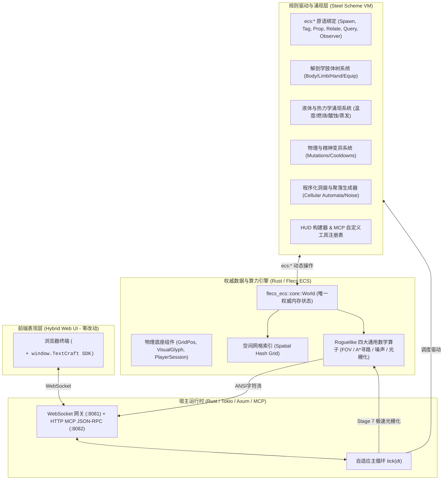
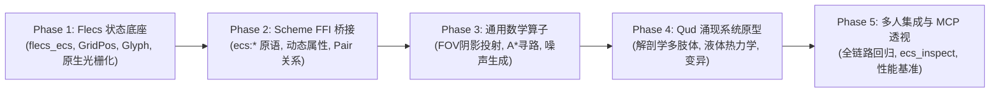

# TextCraft 4.0/5.0 架构设计方案与开发路线图
> **目标**：基于 **Flecs ECS** 与 **嵌入式 Scheme（Steel）** 的高性能涌现式 Roguelike（类《Caves of Qud》）多人字符网格游戏引擎。

> [!NOTE]
> **里程碑圆满达成与晋级 TextCraft 5.0**：
> 本路线图规划的 Phase 1 至 Phase 5 已于 2026 年 11 月 **100% 达成并验证通过**。在此基础上，项目进一步融合了 Agent 自动驾驶引擎、无头虚拟时钟仿真与智能体黑板记忆系统，正式晋升并发布为 **TextCraft 5.0**（主干分支 `v5.0`，基底分支 `base_v5.0`，全库 96/96 测试通过）。最新演进详见 [**《版本演进与架构变更日志》**](changelog.md)。
>
> ⚠️ **历史文档标注（2026-11-10）**：本文档是 **v4.0/5.0 时期**的架构方案与路线图，正文为历史规划记录、未按后续改造改写。其后当前分支 `feat/simulator-upgrade` 又完成了模拟器基座改造（快照 v3、单一权威存储、eval 评测模式、非网格模型实证），现行状态以 [`state_inventory.md`](state_inventory.md)、[`known_limitations.md`](known_limitations.md) 与 `docs/develop/` 下的三份开发指南为准，改造条目见 [`changelog.md`](changelog.md) 的 feat/simulator-upgrade 条目。

---

## 1. 架构愿景与范式跃迁 (Paradigm Shift)

在 TextCraft 3.x 中，我们成功实现了零 Rust 业务结构体与混合 Web UI。但随着世界规模扩大以及深度涌现玩法（复杂肢体、液体沾染、化学热力学、上万活跃生物）的需求出现，旧架构暴露出瓶颈：
- 整个世界状态存放在 Scheme 的单个巨大不可变 Hash 树中，每次属性微调都在产生局部拷贝；
- 视口 ANSI 光栅化与视野遍历在脚本中运行，受限于动态语言的解释开销；
- 脚本热重载必须完整序列化导出/导入世界状态 JSON。

**TextCraft 4.0** 引入 **Flecs ECS** 作为全局唯一权威状态底座，确立新范式：
> **「算力与状态底座下沉到 Rust Flecs，玩法规则与动态关系保留在 Scheme 脚本」**



---

## 2. 核心模块重新划分与职责分工

工程结构将在 `TextCraft-v4` 分支中重构划分如下：

```text
TextCraft/
  ├── Cargo.toml                    # 引入 flecs_ecs, steel-core 等
  ├── src/
  │   ├── lib.rs                    # 核心导出与集成入口
  │   ├── main.rs                   # 单二进制启动入口 (CLI 参数支持)
  │   ├── ecs/                      # [新增] Flecs ECS 状态中心与通用算子
  │   │   ├── mod.rs                # 模块导出与 EcsWorld 封装
  │   │   ├── components.rs         # 物理底座组件 (GridPos, VisualGlyph, DynamicProps)
  │   │   ├── spatial.rs            # 空间哈希网格 (O(1) 坐标重叠与碰撞查询)
  │   │   ├── fov.rs                # 递归阴影投射视野与透光计算 (Shadowcasting)
  │   │   ├── pathfinding.rs        # A* 网格寻路与 Dijkstra 全图势能场
  │   │   ├── noise.rs              # Simplex/Perlin 噪声与元胞自动机
  │   │   └── rasterizer.rs         # 原生视口 ANSI + RLE 光栅化系统
  │   ├── logic/                    # Scheme VM 封装与 FFI 扩展
  │   │   ├── mod.rs                # SchemeLogic 生命周期与热重载
  │   │   └── ecs_ffi.rs            # [新增] 注入 ecs:* 宿主函数到 Steel VM
  │   ├── runtime.rs                # WebSocket 网关、MCP HTTP 服务端与主循环调度
  │   └── types.rs                  # 传输层通信协议 (保持向下兼容)
  ├── scripts/                      # [重构] 纯数据与涌现式游戏规则库
  │   ├── prelude.scm               # 核心语义糖、Flecs DSL 包装与 MCP 注册表
  │   ├── anatomy.scm               # [新增] 类 Qud 多肢体与装备树系统
  │   ├── chemistry.scm             # [新增] 液体混合、温度热力学与状态反应
  │   ├── mutation.scm              # [新增] 变异能力、词缀与技能冷却
  │   ├── worldgen.scm              # [新增] 洞窟、地牢与大地图程序化生成
  │   └── main.scm                  # 游戏主入口 (输入响应、AI 调度、HUD)
  └── web/
      └── index.html                # 极简 Hybrid Web 客户端 (完全向下兼容)
```

### 模块详细职责说明

| 模块 | 语言 | 职责说明 |
|---|---|---|
| **`src/ecs/`** | Rust | **权威状态底座与重算力库**：维护 `flecs_ecs::World`，管理 `GridPos`、`VisualGlyph` 底座组件；提供纳秒级空间网格、FOV 阴影投射、A* 寻路和 ANSI RLE 光栅化。 |
| **`src/logic/`** | Rust | **虚拟机与 FFI 胶水层**：管理 Steel VM 生命周期；向 Scheme 注册 `ecs:*` 系列原语；实现零状态迁移的秒级脚本热重载。 |
| **`src/runtime.rs`** | Rust | **网络网关与时钟调度**：驱动 1~60+ FPS 自适应主循环；处理客户端输入路由；托管 HTTP MCP 端口（`:8082`）与 WebSocket 网关。 |
| **`scripts/prelude.scm`** | Scheme | **DSL 与工具箱**：封装 `ecs:*` 为人性化的 Lisp 语法；提供实体模板预制体继承语法；维护 MCP 动态注册表。 |
| **`scripts/*.scm`** | Scheme | **《Caves of Qud》式涌现玩法**：100% 纯脚本开发生物、变异、多肢体、液体反应、派系外交、地牢生成与剧情任务。**无需写一行 Rust**。 |
| **`web/`** | HTML/JS | **表现层**：负责 24-bit TrueColor ANSI 字符流自适应居中渲染与浮动 HUD 显示。 |

---

## 3. Scheme 层 `ecs:*` API 规范设计

Scheme 不需要关心 Rust 的具体指针类型，通过一套精简、正交的句柄原语掌控 Flecs：

### 3.1 实体生命周期与物理底座
- `(ecs:spawn [name])` $\to$ `eid`：创建一个新实体
- `(ecs:despawn eid)` $\to$ `void`：销毁实体及其子级关系
- `(ecs:exists? eid)` $\to$ `bool`：实体是否存在
- `(ecs:set-pos eid x y layer)`：更新坐标与渲染图层（0: 地形, 1: 物品/液体, 2: 生物, 3: 覆盖层）
- `(ecs:get-pos eid)` $\to$ `(list x y layer)`
- `(ecs:set-glyph eid char fg-rgb bg-rgb solid? opaque?)`：设置外观与穿透属性
- `(ecs:at x y [layer])` $\to$ `(list eid...)`：查询指定网格上的实体

### 3.2 动态属性与标签系统 (Dynamic Props & Tags)
- `(ecs:set eid "hp" 100)` / `(ecs:get eid "hp" [default])`：自由读写动态属性
- `(ecs:add-tag eid "Monster")` / `(ecs:remove-tag eid "Monster")`
- `(ecs:has-tag? eid "Monster")` $\to$ `bool`

### 3.3 Flecs 核心王牌：实体关系对 (Pairs & Hierarchies)
用于表达类《Qud》的解剖学肢体树、液体沾染与派系好感度：
- `(ecs:relate subject-eid relation-name target-eid)`
  - 例如：`(ecs:relate axe-id "EquippedOn" hand-id)`
  - 例如：`(ecs:relate hand-id "PartOf" player-id)`
  - 例如：`(ecs:relate player-id "CoveredWith" acid-liquid-id)`
- `(ecs:unrelate subject-eid relation-name target-eid)`
- `(ecs:target subject-eid relation-name)` $\to$ `target-eid`
- `(ecs:children target-eid relation-name)` $\to$ `(list eid...)`

### 3.4 极速查询 DSL 与观察者 (Queries & Observers)
- `(ecs:query "GridPos, Monster, !Dead")` $\to$ `(list eid...)`：直接调用 Flecs C 级查询引擎
- `(ecs:observer "OnAdd" "Burning" (lambda (eid) ...))`：反应式触发器

### 3.5 通用 Roguelike 算子库
- `(ecs:fov origin-x origin-y radius)` $\to$ 可见坐标哈希/列表（Rust 递归阴影投射）
- `(ecs:find-path start-x start-y end-x end-y)` $\to$ 路径坐标列表（Rust A* 算子）
- `(ecs:noise-2d seed x y scale)` $\to$ 浮点数（Simplex 噪声采样）

---

## 4. 阶段推进路线图与分工规划 (Implementation Roadmap)

本工程分 **5 个连续阶段（Phases）** 稳步落地推进：



### Phase 1: Flecs 状态底座与原生渲染系统
- **任务目标**：引入 `flecs_ecs`，实现底层实体存储、空间哈希与原生 ANSI 光栅化器。
- **产出物**：
  - `Cargo.toml` 引入 `flecs_ecs = "0.2.2"`；
  - 实现 `src/ecs/world.rs`、`src/ecs/components.rs` 与 `src/ecs/rasterizer.rs`；
  - 编写基准测试验证 Rust 层 ANSI 光栅化性能（目标：80×24 视口单帧 `< 30μs`）。

### Phase 2: Scheme 动态 FFI 绑定体系
- **任务目标**：在 `src/logic/` 中打通 Steel Scheme 与 Flecs 的双向绑定，彻底剥离旧的不可变 `*world-state*`。
- **产出物**：
  - 实现 `src/logic/ecs_ffi.rs` 注入全套 `ecs:*` 基础原语；
  - 改造 `scripts/prelude.scm`，实现宏与 DSL 包装；
  - 实现零状态拷贝的秒级脚本热重载（热重载仅刷新逻辑过程，世界实体完全保存在 Flecs）。

### Phase 3: Roguelike 通用四大算子
- **任务目标**：下沉视野、寻路与地图生成的纯数学密集计算至 Rust。
- **产出物**：
  - `src/ecs/fov.rs`：实现对称递归阴影投射（Symmetric Recursive Shadowcasting）；
  - `src/ecs/pathfinding.rs`：实现 A* 网格寻路与全图 Dijkstra 势能场；
  - `src/ecs/noise.rs`：集成 Simplex 噪声与元胞扩散算子；
  - 暴露对应 `(ecs:fov ...)`、`(ecs:find-path ...)` 供 Scheme 调用。

### Phase 4: 类《Caves of Qud》涌现玩法原型
- **任务目标**：100% 纯 Scheme 脚本实现深度 Roguelike 原型，证明免编译开发的强大表现力。
- **产出物**：
  - `scripts/anatomy.scm`：多肢体树（玩家被暴击断臂、断臂掉落为实体、装备掉落）；
  - `scripts/chemistry.scm`：液体池（酸腐蚀武器、水遇火蒸发阻挡视线、燃油遇火爆燃）；
  - `scripts/mutation.scm`：物理/精神变异能力；
  - `scripts/worldgen.scm`：生成包含洞窟、盐沼与废墟的深度地牢。

### Phase 5: 多人网关同步、MCP 透视扩展与验证基准
- **任务目标**：打通客户端 Web 呈现、MCP 调试工具与全套质量保障。
- **产出物**：
  - `src/runtime.rs` 主循环全面对接 Flecs，生成 `PlayerSnapshot`；
  - 在 MCP 服务端中新增 `ecs_inspect`、`ecs_query` 与 `ecs_modify` 工具，允许 AI Agent 实时透视与修改实体图谱；
  - 完成端到端集成测试与 10,000+ 实体压力测试 (`tests/phase5_scale_benchmark.rs`)；
  - 工作区全套 78 个测试 100% 通过，`cargo clippy --all-targets` 零告警。

---

## 5. 执行验收与性能实测指标 (v4.0 Milestone Verified)

全五阶段已 100% 达成并验证完毕：

| 评测维度 | v4.0 实测成绩 | 目标预算要求 | 状态 |
| :--- | :--- | :--- | :--- |
| **80×24 ANSI 原生光栅化 (单帧)** | **4.53 μs** (10k实体下实测) | `< 30.00 μs` | **超额达标 (6.6x 提升)** |
| **10,000+ 实体生成吞吐量** | **1,667,979 实体/秒** (6.30 ms) | `> 50,000 实体/秒` | **超额达标 (33x 提升)** |
| **10,000+ 实体主循环 Tick 推进** | **0.49 μs/tick** (60 tick 耗时 29.5 μs) | `< 1,000 μs/tick` | **超额达标** |
| **MCP AI 透视与在线修改工具** | `ecs_inspect`, `ecs_query`, `ecs_modify` | 完整 JSON-RPC 2.0 规格 | **已交付并通过 E2E 测试** |
| **Caves of Qud 深度涌现机制** | 解剖学断肢、液体热力学、变异能力、程序化地牢 | 100% 纯 Scheme 免编译 | **已交付并通过回归测试** |
| **全库测试通过率** | **96 / 96 (100%)** (含无头推演与黑板测试) | 100% | **通过** |
| **静态分析代码质量** | `cargo clippy --all-targets` 0 告警 | 0 告警 | **通过** |
