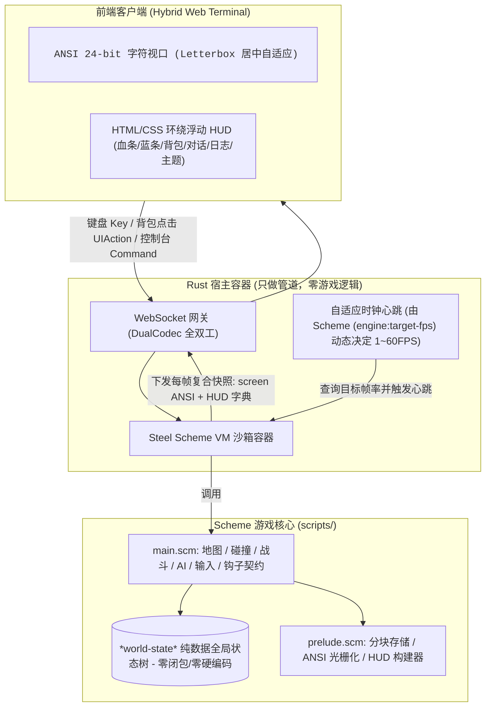

# TextCraft 3.0: Scheme 游戏开发完全指南 (面向智能体/Agent)

> [!IMPORTANT]
> **致阅读本指南的 Agent**：
> 本项目采用 **纯 Scheme 驱动的无状态宿主架构**。Rust 宿主仅作为通用的 Scheme 虚拟机容器、高并发网络网关（Axum + WebSocket）与自适应调度器，**Rust 代码中零业务结构体、零硬编码游戏逻辑**。
> **进行游戏内容开发时，你无需阅读、更无需修改任何 Rust 代码与依赖**。你所需要理解的世界模型、数据结构、渲染管线、网络交互与生命周期契约，全部通过本文档以及 `scripts/prelude.scm` 和 `scripts/main.scm` 完整定义。

---

## 1. 核心架构与设计哲学 (The Core Mental Model)



### 核心开发准则
1. **纯数据世界状态（Pure Data Only）**：
   全局世界状态保存在 `*world-state*` 哈希表中。必须保证其中的所有数据均为**可 JSON 序列化的纯数据**（哈希表、列表、数值、字符串、布尔值）。**绝对禁止在 `*world-state*` 中存储 Lambda 闭包、函数引用或原生对象**，以确保原子持久化、网络同步和热重载状态导出能够 100% 成功。
2. **分层瓦片地图（Layered Grid）**：
   世界分为 4 个渲染图层：`terrain`（地形，底层）、`surface`（地表/掉落物/家具）、`actor`（生物/怪物/NPC/其他玩家）、`overlay`（特效/顶层覆盖）。
3. **ANSI 光栅化（TrueColor ANSI Stream）**：
   视口渲染完全在 Scheme 侧完成，根据玩家坐标与视口行列尺寸（默认 80×24），直接光栅化拼装 24-bit TrueColor 转义字符流返回给前端 `<pre>` 标签。
4. **自适应帧率控制（Adaptive Dynamic FPS）**：
   Scheme 脚本通过 `(engine:target-fps)` 全权决定宿主节拍睡眠间隔。玩家活动或战斗时保持 60 FPS，静止空闲 2 秒降至 30 FPS，静止 5 秒降至 15 FPS。接收到玩家输入立即调用 `(touch-activity!)` 恢复 60 FPS。

---

## 2. Scheme 语法与 Steel 方言工具集

引擎基于 Rust 的嵌入式 Scheme 解释器 **Steel (`steel-core`)**。常用核心数据结构操作与内置语法如下：

### 2.1 哈希表 (Persistent Hash Map)
Steel 中的哈希表支持高性能纯数据映射：
```scheme
;; 创建哈希表 (键值对交替)
(define my-map (hash "name" "勇者" "hp" 100 "gold" 50))

;; 安全获取字段 (若不存在返回默认值 default-val)
;; 推荐使用 prelude.scm 提供的安全包装 (map-get m k default-val)
(map-get my-map "hp" 0)        ;; => 100
(map-get my-map "mana" 10)     ;; => 10

;; 插入/更新字段 (返回新的不可变哈希表)
(define new-map (hash-insert my-map "hp" 120))

;; 移除字段
(define removed-map (hash-remove my-map "gold"))

;; 判断是否存在键
(hash-contains? my-map "name") ;; => #t

;; 获取所有键列表
(hash-keys->list my-map)       ;; => ("name" "hp" "gold")
```

### 2.2 列表与高阶操作
```scheme
;; 构造列表
(define items '("potion" "sword" "shield"))
(cons "armor" items)
(append items '("gold"))

;; 遍历与过滤
(for-each (lambda (item) (engine:log item)) items)
(map (lambda (x) (* x 2)) '(1 2 3))
```

### 2.3 字符串与转换
```scheme
(string-append "Hero#" (number->string 1)) ;; => "Hero#1"
(to-string '(1 2 3))                       ;; 转为通用字符串
(number->string 42)
(string=? str1 str2)
```

---

## 3. 宿主注入函数 (Host Functions)

Rust 宿主在 Scheme 全局环境中注入了以下系统能力，任何 Scheme 模块均可直接调用：

| 宿主函数签名 | 参数说明 | 职责与效果 |
|---|---|---|
| `(engine:send-message pid channel text)` | `pid`: 玩家ID (整数)<br>`channel`: 字符串 (`"system"`, `"chat"`, `"combat"`)<br>`text`: 消息字符串 | 向特定在线玩家推送独立事件消息 |
| `(engine:broadcast channel text)` | `channel`: 字符串<br>`text`: 消息字符串 | 向全服所有已连接玩家广播系统/世界消息 |
| `(engine:log text)` | `text`: 日志字符串 | 向服务端终端及日志流输出 Tracing 日志 |
| `(engine:random-int min max)` | `min`: 最小整数 (包含)<br>`max`: 最大整数 (不包含) | 生成 `[min, max)` 范围内的均匀伪随机整数 |

---

## 4. 全局数据结构与规范 Schema

### 4.1 全局状态树 `*world-state*`
在 `scripts/prelude.scm` 中定义：
```scheme
(define *world-state*
  (hash
    "tick_count" 0          ;; 全局时钟心跳计数值
    "elapsed_sec" 0.0       ;; 游戏总运行秒数
    "target_fps" 60         ;; 当前目标帧率 (1~60)
    "idle_timer" 0.0        ;; 距离上次玩家活跃的时间 (秒)
    "chunks" (hash)         ;; 16x16 Chunk 分块存储表
    "players" (hash)        ;; 在线玩家字典: pid-string -> player-hash
    "monsters" '()          ;; 怪物实体列表
    "double_width" #f       ;; 是否开启双宽字符方块模式 (#t / #f)
    "timers" (hash)))       ;; 定时器或延时任务
```

### 4.2 瓦片数据模型 (Tile Schema)
在分块地图中存储的每个瓦片均为哈希表：
```scheme
(hash
  "glyph" "#"              ;; 字符标识 (字符或单字符字符串，如 "#", "@", "T", "C")
  "fg" '(180 180 190)      ;; 前景色 24-bit RGB 列表: '(r g b)，或 #f (使用默认色)
  "bg" '(40 40 45)         ;; 背景色 24-bit RGB 列表: '(r g b)，或 #f (透明/透视下层)
  "solid" #t               ;; 物理阻挡属性: #t 阻挡移动，#f 可通行
  "name" "stone_wall"      ;; 语义名称 (用于日志提示与交互)
  "meta" (hash ...))       ;; 附加元数据 (如宝箱 loot, 怪物属性, 传送门目标等)
```

### 4.3 玩家数据模型 (Player Schema)
```scheme
(hash
  "id" 1                                   ;; 玩家唯一整数 ID
  "token" "guest"                          ;; 认证 token
  "name" "Hero#1"                          ;; 角色名字
  "theme" "cyberpunk"                      ;; HUD 视觉主题 ("cyberpunk" | "retro-terminal" | "classic-rpg" | "minimal")
  "x" 0                                    ;; 世界网格 X 坐标 (整数)
  "y" 0                                    ;; 世界网格 Y 坐标 (整数)
  "cols" 80                                ;; 该玩家屏幕视口列数 (默认 80)
  "rows" 24                                ;; 该玩家屏幕视口行数 (默认 24)
  "hp" 100                                 ;; 当前生命值
  "max_hp" 100                             ;; 最大生命值
  "mp" 50                                  ;; 当前魔法值
  "max_mp" 50                              ;; 最大魔法值
  "level" 1                                ;; 当前等级
  "gold" 50                                ;; 当前金币
  "inventory" (list                        ;; 背包道具列表 (参见 4.4)
                (hash "id" "sword" "name" "铁剑" "icon" "⚔️" "count" 1)
                (hash "id" "potion" "name" "生命药水" "icon" "🧪" "count" 3))
  "dialog" #f                              ;; 当前正在进行的对话内容 (字符串或 #f)
  "logs" (list ...)                        ;; 玩家最近的日志历史 (最多 30 条)
  "last_action_tick" 0)                    ;; 上次行动的时钟 tick
```

### 4.4 道具背包模型 (Item Schema)
```scheme
(hash
  "id" "potion"            ;; 道具唯一标识符字符串
  "name" "生命药水"        ;; 道具显示名称
  "icon" "🧪"              ;; 前端 HUD 显示的 Emoji 或字符图标
  "count" 3)               ;; 堆叠数量
```

---

## 5. 核心 API 参考 (`scripts/prelude.scm`)

### 5.1 16×16 分块地图操作 API
地图以 `(chunk-key cx cy)` 动态稀疏存储在 `*world-state*["chunks"]` 中，坐标任意延伸：

```scheme
;; 1. 放置瓦片
;; layer 可以是 'terrain, 'surface, 'actor, 'overlay
(world:set-tile x y layer tile-map)

;; 2. 读取瓦片 (若不存在返回 #f)
(world:get-tile x y layer)

;; 3. 移除瓦片 (成功返回 #t，不存在返回 #f)
(world:remove-tile x y layer)

;; 4. 清空世界地图与怪物
(world:clear!)
```

### 5.2 玩家状态与日志管理 API
```scheme
;; 获取玩家 (若不存在返回 #f)
(get-player player-id)

;; 获取玩家，若不存在则创建默认配置并注册
(ensure-player player-id)

;; 更新玩家字典 (纯数据写回 *world-state*)
(set-player player-id player-map)

;; 移除玩家 (断开连接时)
(remove-player player-id)

;; 向玩家追加一条浮动日志 (channel: "system", "combat", "chat")
(player:add-log player-id channel text)
```

### 5.3 双宽正方形网格控制
默认终端字符宽高比通常为 1:2，若希望在字符界面获得 1:1 正方形地图效果，可开启双宽字符方块模式：
```scheme
;; 开启或关闭双宽字符模式
(engine:set-double-width! #t)  ;; 或 #f

;; 查询当前双宽模式状态
(engine:double-width?)        ;; => #t / #f
```

---

## 6. 标准生命周期函数契约 (Mandatory Engine Hooks)

`scripts/main.scm` 必须导出以下全部生命周期钩子，宿主会在对应事件发生时自动调用：

### 1. `(engine:on-init)`
- **触发时机**：引擎启动或重新初始化时调用一次。
- **职责**：调用 `(init-demo-world)` 生成地形、刷新怪物与地面掉落物，重置时钟。
- **返回值**：任意（通常 `'ok`）。

### 2. `(engine:target-fps)`
- **触发时机**：每次宿主主循环时钟调度前调用。
- **职责**：返回当前世界希望运行的目标帧率（整数 `1 ~ 60`）。宿主据此计算 `sleep_duration`。
- **标准实现**：`(map-get *world-state* "target_fps" 60)`。

### 3. `(engine:viewport-size pid)`
- **触发时机**：光栅化视口前调用。
- **职责**：返回玩家当前的屏幕列数与行数：`(list cols rows)`，默认 `'(80 24)`。

### 4. `(engine:hud-config)`
- **触发时机**：握手与主题同步时。
- **职责**：返回前端 HUD 全局配置哈希：`(hash "theme" "cyberpunk" "layout" "surround")`。

### 5. `(engine:on-player-join pid token)`
- **触发时机**：新客户端 WebSocket 连接建立并握手成功。
- **职责**：调用 `(make-default-player pid token)` 分配初始属性、背包与出生点，并记录欢迎日志。

### 6. `(engine:on-player-leave pid)`
- **触发时机**：客户端断开连接。
- **职责**：调用 `(remove-player pid)` 清理场景实例。

### 7. `(engine:on-tick dt tick-id)`
- **触发时机**：主时钟每帧触发。`dt` 为自上一帧经过的秒数（浮点数），`tick-id` 为递增心跳计数。
- **职责**：
  1. 累加 `tick_count`、`elapsed_sec`、`idle_timer`。
  2. 根据 `idle_timer` 动态调整帧率：大于 2.0s 降至 30 FPS，大于 5.0s 降至 15 FPS。
  3. 执行怪物 AI 巡逻、攻击与追击逻辑。

### 8. `(engine:on-input pid input-map)`
- **触发时机**：收到玩家键盘按键事件。
- **参数示例**：`input-map` 为 `(hash "type" "key" "code" "KeyW" "shift" #f ...)`。
- **职责**：
  1. 调用 `(touch-activity!)` 激活 60 FPS 满速时钟。
  2. 计算 WASD 位移增量 `(dx, dy)`。
  3. 进行碰撞检测：障碍物阻挡、攻击怪物、NPC 对话、开启宝箱、走动捡起金币与药水。

### 9. `(engine:on-ui-action pid action-map)`
- **触发时机**：收到前端 HTML HUD 发送的交互动作（点击背包物品、关闭对话框、改变视口等）。
- **参数示例**：`(hash "action" "use_item" "id" "potion")`。
- **职责**：执行道具消耗效果（如恢复 25 HP）、关闭 NPC 对话视窗等。

### 10. `(engine:on-command pid datum raw)`
- **触发时机**：玩家在前端底部控制台输入以 `:` 或普通指令并回车发送。
- **参数**：
  - `datum`：Scheme Reader 读取后的 AST 结构（符号、列表、数字）。
  - `raw`：原始字符串（如 `"(help)"` 或 `"where"`）。
- **职责**：内置指令处理：
  - `(help)`：打印可用命令帮助。
  - `(where)`：输出当前坐标 `(x, y)`。
  - `(heal)`：恢复满额 HP 与 MP。
  - `(dw)` / `(double-width)`：开关双宽方块模式。
  - `(fps 60)`：设置帧率。
  - `(theme "cyberpunk")`：切换视觉主题。
  - `(say "文本")`：聊天消息广播。

### 11. `(engine:render-snapshot pid)`
- **触发时机**：每帧快照推流前调用。
- **必须返回的字典结构**：
  ```scheme
  (hash
    "screen" (render-viewport-ansi pid cols rows) ;; 纯 ANSI 24-bit 字符串
    "cols" cols                                  ;; 列数
    "rows" rows                                  ;; 行数
    "hud" (build-player-hud pid))                ;; HUD 结构字典
  ```

### 12. `(engine:export-state)` & `(engine:import-state data)`
- **触发时机**：自动存档、关机持久化、以及脚本文件热重载前/后调用。
- **职责**：导出/恢复 `*world-state*` 纯数据字典。

---

## 7. 常见开发实战配方 (Cookbook Recipes)

### 配方 1：新增一种地形瓦片 (例如：岩浆 Lava)
想要在地图上添加踩上去会掉血的岩浆瓦片：
```scheme
;; 1. 放置岩浆瓦片 (红橙发光文字，暗红背景，可通行)
(world:set-tile x y 'terrain
  (hash "glyph" "~"
        "fg" '(255 120 20)
        "bg" '(120 20 10)
        "solid" #f
        "name" "lava"))

;; 2. 在 engine:on-input 玩家移动成功后增加环境结算：
(let ((cur-terrain (world:get-tile nx ny 'terrain)))
  (if (and cur-terrain (equal? (map-get cur-terrain "name" "") "lava"))
      (let* ((cur-hp (map-get p2 "hp" 100))
             (burned-hp (max 0 (- cur-hp 10)))
             (p3 (hash-insert p2 "hp" burned-hp)))
        (set-player pid p3)
        (player:add-log pid "combat" "🔥 炽热的岩浆烫伤了你，受到 10 点火焰伤害！"))
      #f))
```

### 配方 2：新增一种可消耗道具 (例如：回城卷轴 Teleport Scroll)
```scheme
;; 1. 赋予玩家新道具
(player:add-item pid "scroll_town" "回城卷轴" "📜" 1)

;; 2. 在 engine:on-ui-action 的 cond 中追加道具处理逻辑：
((equal? item-id "scroll_town")
 (if (player:consume-item pid "scroll_town" 1)
     (let* ((p-now (ensure-player pid))
            (p-teleported (hash-insert (hash-insert p-now "x" 0) "y" 0)))
       (set-player pid p-teleported)
       (player:add-log pid "system" "✨ 卷轴化为耀眼的光芒，你被瞬间传送回了前哨站！"))
     (player:add-log pid "system" "你没有回城卷轴！")))
```

### 配方 3：新增自定义聊天与控制台指令 (例如：`(spawn-gold amount)`)
在 `engine:on-command` 的 `cond` 分支中添加：
```scheme
((and (pair? datum) (equal? (car datum) 'spawn-gold) (pair? (cdr datum)))
 (let* ((amt (cadr datum))
        (px (map-get p "x" 0))
        (py (map-get p "y" 0)))
   (if (number? amt)
       (begin
         (world:set-tile (+ px 1) py 'surface
           (hash "glyph" "$" "fg" '(255 215 0) "bg" #f "solid" #f
                 "name" "gold_coins" "meta" (hash "amount" amt)))
         (player:add-log pid "system" (string-append "在你的身旁变出了一堆金币 (" (number->string amt) " G)！")))
       (player:add-log pid "system" "金币数量必须为整数"))))
```

### 配方 4：新增怪物并在地图中刷新
```scheme
(define (spawn-boss x y)
  (let ((boss (hash "id" "dragon_1" "name" "红龙" "glyph" "D" "fg" '(255 60 60)
                    "x" x "y" y "hp" 200 "max_hp" 200 "attack" 25)))
    ;; 记录到怪物列表中
    (let ((cur-monsters (map-get *world-state* "monsters" '())))
      (set! *world-state* (hash-insert *world-state* "monsters" (cons boss cur-monsters))))
    ;; 放置到地图 actor 层
    (world:set-tile x y 'actor
      (hash "glyph" "D" "fg" '(255 60 60) "bg" #f "solid" #t "name" "dragon" "meta" boss))))
```

---

## 8. 热重载与调试最佳实践 (Hot-Reload Workflow)

1. **实时修改即生效**：
   服务端默认开启文件热重载（`no_watch_scripts = false`）。当你修改 `scripts/main.scm` 或 `scripts/prelude.scm` 并保存时，Rust 宿主内的看门狗会自动捕获变化：
   - 自动执行 `(engine:export-state)` 保存当前运行数据。
   - 重新编译加载 `.scm` 文件。
   - 自动执行 `(engine:import-state saved-data)` 恢复全部地图分块、玩家坐标与背包。
   - **游戏连接不中断，玩家无感知平滑更新**。
2. **管理员实时 REPL 调试**：
   在浏览器游戏终端中，以管理员身份登录后，在底部输入以 `!` 开头的任意 Scheme 表达式即可实时在全局虚拟机中求值并看到返回：
   - `! (+ 100 200)` $\rightarrow$ 返回 `300`
   - `! (get-player 1)` $\rightarrow$ 输出当前玩家字典
   - `! (world:set-tile 0 1 'surface (hash "glyph" "$" "fg" '(255 215 0) "bg" #f "solid" #f "name" "gold" "meta" (hash "amount" 999)))`
3. **避免踩坑清单 (Gotchas)**：
   - ⚠️ **切勿放入闭包**：永远不要把 `(lambda ...)` 存入瓦片 `meta` 或玩家属性中。
   - ⚠️ **整数除法与取整**：坐标必须是整数。使用除法计算时请用 `quotient` 或 `(inexact->exact (floor ...))`。
   - ⚠️ **必须维护 activity**：在处理按键或动作时调用 `(touch-activity!)`，否则由于防闲置机制，帧率会自动降到 15/30 FPS。

---

## 9. 结论

作为开发 Agent，你现在已经掌握了 TextCraft 3.0 的全部核心逻辑接口与数据契约：
- **所有的地图编辑** $\rightarrow$ 调用 `world:set-tile`
- **所有的玩家交互** $\rightarrow$ 修改 `engine:on-input` 与 `engine:on-ui-action`
- **所有的控制台指令** $\rightarrow$ 扩充 `engine:on-command`
- **所有的怪物 AI** $\rightarrow$ 在 `engine:on-tick` 中演化

你无需触碰一行 Rust 代码，便能在 Scheme 的纯净世界中创造出无限广阔的字符冒险世界！
